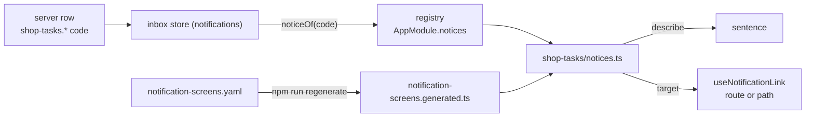

# shop-tasks

::: tip At a glance
**Owns** — the words and links of the shop's 19 notification codes (`shop-tasks.*`), and the shop's half of the `task-kind`, `task-category` and `task-link` labels.
**Depends on** — nothing it imports. It declares `AppModule.notices` entries; the foundation's bell asks the registry and names no shop code.
**Breaks if you change** — the `shop-tasks.*` codes and their `params` (the contract's union). A code this build has no entry for reads as a generic notification.
:::

| Fact                    | This module                                |
| ----------------------- | ------------------------------------------ |
| **Subdomain**           | `supporting`                               |
| **Screens**             | 0 — no routes                              |
| **Store**               | —                                          |
| **Menu entries**        | —                                          |
| **API calls**           | 0                                          |
| **Depends on**          | —                                          |
| **Depended on by**      | —                                          |
| **Languages**           | `en` · `it`                                |
| **Publishes**           | —                                          |
| **Backend counterpart** | `shop-tasks` in `boilerplate-node-backend` |

## The map

`shop-tasks` imports no sibling. Its links name sibling routes (`OrderTarget`, `UserTarget`,
`ReturnTarget`, `SalesOrders`, `PaymentsList`, `SalesReturns`, `PreordersBoard`,
`InventoryLedger`); the bell binds a link only when this build ships that route, so removing a
sibling removes the link and nothing else. No `MODULE_EDGES` entry is needed: there is no import
to permit.

## The story

The foundation ships a bell and a to-do inbox that know no shop. This module is what a shop adds:
the sentences of its buyer notices, the screens its staff summaries open, and the labels of its
task kinds.



### The text

Three shapes of notice:

| Shape           | Codes                                                                                                     | Links to                             |
| --------------- | --------------------------------------------------------------------------------------------------------- | ------------------------------------ |
| Buyer           | `cart-line-removed`, `wishlist-item-removed`, `stock-alert`, `cart-merge-refused`                         | nothing                              |
| Buyer, an order | `fulfillment-delayed`, `fulfillment-held`, `shipment-lost`                                                | `OrderTarget`, where they can cancel |
| Staff record    | `staff.purchase-hold-placed`, `staff.return-requested`                                                    | `UserTarget`, `ReturnTarget`         |
| Staff summary   | ten `staff.*` codes (`transfers-due`, `preorders-late`, `low-stock`, `unshipped`, ...) carrying a `count` | the list they count                  |

A summary row carries a count and no id, so it points at a list. Which list is a choice, written
once in `notification-screens.yaml` next to the module and generated into
`notification-screens.generated.ts`; `notices.ts` builds the ten entries from that map.

A product's name comes from `params.titles`, a map of locale to name copied in when the
notification was written, because the notification outlives the product:

| Order | Name used                                             |
| ----- | ----------------------------------------------------- |
| 1     | The reader's current language                         |
| 2     | The shop's main language (vue-i18n's fallback locale) |
| 3     | Any name there is                                     |
| 4     | "a product", when `titles` is empty                   |

The late-preorder, hold and lost-parcel sentences compose several dictionary entries (the date, a
missing date, the shop's own message line); they are written out as literal keys in `describe.ts`
so the unused-key audit sees them.

### Task labels

`task-kind.*`, `task-category.*` and `task-link.*` are co-owned namespaces, one key per contract
value. This module owns the shop's: kinds `manual_refund_owed`, `refund_refused`,
`amount_mismatch`, `dispute`, `paid_without_hold`, `consent_due`; categories `order`,
`cancellation`, `return`, `payment`; link types `order`, `payment`, `refund`, `fulfillment_order`.
The foundation's are in [`tasks`](./tasks.md).

## Files

| File                                  | What it is                                                                    | Explained in                      |
| ------------------------------------- | ----------------------------------------------------------------------------- | --------------------------------- |
| `module.ts`                           | The manifest. No routes; `notices` and locales.                               | [read](../theory/modules.md)      |
| `notices.ts`                          | The 19 codes as `AppModule.notices` entries, summary rows built from the map. | [read](../theory/modules.md)      |
| `describe.ts`                         | Pure: the shop's sentences from a code's typed `params`, and `productName`.   | [read](../theory/domain-layer.md) |
| `notification-screens.yaml`           | The list each summary code counts. Edit this, then regenerate.                | [read](../tools/shared-rules.md)  |
| `notification-screens.generated.ts`   | Generated from the YAML. Never edited by hand.                                | [read](../tools/shared-rules.md)  |
| `locales/en.json` · `locales/it.json` | The `shop-tasks` sentences and the shop's task labels.                        | [read](../tools/i18n.md)          |

## Libraries

None.

## Working on it

```bash
# this module's vitest suite
npm run test:unit -- shop-tasks

# after the backend changes a code or the summary screens
npm run regenerate
```

## Related pages

- [`notifications`](./notifications.md) — the bell and the registry that read these entries
- [`tasks`](./tasks.md) — the to-do inbox and the foundation's half of the labels
- [Shared rules](../tools/shared-rules.md) — how the YAML becomes the generated map
