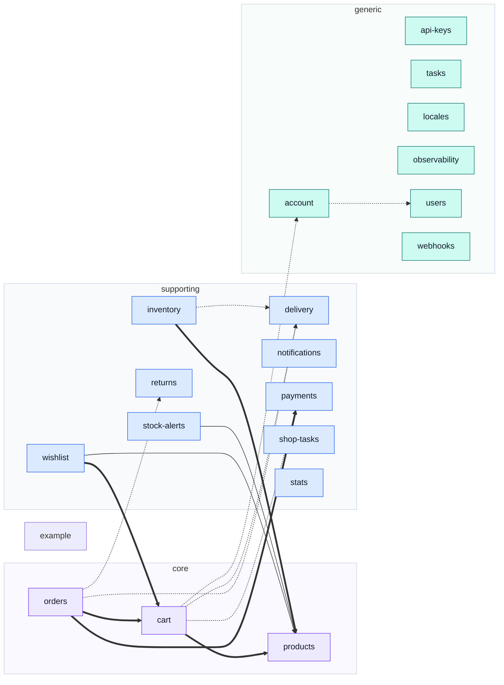

# Modules

One page per domain, top to bottom. This is the **vertical** cut through the codebase; the rest of
this site is the horizontal one.

::: tip Which section answers which question

| You want                                          | Read                                       |
| ------------------------------------------------- | ------------------------------------------ |
| What a module _is_, and the rules every one obeys | [Understand](../understand/start.md)       |
| What **this** domain does, end to end             | a page in this section                     |
| How a mechanism works, in general                 | [Tool map](../understand/tool-map.md)      |
| The contract-first workflow                       | [API contracts](../build/api-contracts.md) |
| "I landed on a filename"                          | [Reference](../reference/start.md)         |
| :::                                               |

The division is one rule: **a horizontal page owns a mechanism, a module page owns a decision.**
[State & Routing](../understand/state-and-routing.md) explains what a Pinia store is; the
[`cart`](./cart.md) page lists what its store holds and links back. Neither says the other's half.

The test that keeps it honest is the one this architecture is already built on — delete
`src/modules/cart/` and exactly one page in this site dies with it. Every other page loses a link and
nothing else.

::: warning Read every page with one caveat
**This application owns almost none of the domain it displays.** Totals, eligibility, availability
and permissions are all decided server-side. A page here describes the screens, the state and the
client-side rules of a domain — the reasoning behind the rules lives in the
[paired backend's module pages](../understand/domain-layer.md).
:::

## The whole map

## Reading the diagrams

Every diagram in this section encodes two things and only two, so a map is readable without a key
beside it.

**Node fill — where the domain sits in the business.**

| Fill      | Subdomain    | What it means                                                                                                                                           |
| --------- | ------------ | ------------------------------------------------------------------------------------------------------------------------------------------------------- |
| 🟪 violet | `core`       | The reason the product exists. Worth its own client-side rules.                                                                                         |
| 🟦 blue   | `supporting` | Specific to this business but not a differentiator. Kept plain.                                                                                         |
| 🟩 teal   | `generic`    | A solved problem. Modelling effort here is waste — a `domain/` folder inside one is a rule of thumb this codebase asks a reviewer to catch, not a spec. |
| ⬜ none   | —            | `example` only: the template a domain is copied from, which is not a subdomain.                                                                         |

::: warning Read `core` with one caveat, on a client
This application owns almost none of the domain it displays. Prices, totals, eligibility and
permissions are all decided server-side, so `core` here marks **where the screens and the
client-side rules are load-bearing**, not where the business logic lives.
:::

**Arrow style — what kind of relationship the edge is.**

| Arrow         | Relationship         | What crosses the edge                                                                                                     |
| ------------- | -------------------- | ------------------------------------------------------------------------------------------------------------------------- |
| `-->` thin    | `conformist`         | Reads another module’s store as it is, with no translation and no say in its shape.                                       |
| `==>` thick   | `customer-supplier`  | Calls a sibling’s store to make something happen, and that sibling’s surface is shaped by the demand.                     |
| `-.->` dashed | `published-language` | Receives vocabulary rather than state — a Zod schema, a pure function, or a self-contained component. The strongest edge. |

::: info `shared-kernel` is absent, and that is a finding
The backend has one: `account → users`, because both write the same User record. Here the same
pair is `published-language`, because this client shares only the validation vocabulary and the
server remains the single writer. That divergence is what
[Domain layer](../understand/domain-layer.md) means by the domain living behind the API.
:::

Every diagram under `/modules/` uses this and only this.

## Every module

One row per domain: its subdomain and its group. Everything countable about a module is read off
the code, not kept here.

One row is worth noticing before you read any page: [`delivery`](./delivery.md) has **no screens
at all** — its published surface is a component another module mounts. [`payments`](./payments.md)
has one, the staff page; paying itself is a component too.

**Group** is a second, independent axis from Subdomain: `foundation` ships with every deployment,
`shop` is the removable pet-supply demo domain (`npm run demo:remove`), and `example` is the one
module that exists only to be copied when a new domain starts: it has no page of its own, its
story is [Adding & deleting a domain](../understand/modules.md#adding-and-deleting-a-domain), and
`demo:remove` deletes it with the shop (copy it first). Every module declares its `group` (and `dependsOn`) in its own `module.yaml`, the same field names the paired backend uses; `scripts/module-manifest.ts` reads them, and
`eslint.config.ts` refuses a `foundation` module importing a `shop` one.

`example` is unclassified: it is the template a new domain is copied from, not a subdomain.

| Module                                                             | Subdomain    | Group        |
| ------------------------------------------------------------------ | ------------ | ------------ |
| [`account`](./account.md)                                          | `generic`    | `foundation` |
| [`api-keys`](./api-keys.md)                                        | `generic`    | `foundation` |
| [`cart`](./cart.md)                                                | `core`       | `shop`       |
| [`delivery`](./delivery.md)                                        | `supporting` | `shop`       |
| [`example`](../understand/modules.md#adding-and-deleting-a-domain) | —            | `example`    |
| [`tasks`](./tasks.md)                                              | `generic`    | `foundation` |
| [`inventory`](./inventory.md)                                      | `supporting` | `shop`       |
| [`locales`](./locales.md)                                          | `generic`    | `foundation` |
| [`notifications`](./notifications.md)                              | `supporting` | `foundation` |
| [`observability`](./observability.md)                              | `generic`    | `foundation` |
| [`orders`](./orders.md)                                            | `core`       | `shop`       |
| [`payments`](./payments.md)                                        | `supporting` | `shop`       |
| [`products`](./products.md)                                        | `core`       | `shop`       |
| [`returns`](./returns.md)                                          | `supporting` | `shop`       |
| [`shop`](./shop.md)                                                | `supporting` | `shop`       |
| [`shop-tasks`](./shop-tasks.md)                                    | `supporting` | `shop`       |
| [`stats`](./stats.md)                                              | `supporting` | `shop`       |
| [`stock-alerts`](./stock-alerts.md)                                | `supporting` | `shop`       |
| [`users`](./users.md)                                              | `generic`    | `foundation` |
| [`webhooks`](./webhooks.md)                                        | `generic`    | `foundation` |
| [`wishlist`](./wishlist.md)                                        | `supporting` | `shop`       |

Screens, stores and calls are not counted here: they are the generated [sitemap](../understand/sitemap.md) and each module's `module.ts`. Who depends on whom is [the whole map](#the-whole-map), checked against every `module.yaml`.

## The two repositories

Most domains exist on both sides under the same name. **The two that do not are the
interesting ones**, and until this table the asymmetry was written down nowhere in either repository:
[`account`](./account.md) folds the address book and the account of record into one module, and
[`observability`](./observability.md) renders three backend domains over one console and playground.

Keeping the table below in step with the backend is a review job, not a checked one.

| This repository                       | boilerplate-node-backend          | Note                                                                                                                                                                         |
| ------------------------------------- | --------------------------------- | ---------------------------------------------------------------------------------------------------------------------------------------------------------------------------- |
| [`account`](./account.md)             | `account` + `addresses` + `users` | The address book lives inside this module as `AddressPicker`, and it reads `users` for the account of record — the backend keeps both a separate domain.                     |
| [`observability`](./observability.md) | `observability` + `audit-logs`    | One set of screens over two backend domains: `observability` serves health, the metrics overview and the SSE stream, and `audit-logs` owns the trail behind the audit table. |

Every other module here has a backend module of the same name.
