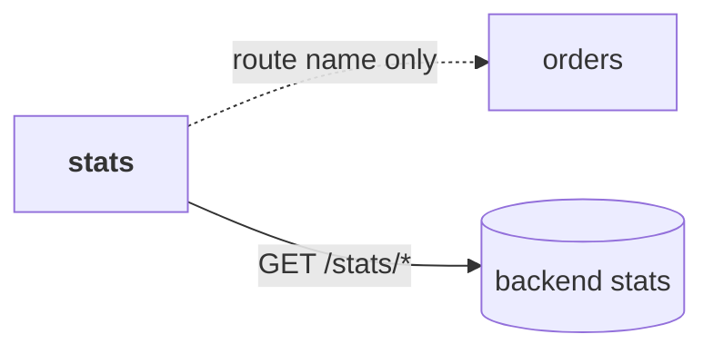
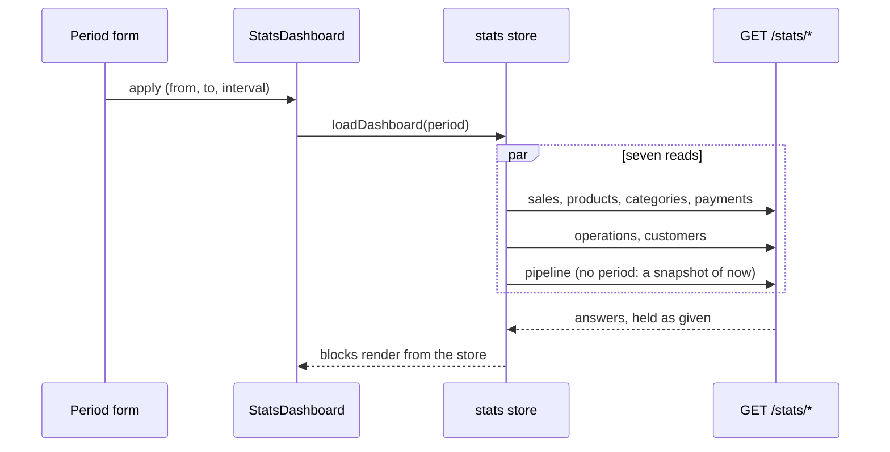

# stats

::: tip At a glance
**Owns** — the sales dashboard and one product's sales page: headline cards, charts, tables, a "show as table" toggle and a client-side CSV for every block.
**Depends on** — nothing. It reads eight backend GETs and links to other pages by route name.
**Breaks if you change** — nothing outside this folder. No module depends on it.
:::

| Fact                    | This module                                                                    |
| ----------------------- | ------------------------------------------------------------------------------ |
| **Subdomain**           | `supporting` — Specific to this business but not a differentiator. Kept plain. |
| **Screens**             | 2 — `StatsDashboard`, `StatsProductSales`                                      |
| **Store**               | `stats`                                                                        |
| **Menu entries**        | `StatsDashboard`                                                               |
| **API calls**           | 8                                                                              |
| **Depends on**          | _nothing_                                                                      |
| **Depended on by**      | _nothing_                                                                      |
| **Languages**           | `en` · `it`                                                                    |
| **Publishes**           | _nothing_ — no barrel, so no sibling may import it                             |
| **Backend counterpart** | `stats` in `boilerplate-node-backend`                                          |

## The map



`stats` imports no sibling. The one link out, from a product's page to the staff orders list
(filtered by product and paid days), is resolved with `linkIfRouted`: a build with no `orders`
module renders no button instead of a dead one.

## The story

The page asks one question — _what happened between these two days?_ — and shows the backend's
answer. **Nothing here computes a figure.** Net sales, reversals, the average order value and the
change against the previous period all arrive finished, because the backend takes its money from the
invoices and credit notes, which are the shop's frozen record. A second implementation of "net
sales" here would be a second thing that can disagree with them.



- **Days are the shop's.** `from` and `to` are calendar days (`YYYY-MM-DD`) and the answer reports
  the zone it used (`period.timeZone`). A bucket's start is read back in that zone, never the
  browser's: a 00:00 Rome bucket would otherwise label as the evening before in London.
- **The form refuses what the API refuses.** At most two years and 400 buckets
  (`domain/period.ts`), so the visitor reads why instead of a 422. The bucket size follows the
  range until the visitor picks one.
- **Money stays per currency.** One group per currency, never converted, each with its own cards,
  charts and revenue table.
- **A product's page** takes its period from the URL, so the link from the dashboard, a reload and a
  shared address all show the same question.

Known limits are stated on the page itself, not only here: an offline payment counts from the day it
was recorded; shipping is exact for full refunds only; a product in two categories counts in both;
deleting an order drops it from counts but not from the invoices' money.

## Charts: Mermaid, and why no chart library

The charts are [Mermaid](https://mermaid.js.org/) `xychart-beta` (bars and lines) and `pie`,
drawn from text. Mermaid was already a docs dev-dependency; this promoted it to a runtime
dependency, and it is loaded by a dynamic `import()` inside `MermaidChart.vue`, so it lives in the
stats routes' own chunks and never in the entry bundle (`entry-chunk-budget.spec.ts` holds that).

What this buys is zero new dependencies for six plain bar, line and pie charts. What it costs is
real, and accepted: **no tooltips and no zoom**. That is why every chart has a "show as table"
toggle — the table is the accessible alternative to a picture, and the source of the CSV.

Three rules keep it safe:

- **Labels are escaped before they enter Mermaid's text.** A product or category title is text a shop
  owner typed. `safeLabel` keeps letters and digits of any script and a few plain marks, and turns
  everything else (quotes, `#`, `;`, brackets, `%` directives, line breaks) into a space.
- **`securityLevel: 'strict'`** stays on: no clickable nodes, no HTML in labels.
- **The SVG is attached as a parsed node**, not set as `innerHTML`.

The CSV is built in the browser from the rows on screen. An aggregate holds no personal data, so it
needs no server route and no step-up; a cell a spreadsheet would read as a formula is prefixed with
`'`.

## State

Store `stats`, from `store.ts`. Only what the setup function returns is listed.

| Kind        | Members                                                                                                        | What it is                                        |
| ----------- | -------------------------------------------------------------------------------------------------------------- | ------------------------------------------------- |
| **State**   | `sales` · `products` · `categories` · `paymentMix` · `operations` · `customers` · `pipeline` · `productSeries` | The last answer of each read, as the API gave it. |
| **Getters** | `loading`                                                                                                      | The shared loading flag.                          |
| **Actions** | `loadDashboard` · `loadProductSales`                                                                           | Everything that calls the API.                    |

## Screens

| Path                              | Route name          | Access | Permission   | View                       |
| --------------------------------- | ------------------- | ------ | ------------ | -------------------------- |
| `sales/stats`                     | `StatsDashboard`    | `auth` | `read Stats` | `views/StatsDashboard.vue` |
| `sales/stats/products/:productId` | `StatsProductSales` | `auth` | `read Stats` | `views/ProductSales.vue`   |

The permission is `stats.any.read`, which the backend grants to `manager` and `admin`. See
[Security](../tools/security.md#route-guards).

## Wiring

#### Endpoints called

| Call                              | Response envelope               |
| --------------------------------- | ------------------------------- |
| `GET /stats/sales`                | `GetSalesStatsResponse`         |
| `GET /stats/products`             | `GetProductStatsResponse`       |
| `GET /stats/products/{productId}` | `GetProductSalesSeriesResponse` |
| `GET /stats/categories`           | `GetCategoryStatsResponse`      |
| `GET /stats/payments`             | `GetPaymentMixStatsResponse`    |
| `GET /stats/operations`           | `GetOperationsStatsResponse`    |
| `GET /stats/customers`            | `GetCustomerStatsResponse`      |
| `GET /stats/pipeline`             | `GetPipelineStatsResponse`      |

#### Navigation entries

| Route            | Label key                | Section | Order | Icon | Badge |
| ---------------- | ------------------------ | ------- | ----- | ---- | ----- |
| `StatsDashboard` | `navigation.label-stats` | `admin` | 63    | yes  | —     |

## Libraries

**Mermaid** (`mermaid`), for the charts — see [above](#charts-mermaid-and-why-no-chart-library).
It was weighed against Chart.js and ECharts: both are fine, and either would add a dependency and a
canvas that needs its own accessibility story. Mermaid adds none, at the price of tooltips and zoom.

Nothing else. CSV is a forty-line helper (`domain/csv.ts`), because its only edge case is the
formula guard and a library would not remove the need to test it.

## Working on it

```bash
# this module's vitest suites
npm run test:unit -- stats

# after the backend changes a stats endpoint
npm run regenerate
```
