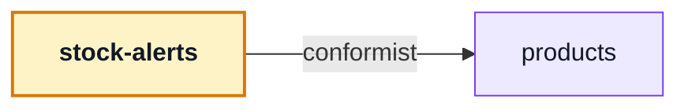

# stock-alerts

::: tip At a glance
**Owns** — the "Notify me" button where a product cannot be ordered, and the account list of open requests.
**Depends on** — [`products`](./products.md), for the shelf state that decides when the button is offered and for the titles of its list.
**Breaks if you change** — the `product-actions` slot contribution. It is the only way the button reaches the product page and card.
:::

| Fact                    | This module                                                                    |
| ----------------------- | ------------------------------------------------------------------------------ |
| **Subdomain**           | `supporting` — Specific to this business but not a differentiator. Kept plain. |
| **Screens**             | 1 — `StockAlerts`                                                              |
| **Store**               | `stock-alerts`                                                                 |
| **Menu entries**        | `StockAlerts`                                                                  |
| **API calls**           | 3                                                                              |
| **Depends on**          | [`products`](./products.md)                                                    |
| **Depended on by**      | —                                                                              |
| **Languages**           | `en` · `it`                                                                    |
| **Publishes**           | —                                                                              |
| **Backend counterpart** | `stock-alerts` in `boilerplate-node-backend`                                   |

## The map

- → `products` **conformist** — Reads the product's shelf state (`shelfStateOf`) to know when the button is offered, and its titles (`useProductLines`) for the list.

## The story

A sold-out page with no way to say "tell me" is a missing standard feature. The button is offered
to a signed-in shopper only while the product cannot be ordered (sold out, or off sale); once asked
it reads "You'll be told", and a second click cancels. The backend sends one mail and one inbox row
when the product can be ordered again, then forgets the request.

The button is contributed by this module's manifest to the `product-actions` slot
[`products`](./products.md) owns (`components/NotifyMeButton.vue`), so the page and the card never
import it, the same way the wishlist's heart reaches them.

## Related pages

- [`wishlist`](./wishlist.md) — the same slot, the same shape
- [`products`](./products.md) — owns the slot and the shelf state
