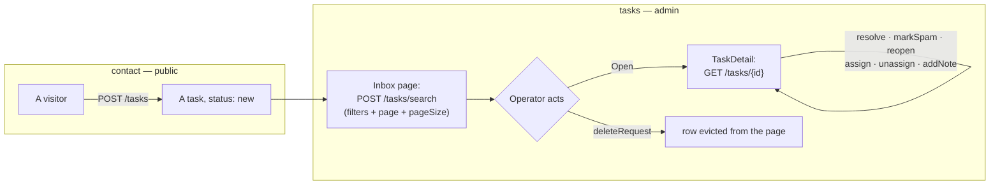

# tasks

::: tip At a glance
**Owns** — the public contact form, the admin inbox behind it and the page of one task, and the foundation's half of the `task-kind` / `task-category` / `task-link` labels.
**Depends on** — nothing, and nothing depends on it. A leaf in both directions.
**Breaks if you change** — nothing outside this folder.
:::

| Fact          | This module                                                         |
| ------------- | ------------------------------------------------------------------- |
| **Subdomain** | `generic` — A solved problem. Modelling effort here would be waste. |

::: info Stands alone
No module depends on this one and it depends on none. Deleting the folder and its line in `src/modules.ts` costs nothing else.
:::

## Its neighbourhood

`tasks` sits on no edge of the context map — nothing imports it and it imports nothing.

## The story

**Labels are co-owned.** The kind, category and link-type words live in three dictionary
namespaces, one key per value of the contract's enum: `task-kind.*`, `task-category.*` and
`task-link.*`. This module owns the foundation's values (the ones the contract's `TaskKind`, `TaskCategory` and
`TaskLinkType` enums mark as the foundation's, plus the `unknown` fallback kind). [`shop-tasks`](./shop-tasks.md) owns the shop's, so a build without it lists the
values it ships and nothing else. The cross-cutting registry spec checks that no entry has two
owners. The contact picker's "no category" option is `contact-page.category-none`, the visitor's
wording ("Not sure"), distinct from the staff label `task-category.none`.

A task references no other domain's records, and every screen talks only to this module's own
endpoints — so it depends on nothing and nothing depends on it.

The three screens (`Contact`, `TaskInbox`, `TaskDetail`) are the two ends of one workflow and share
nothing but a store: `contact` is public, the other two need `['read', 'Task']`. That split is a property of the routes' own
declarations, not of anything in this folder, which is why the menu entry can be contributed
without restating a permission.

::: tip A leaf in both directions
Together with `example` (see [Adding & deleting a domain](../understand/modules-adding-and-deleting.md#adding-and-deleting-a-domain)) and [`observability`](./observability.md), this is a module to read when you
want the module system with none of the interesting coupling in the way. Zero edges, one store, three
screens.
:::

The backend module has answered these endpoints all along. This is the frontend claiming its half —
which is worth noticing, because it is the shape a new domain arrives in: the server exists first,
and a client module is one folder and one registry line away from using it.

**One task is its own page.** `TaskDetail` shows the sender or subject, the deadline, the
assignment, the thread and the composer. Every status change is a door the server offers on the
task's `actions` (resolve, mark as spam, reopen, assign, unassign, add a note): the button exists
only when its action is true, and each door answers the task as it now stands, so the page swaps the
answer in and never re-reads. "Take" assigns the task to the viewer and reads "Take over" when
someone else holds it. The task's `#ref` (its id's last eight characters) is shown on the page and
on the inbox row: the same text the support mailbox's mails carry in their subject.

A task that names a record links to that record's staff page when a module declared one: each module
lists the route of the pages it owns in `recordRoutes` on its manifest, keyed by the task link type
(`tasks` declares `user`, `shop-tasks` declares `order` and `return`). A type nobody declares shows
as plain text.

A kind this build has no word for reads "Task" (`task-kind.unknown`), never a raw translation key.
The badge on the menu entry comes from `GET /tasks/summary`.

**The inbox is a paginated admin list like users, products and orders.** The store is built on
`useStructureCrudApi`, so paging, the page-size select and the pager behave the same as on every
other admin list. `pageTotal` comes from the server's own `meta.totalPages` (`useServerPageTotal`),
never from the rows already cached.

A row is a `TaskListItem`: the sender, subject, status and a `messagePreview` of the first 160
characters. The whole message and the staff notes are `TaskDetail`'s, behind the row's Open button:
that read is the audited one, so the inbox itself carries no whole message.

Every page is read through `POST /tasks/search`, never `GET /tasks`: the GET answers
`Cache-Control: private, max-age=30`, so a reload right after a delete could be a browser cache hit
handing the deleted row back. A POST body is never browser-cached.



## The helpdesk link

A deployment that runs the backend's helpdesk (Zammad) sets its public URL as `VITE_ZAMMAD_URL`, a
[runtime-config](../operate/environment.md#runtime-configuration-config-js) value a container can change
at start. With it set, the module adds a `Helpdesk` route and an `admin` menu entry, for staff who
hold `read:Task`, like the inbox beside it. Entering the route leaves the app for that URL. With it
unset or blank, neither the route nor the entry exists: there is no link to a page that is not there.

The URL is read once, when the module loads, so changing it is a container restart. The backend
sends nothing for this (no `GET /config` field); the backend's Zammad module page, in its own
repository, covers the staff entry from the other side.

## State

State, getters and actions are exactly what the setup function of each store returns: `src/modules/tasks/store.ts`.

## Screens

Paths, route names, access and permission per screen: `src/modules/tasks/routes.ts`; every module's together are in the generated [sitemap](../understand/sitemap.md).

## Wiring

#### Endpoints called

Method, path pattern, response schema and owning module of every operation: `contracts/rest.generated/routes.ts` (rows with `module: "tasks"`). Auth is in the backend contract.

#### Navigation entries

Entries are declared in `src/modules/tasks/module.ts`. Badges: `TaskInbox` — unassigned plus mine, from `GET /tasks/summary`. `Helpdesk` exists only when `VITE_ZAMMAD_URL` is set.

## Files

The folder is `src/modules/tasks/`; each file's own `@module` header says what it is.

## Working on it

```bash
# this module's vitest suites
npm run test:unit -- tasks

# this module's cypress suites
npm run test:e2e -- --spec 'src/modules/tasks/tests/e2e/*.cy.ts'

# after the backend changes an endpoint this module calls
npm run regenerate
```

## Related pages

- [Modules overview](./start.md) — the whole context map
- [Sitemap & Access Control](../understand/sitemap.md) — the public/admin split on these three routes
- [Adding & Removing a Module](../build/module-lifecycle.md) — what adding a domain costs
- [State & Routing](../understand/state-and-routing.md) — the store behind all three screens
