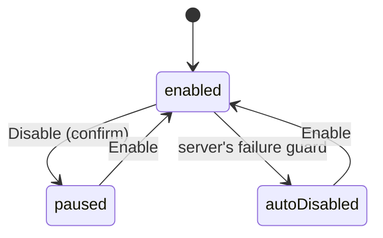

# webhooks

::: tip At a glance
**Owns** — subscription administration (list/create/detail/edit/delete, secret rotation) and the delivery log (filtered read, replay).
**Depends on** — nothing. No sibling module's store or schema is imported.
**Breaks if you change** — nothing outside this folder. It is designed to be deleted.
:::

| Fact          | This module                                                                                                                    |
| ------------- | ------------------------------------------------------------------------------------------------------------------------------ |
| **Subdomain** | `generic` — delivery, retries and signing are a solved problem; the events themselves belong to the modules that publish them. |

## Its neighbourhood

`webhooks` sits on no edge of the context map — nothing imports it and it imports nothing.

## The story

Five screens over one backend module, split by what they need rather than by CRUD verb alone:
subscriptions get the usual four (list, create, a detail page that also carries the status and
secret actions, a plain field-edit form), and the delivery log gets a fifth of its own.

**The delivery log is a route, not a tab, on purpose.** It is read-only and unrelated to the
subscription CRUD form's own state, and — the actual reason — its `subscriptionId`/`status`
filters are mirrored into the URL query string (`useListUrlState`, like every other list), so "failed deliveries for subscription X" is a
link a support conversation can share or bookmark. A tab's state in this codebase is a local
`ref`, gone on reload; that would not survive being handed to someone else.

**The detail and edit pages read their own record.** `store.ts`'s `watchSubscription` is the
toolkit's `watchOne` over `GET /webhooks/subscriptions/{id}`, so an id past the list's first
page resolves, and a 404 or 403 leaves for the shell's Error page (`useMissingRecord`) instead
of sitting on placeholders. The list call that remains (`fetchAllSubscriptions`, 100 rows) only
feeds the delivery log's subscription filter.

**A subscription has three states, and the screens show all three.** The server stores
`disabledAt` and, only when its failure guard did it, `autoDisabledAt`; `enabled` on the wire is
derived. `domain/subscription-status.ts` reads them as one of three states, and
`SubscriptionStatusChip` is the only thing that words and colours them.



- The edit form has no on/off switch: whether a subscription is on is not an edit. Enable and
  disable are buttons on the detail page, each behind the record's own `actions` flag.
- The list's status filter has four choices (any, enabled, paused, auto-disabled). They are two
  server filters, `enabled` and `autoDisabled` (`filterOfStatus`/`statusOfFilter`), because a
  client-side narrowing of a server-paged list would lie about its totals.
- Every write button shows only when the record's `actions` says the server would accept it
  (`update`, `delete`, `enable`, `disable`, `createSecret`, `removeSecret`); a delivery's
  Replay follows `actions.replay`, which is false while its subscription is off.
- A save that lost a race (`412`) shows a warning and offers "reload latest" (`useStaleRecord`, see
  [Request Flow](../understand/request-flow-strategies.md#conditional-writes)); the subscription forms also disable
  the event types the caller may not read.
- A superseded secret shows when it stops signing (`retiringSecrets`); the page never restates
  the server's overlap window.

**The secret ring gets its own hand-written store actions, not the generic `createOne`/
`updateOne`.** Creating a subscription and rotating its secret both receive a plaintext secret in
the response, meant to be shown exactly once through the shared
`src/ui/organisms/SecretRevealModal.vue` (promoted out of this module when `api-keys` needed the
same mechanism; modeled on the two-factor backup-codes screen). The toolkit's generic create/update
path caches whatever the API call resolves to, verbatim — which would leave that plaintext sitting
in this store's reactive state indefinitely, readable by anything with `getRecord(id)`.
`createSubscription` and `createSecret` instead run the call through `fetchAny` (no automatic
caching), strip the secret field by hand, and cache the rest — while still returning the full
response, secret included, to the view that needs it for the one-time reveal. `tests/store.spec.ts`
asserts this directly: after either call, the plaintext never appears anywhere in
`JSON.stringify(store.subscriptions)`.

**A subscription is never kept.** The store's `staleTime` is 0, and so is the detail page's watcher:
a subscription's health (the failure streak, the auto-disable) is written by deliveries, not by an
edit, so nothing on this side could tell a kept copy it is old. Every open and every list read asks
again, and the server answers a 304 while nothing moved.

::: tip Deleting this module
Nothing outside `src/modules/webhooks/` references it — no store, no schema. `rm -rf` the folder
and its line in `src/modules.ts`; `src/ui/organisms/SecretRevealModal.vue` stays (`api-keys` uses
it too). The backend module is unaffected, since this client never wrote to it beyond what any
HTTP client could.
:::

## State

State, getters and actions are exactly what the setup function of each store returns: `src/modules/webhooks/store.ts`. Beside the main store, `badge-store.ts` holds the nav badge's number (the auto-disabled list's total).

## Screens

Paths, route names, access and permission per screen: `src/modules/webhooks/routes.ts`; every module's together are in the generated [sitemap](../understand/sitemap.md).

## Wiring

#### Endpoints called

Method, path pattern, response schema and owning module of every operation: `contracts/rest.generated/routes.ts` (rows with `module: "webhooks"`). Auth is in the backend contract.

#### Navigation entries

Entries are declared in `src/modules/webhooks/module.ts`. Badges: `WebhooksList` — subscriptions the failure guard switched off (its own list total).

Two entries from one manifest — the same split the `tasks` module uses for its public form vs. its admin tasks page: subscriptions and the delivery log are different jobs an operator reaches for at different times.

## Files

The folder is `src/modules/webhooks/`; each file's own `@module` header says what it is.

## Working on it

```bash
# this module's vitest suites
npm run test:unit -- webhooks

# this module's cypress suites
npm run test:e2e -- --spec 'src/modules/webhooks/tests/e2e/*.cy.ts'

# after the backend changes an endpoint this module calls
npm run regenerate
```

## Deeper in

Nothing in this domain needs a page of its own — the story above is the whole of it.

## Related pages

- [`tasks`](./tasks.md) — the other module with two navigation entries from one manifest
- [OpenAPI Workflow](../build/openapi-workflow.md) — where the generated request schemas come from
- [Sitemap & Access Control](../understand/sitemap.md) — the `admin` gate on every route here
- [State & Routing](../understand/state-and-routing.md) — the store behind the five screens
