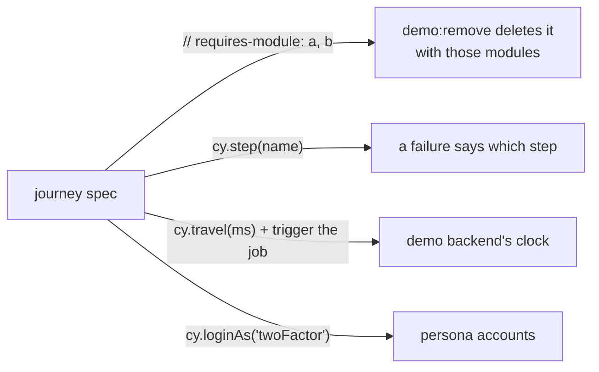
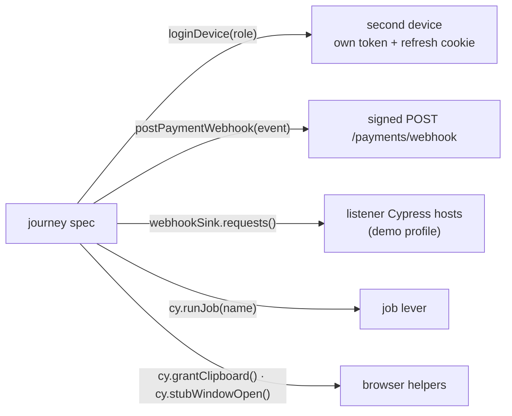

# End-to-end tests and journeys

The `tests/e2e/` half of [Tests](./tests.md): a real browser against a real backend.

## The suite

| File                                    | What it guarantees                                                                                                                                                                                                                                                                                                        | Read next                                                  |
| --------------------------------------- | ------------------------------------------------------------------------------------------------------------------------------------------------------------------------------------------------------------------------------------------------------------------------------------------------------------------------- | ---------------------------------------------------------- |
| `tests/e2e/specs/storefront.cy.ts`      | Browsing the catalogue: listing, search, detail.                                                                                                                                                                                                                                                                          | [Live E2E](../build/live-e2e.md)                           |
| `tests/e2e/specs/commerce.cy.ts`        | Cart and checkout against real API responses.                                                                                                                                                                                                                                                                             | [Live E2E](../build/live-e2e.md)                           |
| `tests/e2e/specs/journey.cy.ts`         | The full visitor journey end to end, the one spec that crosses every domain.                                                                                                                                                                                                                                              | [Live E2E](../build/live-e2e.md)                           |
| `tests/e2e/specs/locale.cy.ts`          | Switching language re-enters the route and the copy follows.                                                                                                                                                                                                                                                              | [Live E2E](../build/live-e2e.md)                           |
| `tests/e2e/specs/consent.cy.ts`         | The analytics banner: no Umami tag before a yes, none after Decline, and the footer's "Privacy choices" link reopens it to withdraw.                                                                                                                                                                                      | [Umami](../operate/umami.md#consent)                       |
| `tests/e2e/specs/uploads.cy.ts`         | The multipart image path, including a file the API must refuse.                                                                                                                                                                                                                                                           | [Security](../understand/security.md)                      |
| `tests/e2e/specs/resilience.cy.ts`      | What the app does when the API is slow, unreachable, or answers an error.                                                                                                                                                                                                                                                 | [Observability](../operate/observability.md)               |
| `tests/e2e/specs/touch.cy.ts`           | The shell's touch contract: a phone reports a finger and the next test a mouse, the drawer opens by tap and by swipe, menus open with no tooltip over their first entry, and the scan catches what a finger cannot reach.                                                                                                 | [Touch Testing](../build/touch-testing.md)                 |
| `tests/e2e/specs/layout-checks.cy.ts`   | The layout checks proving themselves on planted fixtures: a wide element, cut text, a covered and an unreachable control, a small field, a wide drawer, text spacing; and the look-alikes they must leave alone.                                                                                                          | [Layout Sweep](../build/layout-sweep.md)                   |
| `tests/e2e/specs/a11y.cy.ts`            | The accessibility sweep over every reachable route.                                                                                                                                                                                                                                                                       | [Accessibility Testing](../build/accessibility-testing.md) |
| `tests/e2e/specs/harness.cy.ts`         | The journey harness: the demo clock, the backend's session mode matching `E2E_SESSION_MODE`, the persona and staff accounts, a second device, a signed payment webhook, the webhook sink, the job lever, the browser helpers and `cy.restore` emptying the browser's HTTP cache each do what a journey leans on them for. | [Journeys](#journeys-—-stories-that-cross-modules)         |
| `tests/e2e/specs/harness.antibot.cy.ts` | The antibot run's backend really has the altcha provider on and serves its challenge.                                                                                                                                                                                                                                     | [Live E2E](../build/live-e2e.md#the-antibot-run)           |
| `tests/e2e/visual/visual.cy.ts`         | The visual-regression run for the shell: each baseline screenshot, per viewport and theme, compared pixel-wise.                                                                                                                                                                                                           | [Visual Regression](../build/visual-regression.md)         |

| Pattern                                | What it is                                                                                                                                                                                                                           | Read next                                          |
| -------------------------------------- | ------------------------------------------------------------------------------------------------------------------------------------------------------------------------------------------------------------------------------------ | -------------------------------------------------- |
| `tests/e2e/visual/__snapshots__/*.png` | The shell's committed visual baselines, `<name>.<viewport>[.dark].png` — what a page is _supposed_ to look like. A failure diff is never committed: recording a failure as expected output is how a regression becomes the baseline. | [Visual Regression](../build/visual-regression.md) |
| `tests/e2e/fixtures/*`                 | Files the browser suites upload, including one that is deliberately not an image.                                                                                                                                                    | [Security](../understand/security.md)              |

**Role sweeps.** A module's `roles.cy.ts` walks its pages once per staff persona through
`sweepRoles` (`tests/support/e2e/role-sweep.ts`): an allowed page renders and calls no door that
answers 401 or 403, a refused one turns the visitor back, and the menu link and the `session.can`-gated
buttons follow. What a persona may open is derived from its own the `abilities` of `GET /account`, never
typed into a case. How it works: [Live E2E](../build/live-e2e.md#the-role-sweep).

### Journeys — stories that cross modules

A story that walks **one** module lives in that module's `tests/e2e/`. A story that crosses
several lives in `tests/e2e/specs/journeys/<id>-<slug>.cy.ts` — the existing glob already matches.

- **The header is mandatory.** A first line `// requires-module: cart, orders` (or `none`) names
  the modules the spec needs. `npm run demo:remove` deletes a spec whose header names a removed
  module (`scripts/demo/demo-remove-tests.ts`), and `tests/cross-cutting/journey-headers.spec.ts`
  refuses a journey with none, or one naming something that is not a module.
- **Ids** carry a prefix, and an id is never reused (so a number missing from a prefix is a retired story):

    | Prefix | Means                                                    |
    | ------ | -------------------------------------------------------- |
    | AC     | account: the signed-in person's own data and credentials |
    | AT     | administration                                           |
    | CU     | customer: shopping, paying, getting the order            |
    | FR     | friction and failure: what goes wrong around a flow      |
    | IN     | integrator: API keys and webhooks                        |
    | N      | withdrawal: the buyer's right to change their mind       |
    | OP     | shop operations: staff running the shop                  |
    | PS     | product states                                           |
    | VI     | visitor: the signed-out storefront                       |

- **One story per file:** one `describe('CU1 · …')`, one arc `it`. Setup the story does not care
  about goes through `cy.apiAs('admin', …)`; what the story is about goes through the UI.
- **`cy.step(name)`** starts a named phase. The name is prefixed onto a failure's message, since
  `cy.log` never reaches the terminal.
- **One alias, one `cy.intercept`.** Registering the same alias again keeps the old routes under it,
  and `cy.wait('@alias')` yields the first request that has COMPLETED among all of them, which can
  be an earlier call's answer, not the one just sent. Register once before a loop, or give each call
  its own alias (`addOpenProductToCart` does). A status assertion on a stale answer passes or fails
  by timing.
- **`cy.travel(ms)`** moves the demo backend's clock forward (`POST /__test/clock`); the browser's
  clock does not move. It runs no job: trigger the reaction through its own door (the reservation
  sweep is `POST /inventory/reservations/sweep`), or run a declared job with `cy.runJob(name)`
  (yields `{ job, result }`; a name the backend does not carry fails and lists the ones it does).
  Open a time journey with `cy.skipUnlessDemo()`. A `loginAs` session is the short tier (1 day): a jump beyond a day ends it, and a staff or admin session also ends after 30 minutes without a request — sign in again after any longer jump.
- **`cy.travelEverywhere(ms)`** moves both clocks: the server's, and a Date-only browser clock for a
  countdown the page works out itself. The server clock only goes forward, a staff session idles
  out at 30 minutes, TTL indexes never move, and past a day you sign in again.
- **Personas** are `E2ERole`s beside the four seeded roles: `secondShopper` (a plain verified customer
  with an address book), `unverified`, `twoFactor` (with
  `backupCodes`), `pendingEmail`, `banned`. Their state is seeded, so a journey starts in it.
- **`cy.accountOf(role)`** yields a seeded login, read when it runs. A journey asks for it and
  imports nothing from `scenario.ts`: a spec file that imports that module gets its own copy of
  the backend's description, which `cy.restore()` never refreshes, so `order.*` ids — new after
  every live reset — go stale and `cy.subjectId` answers with the previous test's rows.
- **Staff** are `manager`, `warehouse`, `support` (one shop role each) and `operator` (a platform
  role only, with no shop membership). Their passwords are the backend's `NODE_SEED_<NAME>_PASSWORD`.

- **`loginDevice(role)`** signs in as a second device, server-side, so the page's own session is
  untouched. Keep the returned device and hand it to `refreshDevice(device)` and
  `requestAsDevice(device, method, path)`. A refused refresh (401) is an answer, not a failure: it is
  what a journey asserts after a logout-everywhere or a password reset. In `cookie` mode there is no
  refresh endpoint, so `refreshDevice` asks `GET /account`: 200 while the session lives, 401 once revoked.
- **`skipUnlessSessionMode(this, 'jwt')`** skips a journey that is about one session mode's own
  machinery (refresh rotation, access-token expiry). The mode is `E2E_SESSION_MODE`
  (`jwt` default, or `cookie`): the demo shards boot their backends with it as `NODE_SESSION_MODE`,
  and `ci.yml`'s `test-e2e` runs the whole suite once per mode.
- **`postPaymentWebhook(event, timestamp?)`** signs a provider event with the backend's
  `NODE_PAYMENT_WEBHOOK_SECRET` (`E2E_PAYMENT_WEBHOOK_SECRET` on live) and posts it. An old
  `timestamp` proves a stale delivery is refused.
- **`totpCodeFor(secret, stepsFromNow)`** is the code an authenticator app shows for a TOTP secret, computed in
  Cypress' Node process with `otplib` (the backend's own library and major). Step 0 confirms an
  enrolment; the backend takes a step once, so every later code is a step further on.
- **Staff logins answer a code.** A staff role grants nothing without an authenticator app, so every
  seeded staff account is armed and its `cy.accountOf` login carries `totpSecret`. `cy.loginAs`,
  `loginAsFast`, `switchUser`, `loginDevice` and the `adminApi` task type the code after the password.
  The `loginTotpCode` task hands out the earliest step the backend still accepts and no earlier login
  used (two per half-minute per account; a third waits for the clock), and `cy.restore` forgets
  what it handed out, because the restore resets the replay mark too.
- **`webhookSink`** (demo only): `clear()` starts the listener and forgets, `requests()` reads what
  arrived, each with `signatureValid` against the seeded subscription's known secret. Clear first,
  then trigger the replay. On live the `webhook-tester` service plays this part.
- **`webhooksReceived(url)`** reads what the receiver captured for one subscription URL, on either
  profile: the Cypress-hosted sink on demo, `webhook-tester`'s API on live
  (`scripts/e2e/webhook-tester.ts`). `signatureVerifies(received, secret)` says whether the delivery
  verifies under a secret the journey holds (a rotated one, say), where the sink's own
  `signatureValid` only knows the seeded one. `forgetWebhooks()` clears the demo sink; the live
  tester keeps its history, so a journey picks its deliveries out by the order they name.
- **The receiver is the seeded subscription, and only that one.** The contract wants `https://`
  for every subscription, the receiver speaks plain HTTP, so a journey cannot subscribe to it:
  it finds the backend's own (the one `http://` row) and replays against it. A subscription a
  journey makes itself points at `https://127.0.0.1:1/…`, which the SSRF guard lets through (it
  exempts the receiver's host) and nothing answers.
- **`requestWithKey(secret, method, path)`** is the integrator's script: one call with an `sk_…`
  key as the bearer and no cookie, from Node. `requestAsGuest` is the same with no credential.
  `loginDeviceWith(email, password)` is `loginDevice` for an account a journey made itself.
- **`cy.emailTo(address, matches?)`** keeps looking until an email passes `matches` — a sign-up's
  verify mail, then the order's, go to one address. `mailMentions(email, needle)` asks one question
  of both profiles: an inbox gives a body and its links, the outbox gives `key: value` lines.
  No mail carries an invoice: the PDF is issued on payment and fetched from the order page.
- **`cy.grantClipboard()`** lets the page read the clipboard (over the DevTools protocol, so a
  Chromium-family browser); **`cy.stubWindowOpen()`** stubs `window.open` as `@windowOpen`. Call
  either after `cy.visit()`.
- **The antibot run.** A spec named `<name>.antibot.cy.ts` runs against a backend with the
  human-challenge provider on, in its own shard — see [Live E2E](../build/live-e2e.md#the-antibot-run). `solveHumanCheck()`
  (in `steps.ts`) ticks the widget and waits for its proof-of-work; the form's own button is pressed
  after it.
- **The consent build.** A build with Umami configured (`VITE_UMAMI_WEBSITE_ID`) asks every first-time
  visitor for analytics consent; the global hook answers "denied" for every spec so the banner never
  shifts a page. A journey about consent clears the cookie and skips itself when no banner shows
  (`VI4`, `AC12`, like `consent.cy.ts`), so on a build without Umami it is a no-op. The rows Umami
  holds are read only on live (`withUmami`, `CU25`).

Every journey is a spec in `tests/e2e/specs/journeys/`: its file name is the story, its `@module` header tells it, and the `@smoke` tag puts it in the push tier ([Live E2E — Tiers](../build/live-e2e.md#tiers)).

## Read next

- [Tests](./tests.md) — the other suites and the harness
- [Live E2E](../build/live-e2e.md) — running them against a live stack
