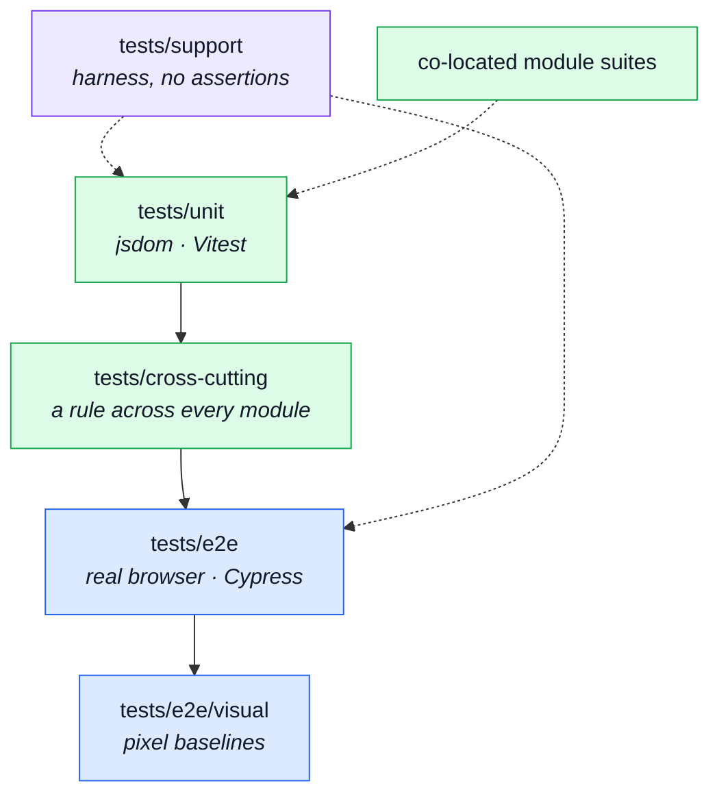
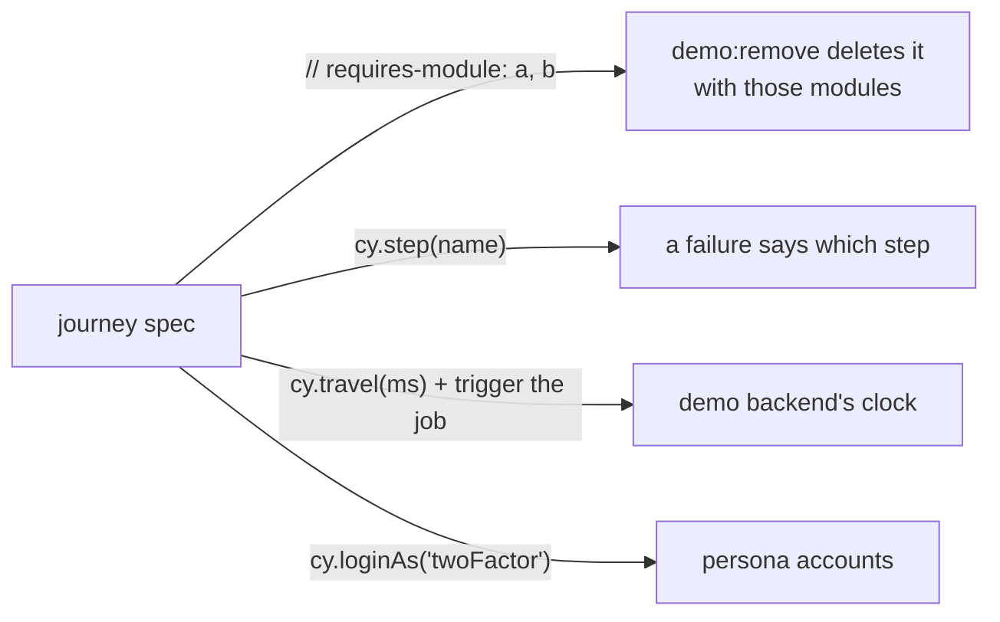
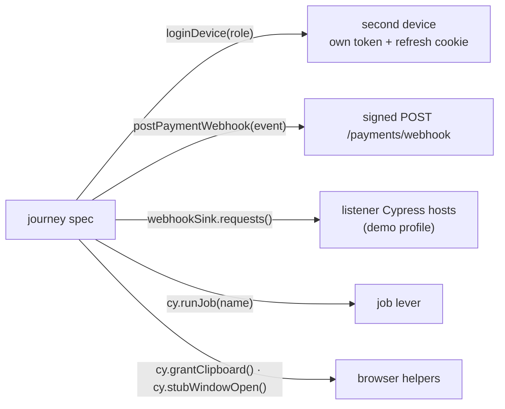

# Tests

Every file here is a distinct guarantee, which is why this page names them one at a time: knowing
_which_ test covers a rule is most of the value of having it.

Tests live in two places, and the split is by scope. A test about **one module** lives inside that
module. A test about **the system** — infrastructure, the kernel, the app shell, or a rule that
holds across every module — lives in `tests/`.

---

## The four suites, and what runs them

**Vitest** owns everything that runs in jsdom: pure functions, stores, composables, and single
components mounted with `@vue/test-utils`. **Cypress** owns everything needing a real browser — and
in this repo that means a real backend too, since the mock layer was retired in favour of the
paired backend's demo profile.

## `tests/cross-cutting/` — rules that hold across every module

One file per architectural rule, asserted over every module at once. A new module is
covered the day it is added.

Module coupling is not among them: which module may import which is a generated ESLint rule
(`dependsOn` in each `module.yaml`, read by `eslint.config.ts`), enforced at the import on every `npm run lint` rather than
reconciled against a manifest field here. See
[Strategic DDD](../theory/strategic-ddd.md) §2 and §4.

| File                                                | What it guarantees                                                                                                                                                             | Read next                                                  |
| --------------------------------------------------- | ------------------------------------------------------------------------------------------------------------------------------------------------------------------------------ | ---------------------------------------------------------- |
| `tests/cross-cutting/registry.spec.ts`              | Every enabled module's manifest satisfies the invariants any module must — routes named, navigation pointing at a real route.                                                  | [Modules](../theory/modules.md)                            |
| `tests/cross-cutting/form-idiom.spec.ts`            | Every form supplies the toolkit's three answers (`useStructureFormValidation`), hands it an element to focus into, and guards every record-editing page against a lossy leave. | [UI Kit](./src-ui.md)                                      |
| `tests/cross-cutting/schemas-i18n.spec.ts`          | Every validation message resolves to a real dictionary key, so a form never renders a raw key at a user.                                                                       | [App, Kernel & Types](./src-app.md)                        |
| `tests/cross-cutting/a11y-coverage.spec.ts`         | Every route reachable in the app is covered by the accessibility sweep — the check that stops a new page quietly escaping it.                                                  | [Accessibility Testing](../tools/accessibility-testing.md) |
| `tests/cross-cutting/viewport-matrix.spec.ts`       | Device sizes are typed in one module (`scripts/e2e/viewports.ts`) and set through one seam; `index.html`'s meta viewport never blocks zoom.                                    | [Accessibility Testing](../tools/accessibility-testing.md) |
| `tests/cross-cutting/mutate-scope.spec.ts`          | The Stryker `mutate` scope still matches the code that exists, so it never silently stops measuring a directory.                                                               | [Mutation Testing](../tools/mutation-testing.md)           |
| `tests/cross-cutting/mutation-safe-imports.spec.ts` | No import pattern that would break under Stryker's instrumentation.                                                                                                            | [Mutation Testing](../tools/mutation-testing.md)           |
| `tests/cross-cutting/module-coupling.spec.ts`       | A module's `@api` calls stay inside its declared `dependsOn` coupling — the contract-level twin of the import boundary.                                                        | [Strategic DDD](../theory/strategic-ddd.md)                |
| `tests/cross-cutting/module-file-shapes.spec.ts`    | A form schema writes no size bound as a number: a generated contract constant says it.                                                                                         | [Modules](../theory/modules.md)                            |
| `tests/cross-cutting/module-groups.spec.ts`         | Every enabled module has a `module.yaml` with a `foundation` / `shop` group.                                                                                                   | [Modules](../theory/modules.md)                            |
| `tests/cross-cutting/journey-headers.spec.ts`       | Every journey names the modules it needs on a `// requires-module:` line, and only real ones — so `demo:remove` can delete it.                                                 | [Journeys](#journeys-—-stories-that-cross-modules)         |
| `tests/cross-cutting/route-name-coupling.spec.ts`   | A module naming a sibling's route is either a declared edge or guarded by `router.hasRoute`.                                                                                   | [Modules](../theory/modules.md)                            |
| `tests/cross-cutting/sitemap-document.spec.ts`      | The route table on the sitemap page is exactly what the enabled modules contribute; also regenerates it.                                                                       | [Sitemap & Access Control](../theory/sitemap.md)           |
| `tests/cross-cutting/badge-name.spec.ts`            | Every count the app renders is announced as a count, not as "Badge".                                                                                                           | [Accessibility Testing](../tools/accessibility-testing.md) |
| `tests/cross-cutting/entry-chunk-budget.spec.ts`    | The entry chunk stays under its byte budget — a real production build is inspected.                                                                                            | [Runtime](../tools/runtime.md)                             |
| `tests/cross-cutting/utility-collisions.spec.ts`    | The class names Vuetify and Tailwind both generate mean the same, except the listed ones; no radius name collides; Tailwind scans `src/` only.                                 |
| `tests/cross-cutting/pinned-browser-image.spec.ts`  | Every nightly that measures a browser (visual, Lighthouse) runs in the same `cypress/included` tag and digest; a bump in one workflow that leaves the other behind fails.      | [Lighthouse](../tools/lighthouse.md)                       |

## `tests/unit/`

| File                                                    | What it guarantees                                                                                                                      | Read next                                          |
| ------------------------------------------------------- | --------------------------------------------------------------------------------------------------------------------------------------- | -------------------------------------------------- |
| `tests/unit/kernel/registry.spec.ts`                    | The registry's route- and navigation-collecting functions behave correctly on synthetic modules.                                        | [Modules](../theory/modules.md)                    |
| `tests/unit/app/router/router.spec.ts`                  | The router is assembled from the registry, and a module's routes arrive under the locale prefix.                                        | [State & Routing](../tools/state-and-routing.md)   |
| `tests/unit/app/router/navigation.spec.ts`              | The navigation model: what the shell renders, and where an unauthenticated visitor is sent.                                             | [Sitemap & Access Control](../theory/sitemap.md)   |
| `tests/unit/app/guards/authentications.spec.ts`         | A route's declared requirement is enforced, and a public route stays public.                                                            | [Sitemap & Access Control](../theory/sitemap.md)   |
| `tests/unit/app/guards/authentications-restore.spec.ts` | A visitor sent to sign in is returned to where they were aiming.                                                                        | [Security](../tools/security.md)                   |
| `tests/unit/app/guards/locale-choice.spec.ts`           | The locale a route is entered under, and the dictionary assembled for it.                                                               | [Infrastructure](./src-infrastructure.md)          |
| `tests/unit/app/tours.spec.ts`                          | Tour steps assemble in order, drop absent anchors, have copy in both languages, and the popover is accessible.                          | [Guided tours](../tools/tours.md)                  |
| `tests/unit/app/browser-storage-table.spec.ts`          | The privacy page's cookies table: a row per item, cells as translation keys, consent rows and the Cloudflare note only when they apply. | [Cookies and storage](../tools/browser-storage.md) |
| `tests/unit/app/tour-host.spec.ts`                      | The welcome tour opens once after the first sign-in; `?tour=` opens a known tour and is stripped.                                       | [Guided tours](../tools/tours.md)                  |
| `tests/unit/app/app-navigation.spec.ts`                 | The shell's navigation renders from the registry rather than a hand-written list.                                                       | [App, Kernel & Types](./src-app.md)                |

### `tests/unit/infrastructure/`

| File                                                             | What it guarantees                                                                                                                         | Read next                                          |
| ---------------------------------------------------------------- | ------------------------------------------------------------------------------------------------------------------------------------------ | -------------------------------------------------- |
| `tests/unit/infrastructure/browser-storage.spec.ts`              | The inventory of cookies and storage keys: one row per named item, translated cells in both languages, optional rows left out.             | [Cookies and storage](../tools/browser-storage.md) |
| `tests/unit/infrastructure/http/client.spec.ts`                  | The axios instance's base URL, credentials and timeouts.                                                                                   | [Infrastructure](./src-infrastructure.md)          |
| `tests/unit/infrastructure/http/http.spec.ts`                    | The transport's public surface — what a caller gets back, and in what shape.                                                               | [Endpoints](../api/endpoints.md)                   |
| `tests/unit/infrastructure/http/http-request.spec.ts`            | Request assembly, including the JSON-or-multipart duality the generated clients hand over.                                                 | [OpenAPI Workflow](../api/openapi-workflow.md)     |
| `tests/unit/infrastructure/http/http-refresh.spec.ts`            | The refresh-and-retry flow, and that the endpoints excluded from it stay excluded — a 401 on login is an answer, not a stale token.        | [Security](../tools/security.md)                   |
| `tests/unit/infrastructure/http/http-validate-responses.spec.ts` | Responses are parsed through their contract schema when validation is on, and a mismatch is caught at the boundary.                        | [OpenAPI Workflow](../api/openapi-workflow.md)     |
| `tests/unit/infrastructure/http/url.spec.ts`                     | Query strings, absolute URLs and the leading slash — the normalisation both the schema table and the refresh exclusion list match against. | [Contracts](./contracts.md)                        |
| `tests/unit/infrastructure/http/response-schema-map.spec.ts`     | Every generated call site maps to a schema — the check that stops a new endpoint being silently unvalidated.                               | [Contracts](./contracts.md)                        |
| `tests/unit/infrastructure/locale-overrides.spec.ts`             | Admin-edited copy overlays the bundled defaults, and removing an override restores the default.                                            | [Admin Dashboard](../tools/admin-dashboard.md)     |
| `tests/unit/infrastructure/session.spec.ts`                      | The session store: what is held, what is cleared, and when.                                                                                | [Security](../tools/security.md)                   |
| `tests/unit/infrastructure/observability.spec.ts`                | Faro and Umami are wired behind one surface, and a disabled back end is a no-op rather than a crash.                                       | [Observability](../tools/observability.md)         |
| `tests/unit/infrastructure/create-sse-client.spec.ts`            | The typed SSE wrapper: decoding, reconnection, and cleanup on unmount.                                                                     | [Realtime](../tools/realtime.md)                   |
| `tests/unit/infrastructure/utils/errors.spec.ts`                 | A human-readable message out of any thrown value, so a `catch` never renders `[object Object]`.                                            | [Endpoints](../api/endpoints.md)                   |
| `tests/unit/infrastructure/utils/formatters.spec.ts`             | Date, money (places read off the amount text) and fallback rendering.                                                                      | [UI Kit](./src-ui.md)                              |
| `tests/unit/infrastructure/utils/money.spec.ts`                  | Decimal-string money: exact sums and line totals (EUR, JPY, KWD), `"71"` equals `"71.00"`, padding a typed amount.                         | [Cart](../modules/cart.md)                         |
| `tests/unit/infrastructure/utils/formatters.property.spec.ts`    | The same, as **properties** over generated inputs rather than examples.                                                                    | [Property Testing](../tools/property-testing.md)   |
| `tests/unit/infrastructure/utils/logger.spec.ts`                 | The one module allowed to touch `console` behaves as the rest of the app assumes.                                                          | [Observability](../tools/observability.md)         |
| `tests/unit/infrastructure/utils/uploads.spec.ts`                | The client-side limits, so a rejection happens before the request.                                                                         | [Security](../tools/security.md)                   |

### `tests/unit/i18n/` — the extractable runtime

| File                                     | What it guarantees                                                            | Read next                           |
| ---------------------------------------- | ----------------------------------------------------------------------------- | ----------------------------------- |
| `tests/unit/i18n/i18n.spec.ts`           | Dictionary resolution, including the array messages `tm()` and `rt()` render. | [App, Kernel & Types](./src-app.md) |
| `tests/unit/i18n/language-label.spec.ts` | A language's display name, falling through translated → native → `Intl` name. | [App, Kernel & Types](./src-app.md) |

### `tests/unit/ui/` and `tests/unit/scripts/`

| File                                                      | What it guarantees                                                                                                                                                                                                                                   | Read next                                                             |
| --------------------------------------------------------- | ---------------------------------------------------------------------------------------------------------------------------------------------------------------------------------------------------------------------------------------------------- | --------------------------------------------------------------------- |
| `tests/unit/ui/form-image-upload.spec.ts`                 | File selection, preview and the limits it enforces.                                                                                                                                                                                                  | [UI Kit](./src-ui.md)                                                 |
| `tests/unit/ui/list-pagination.spec.ts`                   | Page maths and the events a parent listens for.                                                                                                                                                                                                      | [UI Kit](./src-ui.md)                                                 |
| `tests/unit/ui/use-media-query.spec.ts`                   | The ref starts at the current answer, follows a change, asks for the query it was given, and lets go of its listener with its scope.                                                                                                                 | [Pointer vs touch](../theory/design-system.md#pointer-vs-touch)       |
| `tests/unit/ui/use-touch-friendly-size.spec.ts`           | A row action is `large` (44 px) below `sm` or on a coarse pointer, and `small` only with both off; it follows the viewport.                                                                                                                          | [Pointer vs touch](../theory/design-system.md#pointer-vs-touch)       |
| `tests/unit/ui/use-copy-to-clipboard.spec.ts`             | A copy toasts the success text, or the caller's own failure text as a danger toast when the clipboard refuses.                                                                                                                                       | [Pointer vs touch](../theory/design-system.md#pointer-vs-touch)       |
| `tests/unit/ui/use-leave-guard.spec.ts`                   | Dirty form asks before a leave; clean, saved or signed-out forms do not; the unload prompt follows the same rule.                                                                                                                                    | [UI Kit](./src-ui.md)                                                 |
| `tests/unit/scripts/design-lint-config.spec.ts`           | The design lint run for real on snippets: the theme is read, refusals fire, a reasoned disable is accepted, an unused one fails.                                                                                                                     |
| `tests/unit/scripts/eslint/stylesheet-classes.spec.ts`    | The app's own classes are read from CSS and SFC style blocks; a scoped class stays in its file.                                                                                                                                                      |
| `tests/unit/scripts/eslint/mobile-strategy.spec.ts`       | A dialog without `fullscreen`, a data table outside the wrapper and an unnamed `v-table` are reported.                                                                                                                                               |
| `tests/unit/scripts/eslint/no-hover-only.spec.ts`         | A hover with no tap, `open-on-hover` alone, a gesture-only handler and a `title` on clipped text are reported.                                                                                                                                       |
| `tests/unit/scripts/e2e/cypress-spec-globs.spec.ts`       | The five spellings of the Cypress spec set resolve to the same files — `package.json`'s `--spec` arguments included, since they cannot import the constant.                                                                                          | [Package Scripts](../tools/package-scripts.md)                        |
| `tests/unit/scripts/demo/demo-remove-registry.spec.ts`    | `demo:remove` drops a removed module's folder, registry lines and coupling-graph entry, and keep every other line.                                                                                                                                   | [Journeys](#journeys-—-stories-that-cross-modules)                    |
| `tests/unit/scripts/demo/demo-remove-tests.spec.ts`       | `demo:remove` deletes a spec by its `requires-module` header or an import of a removed module, keeps the rest, and the header check can fail.                                                                                                        | [Journeys](#journeys-—-stories-that-cross-modules)                    |
| `tests/unit/scripts/e2e/device-session.spec.ts`           | A second device keeps its own session cookie in either session mode, rotates its token on a `jwt` refresh, asks `GET /account` in `cookie` mode, and answers a refused call as data.                                                                 | [Journeys](#journeys-—-stories-that-cross-modules)                    |
| `tests/unit/scripts/e2e/payment-webhook.spec.ts`          | A payment event is signed as `t=…,v1=<HMAC of "<t>.<body>">` over the exact bytes sent, with the demo secret unless the environment names one.                                                                                                       | [Journeys](#journeys-—-stories-that-cross-modules)                    |
| `tests/unit/scripts/e2e/webhook-sink.spec.ts`             | The sink serves TLS the test CA vouches for (a handshake trusting only that CA completes), records what arrives, checks the Standard Webhooks signature, and refuses a port that is taken.                                                           | [Journeys](#journeys-—-stories-that-cross-modules)                    |
| `tests/unit/scripts/e2e/webhook-tester.spec.ts`           | The live receiver's captured requests read back over TLS in the sink's shape: oldest first, header names lower-cased, a session not yet created as nothing.                                                                                          | [Journeys](#journeys-—-stories-that-cross-modules)                    |
| `tests/unit/scripts/e2e/antibot-backend.spec.ts`          | The antibot backend's environment is altcha with a secret and a low cost, and the live workflow boots its matrix entry with the same values.                                                                                                         | [Live E2E](../tools/live-e2e.md#the-antibot-run)                      |
| `tests/unit/scripts/e2e/browser-launch.spec.ts`           | The headless window takes the widest width and the tallest height of the matrix, Electron gets it through preferences, Chromium through `--window-size`, a headed run and Firefox are untouched.                                                     | [Visual Regression](../tools/visual-regression.md#the-browser-window) |
| `tests/unit/scripts/e2e/touch-findings.spec.ts`           | Each touch-reachability rule has a red and a green record: a hover-only control, a title that holds cut-off data, a hint, a tooltip on a non-control; identical hints group; only the gated kinds fail.                                              | [Touch Testing](../tools/touch-testing.md)                            |
| `tests/unit/scripts/e2e/layout-findings.spec.ts`          | What blocks, how a case accepts one finding (and never a whole check), which reasons are refused, how a failure reads, which sizes a case runs.                                                                                                      | [Layout Sweep](../tools/layout-sweep.md)                              |
| `tests/unit/scripts/e2e/shot-size.spec.ts`                | A screenshot the size of the viewport passes; a shorter one names the window, a doubled one names the pixel ratio.                                                                                                                                   | [Visual Regression](../tools/visual-regression.md#the-browser-window) |
| `tests/unit/scripts/audit/design-stitch.spec.ts`          | The fixed bands appear once, every content row lands where the page has it, tiles overlap by exactly the overlap, and the size limits are pinned.                                                                                                    | [AI Auditing](../tools/ai-auditing.md)                                |
| `tests/unit/scripts/audit/design-manifest.spec.ts`        | The parts of one capture merge in run order; two shots with one id are refused.                                                                                                                                                                      | [AI Auditing](../tools/ai-auditing.md)                                |
| `tests/unit/scripts/audit/plan-batches.spec.ts`           | Batches group by module, split at the token or tile budget, never split a case, and an empty capture is a problem, not a pass.                                                                                                                       | [AI Auditing](../tools/ai-auditing.md)                                |
| `tests/unit/scripts/audit/check-report.spec.ts`           | An invented tile, line, item, severity or empty fix fails; a mangled table cannot pass quietly.                                                                                                                                                      | [AI Auditing](../tools/ai-auditing.md)                                |
| `tests/unit/scripts/audit/capture-matrix.spec.ts`         | A plain case is four shots, a size- or theme-only case none, a prepared case one or two; ids are unique and stable; the locale prefix is rewritten and nothing else; an action-table row is shot in the states its kind names, at phone and desktop. | [Design Review](../tools/design-review.md)                            |
| `tests/unit/scripts/audit/capture-scope.spec.ts`          | A module, the shell, a path and a diff each resolve to their sweeps; a change to shared chrome widens to everything; `actions.cy.ts` joins only when it exists.                                                                                      | [Design Review](../tools/design-review.md)                            |
| `tests/unit/scripts/audit/unused-locale-keys.spec.ts`     | The unused-locale-key audit reads leaf paths, dynamic prefixes and literal uses correctly.                                                                                                                                                           | [Design Review](../tools/design-review.md)                            |
| `tests/unit/scripts/audit/capture-task.spec.ts`           | A page is stitched into tiles under the size limit and written where the manifest says; a retried shot replaces its row instead of duplicating it.                                                                                                   | [Design Review](../tools/design-review.md)                            |
| `tests/unit/scripts/e2e/step-prefix.spec.ts`              | A failure message gets the `[step: …]` line once, and not before a step starts.                                                                                                                                                                      | [Journeys](#journeys-—-stories-that-cross-modules)                    |
| `tests/unit/scripts/e2e/totp.spec.ts`                     | An authenticator code is six digits, matches the RFC 6238 vector for the time it is asked at, and is accepted by the library the backend verifies with.                                                                                              | [Journeys](#journeys-—-stories-that-cross-modules)                    |
| `tests/unit/scripts/e2e/cents.spec.ts`                    | A money text reads as an integer count of cents in any locale, so amounts compare without caring how each is spelled.                                                                                                                                | [Journeys](#journeys-—-stories-that-cross-modules)                    |
| `tests/unit/scripts/e2e/mail-message.spec.ts`             | A Mailpit message reads back as the outbox's shape (code, link, attachments, text), and `mailMentions` finds a needle in either.                                                                                                                     | [Journeys](#journeys-—-stories-that-cross-modules)                    |
| `tests/unit/scripts/e2e/mail-filters.spec.ts`             | `byTemplate` and `inLocale` keep the email a spec means, and say what they do when an inbox email records neither.                                                                                                                                   | [Journeys](#journeys-—-stories-that-cross-modules)                    |
| `tests/unit/scripts/e2e/declared-statuses.spec.ts`        | The statuses `openapi.yaml` declares for one operation are listed ascending, and a path or verb the contract lacks lists none.                                                                                                                       | [Journeys](#journeys-—-stories-that-cross-modules)                    |
| `tests/unit/scripts/pairing/spec-identity.spec.ts`        | The cross-repo shared-file list, and that this checkout matches the sibling.                                                                                                                                                                         | [Contracts](./contracts.md)                                           |
| `tests/unit/scripts/pairing/paired-backend-path.spec.ts`  | Sibling-checkout resolution, including the empty-value case an `??` would get wrong.                                                                                                                                                                 | [Scripts & Hooks](./scripts.md)                                       |
| `tests/unit/scripts/mutation/baseline.spec.ts`            | The ratchet reads a Stryker report into per-file scores correctly.                                                                                                                                                                                   | [Mutation Testing](../tools/mutation-testing.md)                      |
| `tests/unit/scripts/mutation/overlay.spec.ts`             | A partial run laid over the whole report: its files replaced, the rest kept, test ids still pointing at the right test.                                                                                                                              | [Mutation Testing](../tools/mutation-testing.md#which-file-is-what)   |
| `tests/unit/scripts/testing/github-artifacts.spec.ts`     | Which uploaded artifact a pull takes: the newest unexpired one from a run on `main`, by name.                                                                                                                                                        | [Mutation Testing](../tools/mutation-testing.md)                      |
| `tests/unit/scripts/lighthouse/evaluate.spec.ts`          | What fails the Lighthouse run (CLS, weighted audits, an outside request, a stale exception) and what only warns (timing, report-only audits, a moved benchmark).                                                                                     | [Lighthouse](../tools/lighthouse.md)                                  |
| `tests/unit/scripts/lighthouse/baseline.spec.ts`          | The timing ratchet records an improvement and a new case, ignores a regression, drops a case nobody declares.                                                                                                                                        | [Lighthouse](../tools/lighthouse.md#baseline-and-ratchet)             |
| `tests/unit/scripts/lighthouse/chrome.spec.ts`            | The egress-lock flags are always present, the sandbox flags only for root, error reporting is off, and the phone profile equals Lighthouse's own preset.                                                                                             | [Lighthouse](../tools/lighthouse.md#the-phone-profile)                |
| `tests/unit/scripts/lighthouse/audit-environment.spec.ts` | The audit build bakes only loopback URLs and runs the container's own generators.                                                                                                                                                                    | [Lighthouse](../tools/lighthouse.md)                                  |
| `tests/unit/scripts/lighthouse/analytics-sink.spec.ts`    | The analytics sink answers a post with 204, listens on loopback, and refuses a taken port.                                                                                                                                                           | [Lighthouse](../tools/lighthouse.md#no-byte-leaves-the-machine)       |
| `tests/unit/scripts/lighthouse/route.spec.ts`             | `{subject:x}` in a case's route is filled, and an unknown subject names the published ones.                                                                                                                                                          | [Lighthouse](../tools/lighthouse.md#cases-live-with-modules)          |
| `tests/unit/docker/runtime-config-entrypoint.spec.ts`     | `index.html` loads `config.js` from the base (a cold deep link boots with it), and the generator writes under `NGINX_HTML_ROOT`, omits a blank key, escapes a value.                                                                                 | [Environment](../tools/environment.md)                                |

## `tests/e2e/` — a real browser against a real backend

| File                                    | What it guarantees                                                                                                                                                                                                                                                                                                        | Read next                                                  |
| --------------------------------------- | ------------------------------------------------------------------------------------------------------------------------------------------------------------------------------------------------------------------------------------------------------------------------------------------------------------------------- | ---------------------------------------------------------- |
| `tests/e2e/specs/storefront.cy.ts`      | Browsing the catalogue: listing, search, detail.                                                                                                                                                                                                                                                                          | [Live E2E](../tools/live-e2e.md)                           |
| `tests/e2e/specs/commerce.cy.ts`        | Cart and checkout against real API responses.                                                                                                                                                                                                                                                                             | [Live E2E](../tools/live-e2e.md)                           |
| `tests/e2e/specs/journey.cy.ts`         | The full visitor journey end to end, the one spec that crosses every domain.                                                                                                                                                                                                                                              | [Live E2E](../tools/live-e2e.md)                           |
| `tests/e2e/specs/locale.cy.ts`          | Switching language re-enters the route and the copy follows.                                                                                                                                                                                                                                                              | [Live E2E](../tools/live-e2e.md)                           |
| `tests/e2e/specs/consent.cy.ts`         | The analytics banner: no Umami tag before a yes, none after Decline, and the footer's "Privacy choices" link reopens it to withdraw.                                                                                                                                                                                      | [Umami](../tools/umami.md#consent)                         |
| `tests/e2e/specs/uploads.cy.ts`         | The multipart image path, including a file the API must refuse.                                                                                                                                                                                                                                                           | [Security](../tools/security.md)                           |
| `tests/e2e/specs/resilience.cy.ts`      | What the app does when the API is slow, unreachable, or answers an error.                                                                                                                                                                                                                                                 | [Observability](../tools/observability.md)                 |
| `tests/e2e/specs/touch.cy.ts`           | The shell's touch contract: a phone reports a finger and the next test a mouse, the drawer opens by tap and by swipe, menus open with no tooltip over their first entry, and the scan catches what a finger cannot reach.                                                                                                 | [Touch Testing](../tools/touch-testing.md)                 |
| `tests/e2e/specs/layout-checks.cy.ts`   | The layout checks proving themselves on planted fixtures: a wide element, cut text, a covered and an unreachable control, a small field, a wide drawer, text spacing; and the look-alikes they must leave alone.                                                                                                          | [Layout Sweep](../tools/layout-sweep.md)                   |
| `tests/e2e/specs/a11y.cy.ts`            | The accessibility sweep over every reachable route.                                                                                                                                                                                                                                                                       | [Accessibility Testing](../tools/accessibility-testing.md) |
| `tests/e2e/specs/harness.cy.ts`         | The journey harness: the demo clock, the backend's session mode matching `E2E_SESSION_MODE`, the persona and staff accounts, a second device, a signed payment webhook, the webhook sink, the job lever, the browser helpers and `cy.restore` emptying the browser's HTTP cache each do what a journey leans on them for. | [Journeys](#journeys-—-stories-that-cross-modules)         |
| `tests/e2e/specs/harness.antibot.cy.ts` | The antibot run's backend really has the altcha provider on and serves its challenge.                                                                                                                                                                                                                                     | [Live E2E](../tools/live-e2e.md#the-antibot-run)           |
| `tests/e2e/visual/visual.cy.ts`         | The visual-regression run for the shell: each baseline screenshot, per viewport and theme, compared pixel-wise.                                                                                                                                                                                                           | [Visual Regression](../tools/visual-regression.md)         |

| Pattern                                | What it is                                                                                                                                                                                                                           | Read next                                          |
| -------------------------------------- | ------------------------------------------------------------------------------------------------------------------------------------------------------------------------------------------------------------------------------------ | -------------------------------------------------- |
| `tests/e2e/visual/__snapshots__/*.png` | The shell's committed visual baselines, `<name>.<viewport>[.dark].png` — what a page is _supposed_ to look like. A failure diff is never committed: recording a failure as expected output is how a regression becomes the baseline. | [Visual Regression](../tools/visual-regression.md) |
| `tests/e2e/fixtures/*`                 | Files the browser suites upload, including one that is deliberately not an image.                                                                                                                                                    | [Security](../tools/security.md)                   |

**Role sweeps.** A module's `roles.cy.ts` walks its pages once per staff persona through
`sweepRoles` (`tests/support/e2e/role-sweep.ts`): an allowed page renders and calls no door that
answers 401 or 403, a refused one turns the visitor back, and the menu link and the `session.can`-gated
buttons follow. What a persona may open is derived from its own the `abilities` of `GET /account`, never
typed into a case. How it works: [Live E2E](../tools/live-e2e.md#the-role-sweep).

### Journeys — stories that cross modules

A story that walks **one** module lives in that module's `tests/e2e/`. A story that crosses
several lives in `tests/e2e/specs/journeys/<id>-<slug>.cy.ts` — the existing glob already matches.

- **The header is mandatory.** A first line `// requires-module: cart, orders` (or `none`) names
  the modules the spec needs. `npm run demo:remove` deletes a spec whose header names a removed
  module (`scripts/demo/demo-remove-tests.ts`), and `tests/cross-cutting/journey-headers.spec.ts`
  refuses a journey with none, or one naming something that is not a module.
- **Ids** carry a prefix, and an id is never reused (so a number missing from a prefix is a retired story):

    | Prefix | Means                                                    |
    | ------ | -------------------------------------------------------- |
    | AC     | account: the signed-in person's own data and credentials |
    | AT     | administration                                           |
    | CU     | customer: shopping, paying, getting the order            |
    | FR     | friction and failure: what goes wrong around a flow      |
    | IN     | integrator: API keys and webhooks                        |
    | N      | withdrawal: the buyer's right to change their mind       |
    | OP     | shop operations: staff running the shop                  |
    | PS     | product states                                           |
    | VI     | visitor: the signed-out storefront                       |

- **One story per file:** one `describe('CU1 · …')`, one arc `it`. Setup the story does not care
  about goes through `cy.apiAs('admin', …)`; what the story is about goes through the UI.
- **`cy.step(name)`** starts a named phase. The name is prefixed onto a failure's message, since
  `cy.log` never reaches the terminal.
- **One alias, one `cy.intercept`.** Registering the same alias again keeps the old routes under it,
  and `cy.wait('@alias')` yields the first request that has COMPLETED among all of them, which can
  be an earlier call's answer, not the one just sent. Register once before a loop, or give each call
  its own alias (`addOpenProductToCart` does). A status assertion on a stale answer passes or fails
  by timing.
- **`cy.travel(ms)`** moves the demo backend's clock forward (`POST /__test/clock`); the browser's
  clock does not move. It runs no job: trigger the reaction through its own door (the reservation
  sweep is `POST /inventory/reservations/sweep`), or run a declared job with `cy.runJob(name)`
  (yields `{ job, result }`; a name the backend does not carry fails and lists the ones it does).
  Open a time journey with `cy.skipUnlessDemo()`. A `loginAs` session is the short tier (1 day): a jump beyond a day ends it, and a staff or admin session also ends after 30 minutes without a request — sign in again after any longer jump.
- **`cy.travelEverywhere(ms)`** moves both clocks: the server's, and a Date-only browser clock for a
  countdown the page works out itself. The server clock only goes forward, a staff session idles
  out at 30 minutes, TTL indexes never move, and past a day you sign in again.
- **Personas** are `E2ERole`s beside the four seeded roles: `secondShopper` (a plain verified customer
  with an address book), `unverified`, `twoFactor` (with
  `backupCodes`), `pendingEmail`, `banned`. Their state is seeded, so a journey starts in it.
- **`cy.accountOf(role)`** yields a seeded login, read when it runs. A journey asks for it and
  imports nothing from `scenario.ts`: a spec file that imports that module gets its own copy of
  the backend's description, which `cy.restore()` never refreshes, so `order.*` ids — new after
  every live reset — go stale and `cy.subjectId` answers with the previous test's rows.
- **Staff** are `manager`, `warehouse`, `support` (one shop role each) and `operator` (a platform
  role only, with no shop membership). Their passwords are the backend's `NODE_SEED_<NAME>_PASSWORD`.

- **`loginDevice(role)`** signs in as a second device, server-side, so the page's own session is
  untouched. Keep the returned device and hand it to `refreshDevice(device)` and
  `requestAsDevice(device, method, path)`. A refused refresh (401) is an answer, not a failure: it is
  what a journey asserts after a logout-everywhere or a password reset. In `cookie` mode there is no
  refresh endpoint, so `refreshDevice` asks `GET /account`: 200 while the session lives, 401 once revoked.
- **`skipUnlessSessionMode(this, 'jwt')`** skips a journey that is about one session mode's own
  machinery (refresh rotation, access-token expiry). The mode is `E2E_SESSION_MODE`
  (`jwt` default, or `cookie`): the demo shards boot their backends with it as `NODE_SESSION_MODE`,
  and `ci.yml`'s `test-e2e` runs the whole suite once per mode.
- **`postPaymentWebhook(event, timestamp?)`** signs a provider event with the backend's
  `NODE_PAYMENT_WEBHOOK_SECRET` (`E2E_PAYMENT_WEBHOOK_SECRET` on live) and posts it. An old
  `timestamp` proves a stale delivery is refused.
- **`totpCodeFor(secret, stepsFromNow)`** is the code an authenticator app shows for a TOTP secret, computed in
  Cypress' Node process with `otplib` (the backend's own library and major). Step 0 confirms an
  enrolment; the backend takes a step once, so every later code is a step further on.
- **Staff logins answer a code.** A staff role grants nothing without an authenticator app, so every
  seeded staff account is armed and its `cy.accountOf` login carries `totpSecret`. `cy.loginAs`,
  `loginAsFast`, `switchUser`, `loginDevice` and the `adminApi` task type the code after the password.
  The `loginTotpCode` task hands out the earliest step the backend still accepts and no earlier login
  used (two per half-minute per account; a third waits for the clock), and `cy.restore` forgets
  what it handed out, because the restore resets the replay mark too.
- **`webhookSink`** (demo only): `clear()` starts the listener and forgets, `requests()` reads what
  arrived, each with `signatureValid` against the seeded subscription's known secret. Clear first,
  then trigger the replay. On live the `webhook-tester` service plays this part.
- **`webhooksReceived(url)`** reads what the receiver captured for one subscription URL, on either
  profile: the Cypress-hosted sink on demo, `webhook-tester`'s API on live
  (`scripts/e2e/webhook-tester.ts`). `signatureVerifies(received, secret)` says whether the delivery
  verifies under a secret the journey holds (a rotated one, say), where the sink's own
  `signatureValid` only knows the seeded one. `forgetWebhooks()` clears the demo sink; the live
  tester keeps its history, so a journey picks its deliveries out by the order they name.
- **The receiver is the seeded subscription, and only that one.** The contract wants `https://`
  for every subscription, the receiver speaks plain HTTP, so a journey cannot subscribe to it:
  it finds the backend's own (the one `http://` row) and replays against it. A subscription a
  journey makes itself points at `https://127.0.0.1:1/…`, which the SSRF guard lets through (it
  exempts the receiver's host) and nothing answers.
- **`requestWithKey(secret, method, path)`** is the integrator's script: one call with an `sk_…`
  key as the bearer and no cookie, from Node. `requestAsGuest` is the same with no credential.
  `loginDeviceWith(email, password)` is `loginDevice` for an account a journey made itself.
- **`cy.emailTo(address, matches?)`** keeps looking until an email passes `matches` — a sign-up's
  verify mail, then the order's, go to one address. `mailMentions(email, needle)` asks one question
  of both profiles: an inbox gives a body and its links, the outbox gives `key: value` lines.
  No mail carries an invoice: the PDF is issued on payment and fetched from the order page.
- **`cy.grantClipboard()`** lets the page read the clipboard (over the DevTools protocol, so a
  Chromium-family browser); **`cy.stubWindowOpen()`** stubs `window.open` as `@windowOpen`. Call
  either after `cy.visit()`.
- **The antibot run.** A spec named `<name>.antibot.cy.ts` runs against a backend with the
  human-challenge provider on, in its own shard — see [Live E2E](../tools/live-e2e.md#the-antibot-run). `solveHumanCheck()`
  (in `steps.ts`) ticks the widget and waits for its proof-of-work; the form's own button is pressed
  after it.
- **The consent build.** A build with Umami configured (`VITE_UMAMI_WEBSITE_ID`) asks every first-time
  visitor for analytics consent; the global hook answers "denied" for every spec so the banner never
  shifts a page. A journey about consent clears the cookie and skips itself when no banner shows
  (`VI4`, `AC12`, like `consent.cy.ts`), so on a build without Umami it is a no-op. The rows Umami
  holds are read only on live (`withUmami`, `CU25`).

Every journey is a spec in `tests/e2e/specs/journeys/`: its file name is the story, its `@module` header tells it, and the `@smoke` tag puts it in the push tier ([Live E2E — Tiers](../tools/live-e2e.md#tiers)).

## `tests/support/` — the harness

No assertions live here.

| File                                                | What it is                                                                                                                                                                                                                                                                                                                                                                                                                                                                                                                                                                                                                         | Read next                                                                                                    |
| --------------------------------------------------- | ---------------------------------------------------------------------------------------------------------------------------------------------------------------------------------------------------------------------------------------------------------------------------------------------------------------------------------------------------------------------------------------------------------------------------------------------------------------------------------------------------------------------------------------------------------------------------------------------------------------------------------- | ------------------------------------------------------------------------------------------------------------ |
| `tests/support/unit/setup.ts`                       | Vitest's per-run bootstrap: global plugins, and the state reset between cases.                                                                                                                                                                                                                                                                                                                                                                                                                                                                                                                                                     | [Unit Testing](../tools/unit-testing.md)                                                                     |
| `tests/support/unit/expect-warning.ts`              | The `[Vue warn]` watcher: fails a test on a warning it did not declare with `expectWarning`.                                                                                                                                                                                                                                                                                                                                                                                                                                                                                                                                       | [Unit Testing](../tools/unit-testing.md#what-the-harness-enforces-for-every-spec)                            |
| `tests/support/unit/axe.ts`                         | `axeViolations`: the one unit accessibility audit, with the jsdom options in one place.                                                                                                                                                                                                                                                                                                                                                                                                                                                                                                                                            | [Unit Testing](../tools/unit-testing.md#what-the-harness-enforces-for-every-spec)                            |
| `tests/support/unit/knobs.ts`                       | `PROPERTY_RUNS`, from `TEST_PROPERTY_RUNS`.                                                                                                                                                                                                                                                                                                                                                                                                                                                                                                                                                                                        | [Property-Based Testing](../tools/property-testing.md#running-budget)                                        |
| `tests/support/unit/contract-data.ts`               | Valid and one-field-broken request bodies, generated from a Zod schema.                                                                                                                                                                                                                                                                                                                                                                                                                                                                                                                                                            | [Unit Testing](../tools/unit-testing.md#what-the-harness-enforces-for-every-spec)                            |
| `tests/support/unit/fixtures.ts`                    | Typed factories for contract entities (`anOrder`, `aUser`, `aProduct`, `aShop`, …). Each parses what it builds through the generated response schema, so a value the contract refuses fails at the factory. A fork of `boilerplate-node-backend/tests/support/body-of.ts`, not kept in step.                                                                                                                                                                                                                                                                                                                                       |
| `tests/support/unit/orval-fixture-schema.ts`        | `parseOrvalFixture`, `contractResponse`, `contractBody`, `contractRequest`: prove a mocked response or sent body against its contract schema and hand back the ORIGINAL data, never Zod's parse.                                                                                                                                                                                                                                                                                                                                                                                                                                   |
| `tests/support/unit/wire-modules.ts`                | Builds a router and registry from a chosen set of modules, so a test can exercise one domain without booting every module.                                                                                                                                                                                                                                                                                                                                                                                                                                                                                                         | [Modules](../theory/modules.md)                                                                              |
| `tests/support/unit/jsdom-quiet-css.environment.ts` | Silences jsdom's unparseable-CSS noise, which Vuetify's stylesheets otherwise emit on every mount.                                                                                                                                                                                                                                                                                                                                                                                                                                                                                                                                 | [Unit Testing](../tools/unit-testing.md)                                                                     |
| `tests/support/stub.ts`                             | The one sanctioned cast for a hand-built stub, and the reason double casts can be banned everywhere else.                                                                                                                                                                                                                                                                                                                                                                                                                                                                                                                          | [Repository Root](./root.md)                                                                                 |
| `tests/support/e2e/e2e.ts`                          | Cypress's support entry point — what loads before every browser spec.                                                                                                                                                                                                                                                                                                                                                                                                                                                                                                                                                              | [Live E2E](../tools/live-e2e.md)                                                                             |
| `tests/support/e2e/commands.ts`                     | The custom commands the specs are written in, including `cy.loginAs()`, `cy.restore()` — the latter branching on which backend profile is running — and the chrome navigation trio `cy.navigateTo(path)`, `cy.navigateViaMenu(menu, path)`, `cy.logout()`, which address the bar and its menus by `href` rather than by label.                                                                                                                                                                                                                                                                                                     | [Live E2E](../tools/live-e2e.md)                                                                             |
| `tests/support/e2e/journey.ts`                      | `cy.step()`, `cy.travel()`, `cy.travelEverywhere()`, `cy.runJob()`, `cy.grantClipboard()` and `cy.stubWindowOpen()` — see [Journeys](#journeys-—-stories-that-cross-modules).                                                                                                                                                                                                                                                                                                                                                                                                                                                      | [Live E2E](../tools/live-e2e.md)                                                                             |
| `tests/support/e2e/harness.ts`                      | Typed doors onto the Node-side tasks: `loginDevice`, `loginDeviceWith`, `refreshDevice`, `requestAsDevice`, `requestWithKey`, `requestAsGuest`, `postPaymentWebhook`, `totpCodeFor`, `webhookSink`, `webhooksReceived`, `forgetWebhooks`, `signatureVerifies` and `otherTab` (`post`, `signIn`) — see [Journeys](#journeys-—-stories-that-cross-modules).                                                                                                                                                                                                                                                                          | [Live E2E](../tools/live-e2e.md) `failRefundsOf` steers the fake provider's refunds of an order (demo only). |
| `tests/support/e2e/steps.ts`                        | Steps two journeys walk identically: a product into the cart through the storefront, the address dialog, signup and sign-in with an account the seed does not know, money read as cents (`shouldShowCents` retries), `eventually` for a consequence the backend reaches through an event, `carriesAnotherLink` to tell a second mailed link from the first, and the staff lists' own steps (`listedIds`, `submitSearch`, `resetSearch`). `shipThroughTheApi` starts and ships a paid order as the admin, `paidPreorderBy` buys and pays one preorder unit, and `withdrawUntilLine` spells the delivery mail's withdrawal sentence. |
| `tests/support/e2e/security-steps.ts`               | Steps the account-security journeys share: the login form up to the backend's answer, the 2FA challenge with a backup code, the backup-codes screen read as text, a second device for an account whose password changed, and `letTimePass` (the demo clock jumps, a live one is waited out).                                                                                                                                                                                                                                                                                                                                       | [Journeys](#journeys-—-stories-that-cross-modules)                                                           |
| `tests/support/e2e/envelope.ts`                     | `rejectEnvelope(status, code, message?)`: a stubbed failure shaped like the backend's problem details (`application/problem+json`), from the contract's code list; `expectDeclaredStatus` refuses a status the contract does not declare for the operation.                                                                                                                                                                                                                                                                                                                                                                        | [Live E2E](../tools/live-e2e.md#the-action-table)                                                            |
| `tests/support/e2e/action-table.ts`                 | `actionTable(module, rows)`: a control answered with a failure or an empty list, run through one set of steps (jwt leg only); in capture mode the rows are photographed in their loading, error and empty states.                                                                                                                                                                                                                                                                                                                                                                                                                  | [Live E2E](../tools/live-e2e.md#the-action-table)                                                            |
| `tests/support/e2e/role-sweep.ts`                   | `sweepRoles(label, cases)`: every persona opens the pages its own the `abilities` of `GET /account` allows, and is turned back from the rest; expectations are derived, never typed.                                                                                                                                                                                                                                                                                                                                                                                                                                               | [Live E2E](../tools/live-e2e.md#the-role-sweep)                                                              |
| `tests/support/e2e/dialog-keyboard.ts`              | `expectDialogKeyboardPattern(opener, dialog)`: Enter opens, Tab stays inside, Escape closes without a write (a `POST` search door counts as a read), focus returns. Rows: the warehouse's ship, hold and cancel-the-rest dialogs (`orders`), the preorder allowance dialog (`inventory`), the access and pause-checkout dialogs (`users`).                                                                                                                                                                                                                                                                                         | [Live E2E](../tools/live-e2e.md)                                                                             |
| `tests/support/e2e/a11y-sweep.ts`                   | The reusable accessibility pass a spec applies to a page.                                                                                                                                                                                                                                                                                                                                                                                                                                                                                                                                                                          | [Accessibility Testing](../tools/accessibility-testing.md)                                                   |
| `tests/support/e2e/visual-sweep.ts`                 | The reusable screenshot-and-compare pass: a case expands over viewports and theme, then drives the shot.                                                                                                                                                                                                                                                                                                                                                                                                                                                                                                                           | [Visual Regression](../tools/visual-regression.md)                                                           |
| `tests/support/e2e/visual-task.ts`                  | The Node-side task behind it — image comparison cannot run in the browser.                                                                                                                                                                                                                                                                                                                                                                                                                                                                                                                                                         | [Visual Regression](../tools/visual-regression.md)                                                           |
| `tests/support/e2e/apply-viewport.ts`               | `applyViewport(name)`: lays the app out at a named device size from `scripts/e2e/viewports.ts`, asserts the page got it, and switches touch emulation by the entry's `touch` flag.                                                                                                                                                                                                                                                                                                                                                                                                                                                 | [Visual Regression](../tools/visual-regression.md)                                                           |
| `tests/support/e2e/touch.ts`                        | `cy.enableTouch()`, `cy.resetTouch()`, `.shouldBeTappable()`, `.tap()` and `cy.tapAway()`: CDP touch emulation with a self-check, and a reset after every test.                                                                                                                                                                                                                                                                                                                                                                                                                                                                    | [Visual Regression](../tools/visual-regression.md)                                                           |
| `tests/support/e2e/touch-task.ts`                   | The Node task behind `cy.checkTouchReachable()`: writes `reports/touch/<spec>.json`, sharing the report read-merge-write in `spec-report.ts` with the a11y task.                                                                                                                                                                                                                                                                                                                                                                                                                                                                   | [Touch Testing](../tools/touch-testing.md)                                                                   |
| `tests/support/e2e/layout-checks.ts`                | `collectLayoutFindings`, `cy.checkLayout()`, `cy.checkTargetComfort()` and the text modes: the layout checks of the a11y sweep.                                                                                                                                                                                                                                                                                                                                                                                                                                                                                                    | [Layout Sweep](../tools/layout-sweep.md)                                                                     |
| `tests/support/e2e/layout-task.ts`                  | The Node task behind `cy.checkLayout()`: writes `reports/a11y/<spec>.layout.json`, sharing the report read-merge-write.                                                                                                                                                                                                                                                                                                                                                                                                                                                                                                            | [Layout Sweep](../tools/layout-sweep.md)                                                                     |
| `tests/support/e2e/sweep-state.ts`                  | `reachState()`, `switchToDarkTheme()` (width-aware) and the route type: the steps every sweep starts with.                                                                                                                                                                                                                                                                                                                                                                                                                                                                                                                         | [Layout Sweep](../tools/layout-sweep.md)                                                                     |
| `tests/support/e2e/design-capture.ts`               | `cy.captureDesign()`: freezes the page, finds its fixed bands, scrolls and shoots it in viewport pieces, reads the form controls and headings, and hands the pieces to Node.                                                                                                                                                                                                                                                                                                                                                                                                                                                       | [Design Review](../tools/design-review.md)                                                                   |
| `tests/support/e2e/integrator.ts`                   | Steps the key and webhook journeys share: the seeded receiver subscription, an order placed through the API, the delivery log read as data, and what the receiver captured.                                                                                                                                                                                                                                                                                                                                                                                                                                                        | [Journeys](#journeys-—-stories-that-cross-modules)                                                           |
| `tests/support/e2e/umami.ts`                        | Umami's own API read from a spec: log in, count the events and pageviews since a moment, wait for a write to become readable; `withUmami` runs only on live.                                                                                                                                                                                                                                                                                                                                                                                                                                                                       |
| `tests/support/lighthouse/case.ts`                  | The `LighthouseCase` shape a module's `tests/lighthouse.ts` exports, and the origin the audit is served on.                                                                                                                                                                                                                                                                                                                                                                                                                                                                                                                        | [Lighthouse](../tools/lighthouse.md#cases-live-with-modules)                                                 |
| `tests/support/scenario-description.ts`             | What the backend says it seeded (logins, row ids), Cypress-free, shared by the Cypress support and the Lighthouse runner.                                                                                                                                                                                                                                                                                                                                                                                                                                                                                                          | [The demo profile](../tools/demo-profile.md)                                                                 |
| `tests/lighthouse/site.ts`                          | The Lighthouse cases and exceptions that belong to no module.                                                                                                                                                                                                                                                                                                                                                                                                                                                                                                                                                                      | [Lighthouse](../tools/lighthouse.md#cases-live-with-modules)                                                 |

## Co-located module tests

| Pattern                                       | What it is                                                                                                                                                                                                                                                                                                              | Read next                                                    |
| --------------------------------------------- | ----------------------------------------------------------------------------------------------------------------------------------------------------------------------------------------------------------------------------------------------------------------------------------------------------------------------- | ------------------------------------------------------------ |
| `src/modules/*/tests/*.spec.ts`               | The module's own unit suites — one per subject, most commonly its store and its routes.                                                                                                                                                                                                                                 | [Unit Testing](../tools/unit-testing.md)                     |
| `src/modules/*/tests/e2e/*.cy.ts`             | Browser specs that belong to one domain, including its slice of the accessibility sweep.                                                                                                                                                                                                                                | [Live E2E](../tools/live-e2e.md)                             |
| `src/modules/*/tests/lighthouse.ts`           | The Lighthouse cases the module contributes (`lighthouseCases`): routes the nightly audit loads on a phone profile.                                                                                                                                                                                                     | [Lighthouse](../tools/lighthouse.md#cases-live-with-modules) |
| `src/modules/*/tests/e2e/__snapshots__/*.png` | That domain's own visual baselines, one per viewport and theme (`<name>.<viewport>[.dark].png`). Most of the repo's baselines live here rather than under `tests/e2e/visual/`, for the same reason its specs do: a screenshot of the orders table belongs to `orders`, and `rm -rf` on the module should take it along. | [Visual Regression](../tools/visual-regression.md)           |
