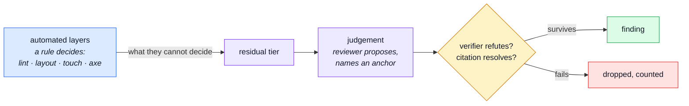

# Judging a Design

A test answers a question a program can decide: is this value in range, did this pixel move. A
design review asks one it cannot: _is this right?_ This page is why that question needs its own
method, and what stands in for the oracle. The tool built on it is [Design Review](../tools/design-review.md).

## A verdict with no oracle

Every other check in this repo has something to compare against: a snapshot, a contract, a rule.
"The primary action should be more prominent than the cancel" has none. A model asked for design
opinions produces plenty, confidently, and most are taste. So the review does not trust the model's
opinion. It trusts what survives three tests, and drops the rest.

## The residual tier

Judgement covers only what the automated layers cannot decide. If a rule can decide it, the rule
decides it, and the review never reports it. [Testing & Docs](../tools/testing-and-docs.md) is the
overview of those layers; the review's first step reads them, so its exclusion list is the layers'
own documentation and not a copy that can go stale.

## The three anchors

A finding is a defect, not taste, when it names one of:

1. **A precedent**: the app does the same thing differently elsewhere. The other screen is the
   evidence.
2. **A named rule**: Material 3 guidance, a WCAG criterion no automated check tests, Apple HIG or
   Android touch guidance, an NN/g heuristic.
3. **A task that fails**: who cannot do what ("a buyer cannot tell these two orders apart").

"I would have used outlined here" has none, and is dropped, not parked.

## What keeps it honest

- **The findings file is frozen** before the verifier reads it. A wrong row is never edited; the
  verifier's row says it was wrong.
- **The verifier sees the claim, not the reasoning.** It asks four things: is the defect visible at
  the described place, does the cited line render that element, is it already gated elsewhere, does
  the anchor hold. Any "no" refutes the row.
- **A script checks every citation.** A tile must be in the manifest, a `file:line` must exist. A
  line number is the citation most likely to be invented and the cheapest to check.
- **The denominator is reported**: "N proposed, M refuted, K confirmed". A run that refutes nothing
  is itself suspicious.
- **A planted defect** proves the review can find one at all. A review that cannot find a seeded
  mistake proves nothing.

## The principles the checklist leans on

- **Visual hierarchy**: the eye reads size, weight and contrast first. One filled action per region
  says "this is the one"; two say nothing.
- **Gestalt proximity**: things close together read as one group. Spacing that groups unrelated
  things wrongly misleads before a word is read.
- **The thumb zone** (Hoober): on a phone held in one hand, the lower middle of the screen is
  easy to reach and the top corners are not. A main action only at the top of a long page is a
  reach.
- **Content priority when columns stack**: a desktop's second column becomes a phone's second
  screen. The task's content has to come first.
- **Consistency** (Nielsen's fourth heuristic): the same meaning looks the same everywhere. "Paid"
  in two colours teaches the user nothing.
- **Density and line length**: about 45–80 characters a line reads best; a full-width paragraph
  does not, and a phone row with five data points does not either.
- **Dark-theme parity** (WCAG 1.4.11): non-text contrast, borders and icons included, must hold in
  both themes. axe tests text contrast only.

## The severity rubric

| Severity | Means                                                        | Why it is drawn there                                             |
| -------- | ------------------------------------------------------------ | ----------------------------------------------------------------- |
| S1       | A user on that device cannot finish, or does the wrong thing | The design is broken for them, not merely unpolished              |
| S2       | The task finishes with hunting, doubt or an extra step       | The design costs something every time, which is what a fix is for |
| S3       | Nobody fails, but it reads as unfinished                     | Worth fixing in passing; never worth a lane of its own            |

## What a static screenshot cannot judge

Motion, a real phone's chrome and keyboard, hover and pressed states, scroll areas inside the page,
data the seed does not hold, and differences under about 4 px. Those are NEEDS-DEVICE-CHECK, not
silence. The full list is on [Design Review](../tools/design-review.md#limits-what-a-static-screenshot-cannot-judge).

## Related pages

- [Design Review](../tools/design-review.md) — the tool
- [Design system](./design-system.md) — the tokens and the phone strategy the checklist is judged against
- [AI Auditing](../tools/ai-auditing.md) — the one rule every audit prompt shares
