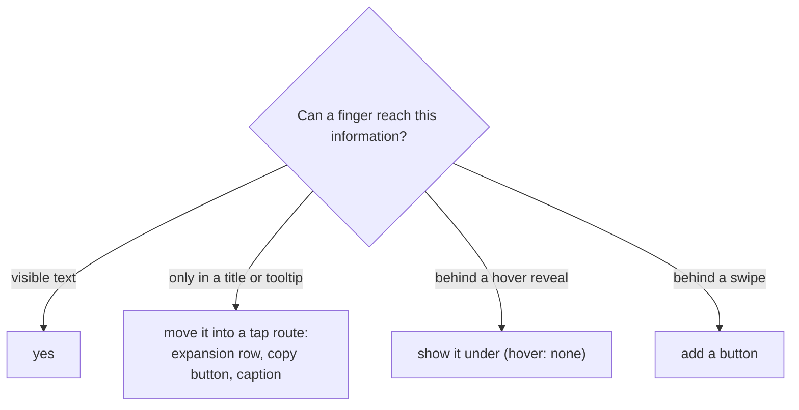

# Design system

How this app decides what its interface may assume. Each section is owned by the lane that built the
thing it describes.

## Pointer vs touch

A phone is not a narrow desktop. What a user can do depends on the **input**, not the window width.

- **Input modality is not width.** `hover`, `any-hover`, `pointer` and `any-pointer` (Media Queries
  Level 4) describe the device. A touch laptop is wide and coarse; a tablet with a mouse is both.
  `mobile` (width) and `coarse` (pointer) are separate inputs, and `useTouchFriendlySize` combines
  them: a row action is big when either is true.
- **Compatibility mouse events and sticky hover.** A tap emits `mouseover`, `mouseenter` and `click`
  (Touch Events, Pointer Events), so a hover state set by a tap sticks until a tap lands elsewhere.
- **A tooltip is a pointer affordance.** Material 3 and WCAG 1.4.13 (content on hover or focus is
  dismissible, hoverable, persistent) describe it. On touch the label lives in the accessible name and
  the icon. Our nav tooltips open on hover only where the device can hover (`useFocusTooltip`), and on
  keyboard focus everywhere.
- **`title=` never carries information alone.** The HTML standard warns that `title` is not exposed to
  touch or keyboard users. Truncated data needs a tap route: an expansion row, a copy button, a caption.
- **Gestures are an enhancement, never the only route**, and never inside an input. WCAG 2.5.1 (pointer
  gestures) and 2.5.7 (dragging). The trap to avoid: a swipe that starts in a text field switching a
  panel (`v-window` does, `v-tabs-window` does not).
- **Target size** is the layout lane's: WCAG 2.5.8 gates at 24 px, and the 44 px comfort tier applies at
  phone widths.

How the e2e suites emulate a finger and scan for the above: [Touch testing](../tools/touch-testing.md).
