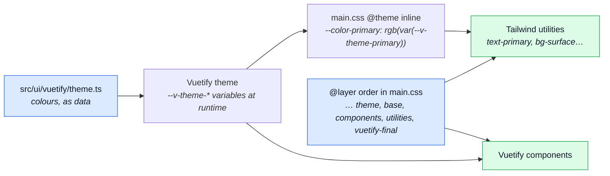

# Design System

How the styling is split between two libraries, and the rules that keep the split from drifting.
The tool that enforces it is [Design Lint](../tools/design-lint.md); this page is the _why_.

## Two libraries, one design

Vuetify draws the components. Tailwind lays them out. Both can emit a class with the same name, so
the order they load in decides which one wins.



- **Colours are Vuetify's.** The palette lives in `src/ui/vuetify/theme.ts`. Tailwind's own palette
  and font families are wiped in `main.css`, and each colour it offers is an alias of a Vuetify
  runtime variable. `text-primary` and `<v-btn color="primary">` cannot drift apart, and both follow
  a light/dark switch.
- **The cascade is fixed once.** The `@layer` statement at the top of `main.css` puts Tailwind's
  `utilities` after Vuetify's component styles. When both libraries generate the same class name
  (`rounded-lg` is the live example), the later layer wins.
- **Tailwind's class scan is not scoped yet.** It reads every tracked file, `docs/` included, so a
  page that merely writes a class name can add that class to the app's CSS. The scan is narrowed to
  `src/` in the next stage of this work.

## Who owns which token

One owner per kind of token, so nobody has to ask which library to use.

| Token                                  | Owner    | Where it lives                                   |
| -------------------------------------- | -------- | ------------------------------------------------ |
| Colour                                 | Vuetify  | `src/ui/vuetify/theme.ts`                        |
| Font family                            | Vuetify  | The Vuetify theme                                |
| Component defaults (rounded, variant…) | Vuetify  | `defaults` in `src/ui/vuetify/index.ts`          |
| Spacing, type size, weight, leading    | Tailwind | The default scale                                |
| z-index names, layout tokens           | Tailwind | `@theme` in `src/styles/main.css`                |
| Breakpoints                            | Both     | `@theme` `--breakpoint-*` and the display config |

A custom value added to `@theme` is a token at once: it becomes a valid class, and the lint
accepts it. There is no second list to keep.

## The reasoned escape hatch

A one-off that no token covers takes an inline disable, and the disable has to say why:

```vue
<!-- eslint-disable-next-line vue/no-v-html -- the string is sanitised in the store -->
```

It cannot rot:

- An **unused** disable is an error (`reportUnusedDisableDirectives`), in scripts and in templates.
- A disable with **no reason** is an error: `@eslint-community/eslint-comments/require-description`
  for scripts, `local/template-directive-description` for `<!-- eslint-disable… -->`.

Known gap: a disable covers the whole line for that rule, not one class on it.

## Colours are names, not literals

A hex, an `rgb(…)` with no `var(`, or a CSS colour name in a string or a style is a finding
(`local/theme-token`). The only home for a literal is `src/ui/vuetify/theme.ts`. A Vuetify colour
prop (`color`, `bg-color`…) takes a theme name; so does a status map in a script, which is typed
`Record<Status, ThemeColor>` so `vue-tsc` refuses a typo or a palette name Vuetify does not have.

The boot surfaces use the same colours. The splash is painted before any JavaScript runs, so
`index.html` repeats the theme's `background` and `on-background` as literals, and a spec holds them
to the theme's values. The address bar follows the theme through `useThemeColorMeta`.

## Layout at phone widths

_The viewport matrix and the layout invariants are written here by the layout sweep._

## Touch and hover at runtime

_Pointer versus touch is written here by the touch emulation work._
