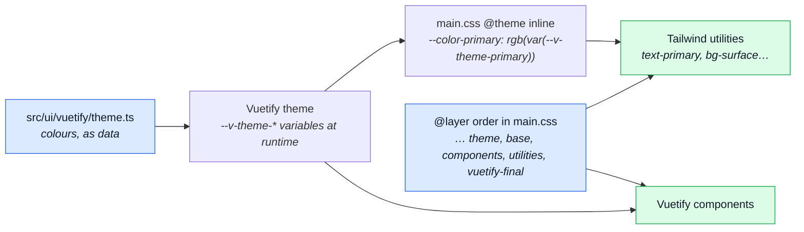
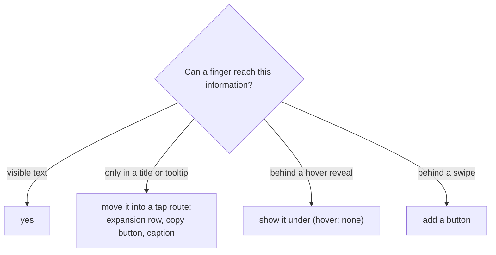

# Design System

How the styling is split between two libraries, and the rules that keep the split from drifting.
The tool that enforces it is [Design Lint](../tools/design-lint.md); this page is the _why_.

## Two libraries, one design

Vuetify draws the components. Tailwind lays them out. Both can emit a class with the same name, so
the order they load in decides which one wins.



- **Colours are Vuetify's.** The palette lives in `src/ui/vuetify/theme.ts`. Tailwind's own palette
  and font families are wiped in `main.css`, and each colour it offers is an alias of a Vuetify
  runtime variable. `text-primary` and `<v-btn color="primary">` cannot drift apart, and both follow
  a light/dark switch.
- **The cascade is fixed once.** The `@layer` statement at the top of `main.css` puts Tailwind's
  `utilities` after Vuetify's component styles. When both libraries generate the same class name
  (`rounded-xl` was the live example), the later layer wins, so the two must agree on what a name
  means: see [Names that mean two things](#names-that-mean-two-things).
- **Tailwind reads `src/` only.** See [What Tailwind reads](#what-tailwind-reads).

## Who owns which token

One owner per kind of token, so nobody has to ask which library to use.

| Token                                  | Owner    | Where it lives                                    |
| -------------------------------------- | -------- | ------------------------------------------------- |
| Colour                                 | Vuetify  | `src/ui/vuetify/theme.ts`                         |
| Font family                            | Vuetify  | The Vuetify theme                                 |
| Radius names (`sm` `md` `lg` `xl`)     | Vuetify  | `--radius-*` in `@theme`, set to Vuetify's values |
| Elevation (shadows)                    | Vuetify  | `elevation-N`; Tailwind's shadow scales are wiped |
| Component defaults (rounded, variant…) | Vuetify  | `defaults` in `src/ui/vuetify/index.ts`           |
| Spacing, type size, weight, leading    | Tailwind | The default scale                                 |
| z-index names, layout tokens           | Tailwind | `@theme` in `src/styles/main.css`                 |
| Breakpoints                            | Both     | `@theme` `--breakpoint-*` and the display config  |

Ownership is enforced by **wiping the Tailwind namespace** (`--color-*`, `--font-*`, `--radius-*`,
`--shadow-*`, `--inset-shadow-*`, `--drop-shadow-*`, `--text-shadow-*`), the way colours and fonts
already were. A class from a wiped namespace is unknown to Tailwind, so `no-unknown-classes` says so
with no extra rule.

A custom value added to `@theme` is a token at once: it becomes a valid class, and the lint
accepts it. There is no second list to keep.

## The radius scale

Cards are 24 px, Vuetify's own `xl`, and Tailwind's radius names carry Vuetify's values, so a name
both libraries generate is one thing.

| Name  | Size  | Used by                            |
| ----- | ----- | ---------------------------------- |
| `sm`  | 2 px  | Vuetify                            |
| `md`  | 4 px  | Vuetify; the default for images    |
| `lg`  | 8 px  | `VBtn`, `VAlert` defaults          |
| `xl`  | 24 px | `VCard` default                    |
| `2xl` | 16 px | Tailwind only (nothing in between) |

`rounded-full` and `rounded-none` are static utilities and unchanged. A bare `rounded` (Tailwind v3)
is refused: write `rounded-md`.

## Adding a custom Tailwind token

1. Add the variable to `@theme` in `src/styles/main.css`, in the namespace the utility reads:
   `--container-*` (widths), `--z-index-*`, `--tracking-*`, `--grid-template-columns-*`. A colour that
   follows the theme goes in `@theme inline` as an alias of a `--v-theme-*` variable.
2. Run `npm run lint:fix`. The canonicaliser rewrites every arbitrary value equal to the new token
   into the token.
3. The class is valid, and nothing else needs registering.

Worked example: `--container-toast: min(420px, calc(100vw - 2rem))` made `w-[min(420px,calc(100vw-2rem))]`
into `w-toast` in two files.

## What Tailwind reads

`main.css` imports the utilities with `source(none)` and names one folder: `@source '../'`, which is
`src/`. Without it Tailwind scans every tracked file, so a doc, a wiki page or a plan that merely
writes a class name could change the app's CSS (the root of the card-radius bug below). The index
page uses no Tailwind class, and `node_modules` was never scanned.

## Names that mean two things

Vuetify and Tailwind generate 411 class names between them that overlap. After the radius scale
was aligned, a small set still means something different in each. `tests/cross-cutting/utility-collisions.spec.ts`
measures the set from the real stylesheets, and `ambiguousUtilities` in `scripts/design-policy.ts`
holds it to a list.

| Name                        | Vuetify               | Tailwind                           | Write instead              |
| --------------------------- | --------------------- | ---------------------------------- | -------------------------- |
| `w-25` … `w-100`, `h-25` …  | a percentage          | a fixed length (`w-100` is 400 px) | `w-1/4`, `w-1/2`, `w-full` |
| `h-screen`                  | `100dvh`              | `100vh`                            | `h-dvh`                    |
| `order-first`, `order-last` | `-1`, `13`            | `-9999`, `9999`                    | an explicit `order-N`      |
| `align-baseline`            | `align-items`         | `vertical-align`                   | `items-baseline`           |
| `text-wrap`                 | `white-space: normal` | `text-wrap: wrap`                  | `whitespace-normal`        |

A new collision, or a listed one that stops colliding, fails the spec by name.

## The reasoned escape hatch

## The reasoned escape hatch

A one-off that no token covers takes an inline disable, and the disable has to say why:

```vue
<!-- eslint-disable-next-line better-tailwindcss/no-restricted-classes -- the honeypot must sit off-screen yet stay filled by bots -->
<div class="absolute left-[-9999px]" aria-hidden="true">
```

In a script the same disable goes above the line as `// eslint-disable-next-line … -- why`. Hoist a
class string that spans several lines into a top-level `*_CLASSES` constant so the disable covers
one line exactly.

It cannot rot:

- An **unused** disable is an error (`reportUnusedDisableDirectives`), in scripts and in templates.
- A second use of the same arbitrary class is an error (`arbitraryRepeatLimit`, checked by
  `tests/cross-cutting/design-arbitrary-values.spec.ts`): a repeated value is a token.
- A disable with **no reason** is an error: `@eslint-community/eslint-comments/require-description`
  for scripts, `local/template-directive-description` for `<!-- eslint-disable… -->`.

Known gap: a disable covers the whole line for that rule, not one class on it.

## Colours are names, not literals

A hex, an `rgb(…)` with no `var(`, or a CSS colour name in a string or a style is a finding
(`local/theme-token`). The only home for a literal is `src/ui/vuetify/theme.ts`. A Vuetify colour
prop (`color`, `bg-color`…) takes a theme name; so does a status map in a script, which is typed
`Record<Status, ThemeColor>` so `vue-tsc` refuses a typo or a palette name Vuetify does not have.

The boot surfaces use the same colours. The splash is painted before any JavaScript runs, so
`index.html` repeats the theme's `background` and `on-background` as literals, and a spec holds them
to the theme's values. The address bar follows the theme through `useThemeColorMeta`.

## Hover is not a cue on touch

Tailwind v4 wraps `hover:` in `@media (hover: hover)`, so on a phone a hover-only underline, reveal
or colour shift never happens. A link that is underlined only on hover is a plain word on touch.

- Give the **resting** state the cue (`underline`); keep `hover:` for a refinement on top of it.
- `hover:underline`, `hover:opacity-*` and the reveal utilities (`hover:block`, `hover:visible`…)
  are refused as classes; `local/no-hover-only` refuses the handler forms (hover with no click,
  `open-on-hover` without `open-on-click`, gesture-only handlers, a native `title` on clipped text).

## Phone strategy

A dialog binds `:fullscreen="fullscreen"` from `useFullscreenDialog()`, so it fills a phone
instead of floating in it. A Vuetify data table is rendered through the `DataTable` wrapper, which
owns `mobile-breakpoint`, and a `v-table` carries a **named** `v-focusable-scroll`, so its sideways
scroll region is reachable by keyboard. `local/mobile-strategy` enforces all three.

## Layout at phone widths

_The viewport matrix and the layout invariants are written here by the layout sweep._

## Pointer vs touch

A phone is not a narrow desktop. What a user can do depends on the **input**, not the window width.

- **Input modality is not width.** `hover`, `any-hover`, `pointer` and `any-pointer` (Media Queries
  Level 4) describe the device. A touch laptop is wide and coarse; a tablet with a mouse is both.
  `mobile` (width) and `coarse` (pointer) are separate inputs, and `useTouchFriendlySize` combines
  them: a row action is big when either is true.
- **Compatibility mouse events and sticky hover.** A tap emits `mouseover`, `mouseenter` and `click`
  (Touch Events, Pointer Events), so a hover state set by a tap sticks until a tap lands elsewhere.
- **A tooltip is a pointer affordance.** Material 3 and WCAG 1.4.13 (content on hover or focus is
  dismissible, hoverable, persistent) describe it. On touch the label lives in the accessible name and
  the icon. Our nav tooltips open on hover only where the device can hover (`useFocusTooltip`), and on
  keyboard focus everywhere.
- **`title=` never carries information alone.** The HTML standard warns that `title` is not exposed to
  touch or keyboard users. Truncated data needs a tap route: an expansion row, a copy button, a caption.
- **Gestures are an enhancement, never the only route**, and never inside an input. WCAG 2.5.1 (pointer
  gestures) and 2.5.7 (dragging). The trap to avoid: a swipe that starts in a text field switching a
  panel (`v-window` does, `v-tabs-window` does not).
- **Target size** is the layout lane's: WCAG 2.5.8 gates at 24 px, and the 44 px comfort tier applies at
  phone widths.



How the e2e suites emulate a finger and scan for the above: [Touch testing](../tools/touch-testing.md).
