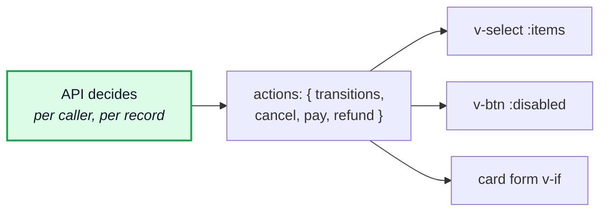

# Strategic DDD

**The part of Domain-Driven Design that survives on a client** — bounded contexts, context mapping,
ubiquitous language and subdomain distillation. All four are in the code — as folders, imports,
identifiers and docblocks, which is where a reader actually meets them rather than in a manifest
field asserted by a spec.

The other half — entities, value objects, aggregates, repositories — is **not** here, and on a
frontend that is more emphatic than a preference. [Domain layer](./domain-layer.md) explains why:
prices, totals, eligibility and permissions are decided server-side, and a client that
re-implements them has two implementations of one rule.

::: tip This page mirrors the backend's
`boilerplate-node-backend/docs/theory/strategic-ddd.md` states the same four ideas for
the API. Read them together — the interesting parts are where the two **disagree**, and each of
those disagreements is a fact about where the domain actually lives. The client-capability half of
§4 below is the backend's `docs/theory/tactical-ddd.md` §2.
:::

---

## The problem this solves

Every architecture document says things like "the cart owns checkout" and "admin depends on
nothing". Those sentences are true when written and unverifiable forever after. Six months later the
document says one thing, the imports say another, and the document is the one that loses — quietly,
because nothing fails.

This client had exactly that, twice:

- `cart` declared `dependsOn: ['orders']` long after checkout moved into the cart store and the
  import disappeared.
- `orders` published `useOrdersStore` "for the cart's checkout" — same vanished import, and the
  export outlived its reason by a whole refactor.

Both were found the day a typed `dependsOn` field and a spec reconciling it against real imports
went in — and both are still findable, because what caught them was never the typed field. It was
comparing a declared edge to a real import. That comparison now happens where a change actually
shows up: `eslint.config.ts`'s generated coupling rule, checked on every `npm run lint`. See §2.

---

## 1. Bounded context — the folder

One module is one context. `rm -rf src/modules/wishlist` plus one line in `src/modules.ts` deletes
the domain, and anything that breaks is real coupling worth seeing. Covered in
[Modules](./modules.md).

## 2. Context map — how a module reaches its siblings

A module's imports are its dependency list. What they do not say is what KIND of reach each one is,
and the kinds differ enormously in what they cost when the upstream moves:

| Kind                 | What it means                                                        | Cost when the upstream changes                  | Example                   |
| -------------------- | -------------------------------------------------------------------- | ----------------------------------------------- | ------------------------- |
| `conformist`         | reads another module's store as it is, no translation, no say        | **high** — its shape is your shape too          | `stock-alerts → products` |
| `customer-supplier`  | calls a sibling's store to make something happen                     | medium — the call survives, the payload may not | `wishlist → cart`         |
| `published-language` | receives vocabulary, not state: a schema, a self-contained component | **low** — neither side learns the other's store | `orders → payments`       |

### Where the map lives

On each module's docs page, under "The map": a Mermaid diagram plus one bullet per edge. That is the
only place a kind is written. [Modules](../modules/index.md#the-whole-map) draws the overview, and
`tests/cross-cutting/module-map.spec.ts` holds the overview and the pages to each other. A
`module.ts` docblock points at its page and states no kind. `cart` reaches four siblings, and its
page says how it depends on each: three `published-language` vocabularies (`delivery`, `payments`,
`account`) and one `customer-supplier` call (`products`, whose cached catalogue it drops after each
cart write). `published-language` is the cheapest relationship in the table and the one to copy:
`delivery` publishes a component and no storage at all.

### Why there is no dependency field on the manifest

A typed `dependsOn: { module, as, because }[]` on the manifest, checked by a spec against real
imports, looks like the natural home. It is not, and the reasoning applies to any labelled-graph
field someone is tempted to add:

- **Nothing would read it at runtime.** Not the router, not a store, not a guard. It would be
  documentation with a type annotation.
- **It would be self-reported.** Because it is not derived from real imports, it could only prove a
  developer's annotations agree with each other — the actual proof still needs a spec scanning every
  `.ts` and `.vue` file for `@/modules/` strings.
- **The enforcement that matters is structural.** `eslint.config.ts` generates one
  `eslint-plugin-boundaries` policy per module from a hand-maintained `MODULE_EDGES` map: a module
  may reach only the siblings that map names for it — and only through their `index.ts` barrel,
  never an internal file — checked at the resolved import on every `npm run lint`, dynamic
  `import()` included. A new coupling fails immediately, at the line that adds it, rather than on a
  separate spec run.

### The one worth still noticing

The backend has a fourth kind, `shared-kernel`, and exactly one edge that is one: `account → users`,
because both modules write the same User record. Here the same pair is `published-language` —
`account` and `users` share `usersSchema`/`usersPasswordSchema`, field rules rather than a store,
because neither module writes anything; the API does. That divergence is what
[Domain layer](./domain-layer.md) means by the domain living behind the API, and it is worth reading
`account/module.ts`'s docblock for, even though nothing checks it holds.

## 3. Ubiquitous language — per context, not per app

**The language lives in the identifiers.** That is Evans' actual requirement: the model and the
language co-evolve, and the code is the primary expression of both.

What an identifier cannot carry is the meaning behind it, and that lives in
**[Glossary](./glossary.md)** — one section per module. On a client it is worth more than it first
looks, because this repo's word is frequently not the server's: a `Cart` here is _a view of the
server's cart, not a second copy of it_, while the backend's `Cart` is _one open basket per user,
priced against the live catalogue_. Both are right in their own context, and a single shared
glossary would have to pick one and be wrong in the other place.

Writing the client's definition down is also the cheapest guard there is against someone deciding
the store should compute a total.

::: tip Why the language is not a manifest field
A `language: {}` map in `module.ts` would be read by nothing, checked by nothing, and sit away from
the store or component each entry describes. The glossary sits beside the meaning instead.
:::

## 4. Subdomain distillation — where to spend effort

DDD's own advice is the part most often skipped: tactical patterns belong in the **core** domain,
and everything else should use the simplest thing that works.

| Subdomain    | Meaning                                                         | Here                                                                                                 |
| ------------ | --------------------------------------------------------------- | ---------------------------------------------------------------------------------------------------- |
| `core`       | the reason the product exists — worth client-side rules         | `products`, `cart`, `orders`                                                                         |
| `supporting` | specific to this business, not a differentiator — keep it plain | `delivery`, `inventory`, `notifications`, `payments`, `returns`, `stats`, `stock-alerts`, `wishlist` |
| `generic`    | a solved problem, interchangeable with something bought         | `account`, `api-keys`, `feedback`, `locales`, `observability`, `users`, `webhooks`                   |

`example` is not classified: it is the template a new domain is copied from, and it carries a
`domain/` so the copy has one to keep or delete.

The same split is drawn as a map in [Modules](../modules/index.md#the-whole-map).

The rule of thumb that follows: **a `generic` module should not carry a `domain/` folder.** A
pure-rules layer inside authentication or i18n is effort spent on the part of the client that should
stay replaceable.

There is no `subdomain` field on the manifest, and no spec holding it. Nothing would read it at runtime, and the one check it enables — refusing `domain/` inside a `generic` module — would be a test acting on a label nothing else consults. The table above is guidance for a reader deciding where a rule goes; no test proves it, the same as `core`.

There is deliberately **no** rule, enforced or otherwise, that `core` must have a `domain/`. `cart`
has one because quantity clamping is a genuine client-side rule. `products` and `orders` have one
too, and what is in it is the point: reading answers, never making them. `shelfStateOf` ranks the
flags the API already sent into one badge; `timeline.ts` words an event the server recorded;
`reorder.ts` diffs the cart the server returned. Prices and status transitions stay the server's to
decide — a second implementation here would be drift, not thoroughness.

::: tip These values are this project's, not a rule for the next one
A boilerplate has no core domain. The table above is this shop's answer, and the first thing a real
project built from this one should do is re-decide it for its own business.
:::

::: warning A `core` label here marks screens, not logic
This application owns almost none of the domain it displays. `orders` is core because the order
history and the admin status screens are load-bearing, not because an invariant lives here. Nothing
in this table is an argument for building an aggregate.
:::

### How a client asks instead of deciding

"The server's to decide" is easy to write and easy to quietly break. The pressure is real: a screen
has to know whether to show a cancel button, which statuses to offer, whether to render a card form
— and the shortest path to each answer is a comparison written here.

Three shapes are tempting: a status dropdown listing every value of the enum, a cancel button
testing for `pending` or `paid`, a pay form testing for `pending`. Each agrees with the API on the
day it is written, and nothing tells you when it stops. The answer is not a better comparison — it
is no comparison. Every read of an order or a payment carries an `actions` block the server computed
for that caller:

A control is enabled when the server says so and disabled otherwise.
An operation's description that states the rule in prose does not count: the client would still hold a copy.
When the flag a control needs is missing, the fix is a flag on the backend's `*Actions`, not a mirror here.

The rules can change on the
API — a new status, a different role boundary, a cancel window that closes earlier — and this
application follows without being edited, because it never held an opinion to update.

The test for whether a new screen is doing this right: **if you can delete the API and still say
what the button would do, the rule is in the wrong repository.**

A permission alone (`session.can`) may gate a control (see Security); a state rule may not.

## 5. Published language — the barrel, held to a size

**A module publishes exactly what a sibling imports. No sibling, no barrel.**

So `orders` and `wishlist` publish no barrel: no sibling imports them, and `wishlist`'s heart reaches
the product page through a slot contribution, not an import.

What remains says something specific about a client. The modules that publish **state access** are
the ones siblings read or ask to change state: `cart` publishes its store (asked to refetch by
`wishlist`, to refill by `orders`), and `products` publishes narrow handles on its store — read by
`cart`, `wishlist`, `inventory` and `stock-alerts` through `useProductLines` and `shelfStateOf`, and
asked to drop its cached catalogue by `cart` and `inventory` through `invalidateProductsCache`. The
ones that publish a **component** or a **schema** are answering a narrower question, and are the
better shape — `PaymentPanel` renders a payment without its caller learning what a provider is.
`delivery` publishes four components and one read-only composable (`usePreorderSummaries`, for
`inventory`'s preorder board) and deliberately not its store, because offering both would mean
offering a wider way to do the same thing, and the wider one always wins.

### Why the backend's rule is the opposite

The paired backend requires a convenience barrel from **every** module, and this repo forbids the
ones nobody imports. Both are right for their own tier. A backend module's barrel is a stable,
documented surface for an AI or a newcomer to extend without copying logic; deleting a module there
is an infrastructure decision. Here, deleting a module is `rm -rf` plus one line, so a barrel with no
importer is dead weight that also promises a sibling something it cannot keep — and
`tests/cross-cutting/published-language.spec.ts` fails on it. The client's other way to let one
module serve another without a barrel is the slot (`src/kernel/slots.ts`): the contributor's manifest
puts a component where the owner asked for one, and the owner imports nothing.

---

## What this does not give you

Everything above is about **boundaries and vocabulary**. None of it makes an invalid order
unconstructable or turns `status: string` into a closed set — and on this side of the API, none of it
should. See [Domain layer](./domain-layer.md) §5 for when a client genuinely does own rules
(offline-first, a complex editor, a client-side pricing engine), and what changes if it does.
