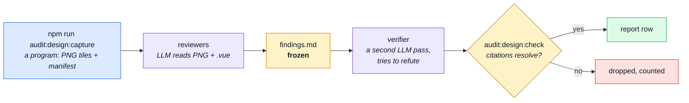

# AI Auditing

Every other instrument in this repo compares the system **to itself**: component to snapshot, mutant
to suite, response to generated schema. That is what makes them deterministic, and it is also their
ceiling. Stryker cannot read `docs/theory/domain-layer.md`. axe cannot read a task. orval cannot
notice that the docs promise a rule the contract never encodes.

**Prose ↔ code is the gap**, and it is the one place a language model beats a program rather than
approximating one. This repo has many files under `docs/` stating rules no schema enforces.

`scripts/audit/` holds the prompts that live in exactly that gap, among them `test-honesty`, which asks
whether a test can fail at all. They are plain markdown, run by hand against an LLM, and they write
reports — never code. The rules every audit shares (read-only, where the report goes, what the scope
names mean, the tripwire) live in
[`scripts/audit/RULES.md`](https://github.com/Guebbit/boilerplate-vue-frontend/blob/main/scripts/audit/RULES.md), which each prompt reads first.

## The one rule

Owned by the backend, and the same here: [The one rule](https://github.com/Guebbit/boilerplate-node-backend/blob/main/docs/tools/ai-auditing.md). This repo's differences, if any, are in the sections below.

## The prompts

| File                                          | Asks                                                                                                                                                                                                                                                                                                   | Writes to                                   |
| --------------------------------------------- | ------------------------------------------------------------------------------------------------------------------------------------------------------------------------------------------------------------------------------------------------------------------------------------------------------ | ------------------------------------------- |
| `scripts/audit/spec-drift/SKILL.md`           | Which tests assert what the **code** does rather than what the **spec** says?                                                                                                                                                                                                                          | `reports/audit-<run>/spec-drift/`           |
| `scripts/audit/spec-gaps/SKILL.md`            | Which business rules and security boundaries have **zero** coverage?                                                                                                                                                                                                                                   | `reports/audit-<run>/spec-gaps/`            |
| `scripts/audit/suite-bloat/SKILL.md`          | Which tests cost CI time and discriminate nothing?                                                                                                                                                                                                                                                     | `reports/audit-<run>/suite-bloat/`          |
| `scripts/audit/test-honesty/SKILL.md`         | Which tests stay green when the behaviour they claim to check is broken? See [below](#test-honesty-a-test-is-innocent-once-it-has-failed).                                                                                                                                                             | `reports/audit-<run>/test-honesty/`         |
| `scripts/audit/accessibility-manual/SKILL.md` | Which accessibility defects live in the ~60–70% axe/eslint/keyboard.cy.ts structurally can't reach — see [Accessibility Testing](./accessibility-testing.md)?                                                                                                                                          | `reports/audit-<run>/accessibility-manual/` |
| `scripts/audit/design-manual/SKILL.md`        | Which design defects do the screenshots show that no automated check can? See [Design Review](./design-review.md).                                                                                                                                                                                     | `reports/audit/design-manual/`              |
| `scripts/audit/css-invasive/SKILL.md`         | Which CSS answers a question Vuetify or Tailwind already answer, beyond the hits `npm run audit:css` gates? See [Design Lint](./design-lint.md#the-invasive-css-scan).                                                                                                                                 | `reports/audit-<run>/css-invasive/`         |
| `scripts/audit/unused-locale-keys/SKILL.md`   | Which locale keys does nothing in the app read? A report-only scan (`npm run audit:locale-keys`), then a judgement on each candidate.                                                                                                                                                                  |
| `scripts/audit/ddd-drift/SKILL.md`            | Where do the strategic-DDD claims (module labels, barrels, who decides a rule) and the code disagree, beyond what the module lint and the specs see? Mirrors `../boilerplate-node-backend/scripts/audit/ddd-drift/SKILL.md`; F2 (FE) and C1 (BE) are one rule seen from each side.                     | `reports/audit-<run>/ddd-drift/`            |
| `scripts/audit/code-shape/SKILL.md`           | Which code does not earn its place: shallow functions, pass-throughs, lazy files, speculative generality, large classes, repeated switches, dead code (`knip`) and copy-paste (`jscpd`)? Counters run first (`npm run audit:shallow`, `audit:unused`, `audit:duplicates`); `.vue` callers are counted. | `reports/audit-<run>/code-shape/`           |

The first four take one argument — a module (`orders`), a path, or `--diff` for whatever the
working tree touched. `accessibility-manual` takes the same shape but defaults an empty scope to
the **whole repo**, not the touched modules — an accessibility gap in an untouched component is
still a gap. `design-manual` does the same and adds `shell` (the app-level sweep) as a scope; a
whole-app run starts with a ~45 minute capture, so it prints the command and waits for a person.
`css-invasive` takes the same scopes, defaults to the whole app, and reads source only: it starts
from `npm run audit:css -- --json` and judges what the scanner cannot.

### Each repo keeps the prompts its own stack needs

The two repos do **not** hold one set, and no longer try to. `accessibility-manual`,
`design-manual` and `css-invasive` audit UI/UX judgement calls with no backend equivalent; the backend's own
`boilerplate-node-backend/scripts/audit/reachability/SKILL.md` and
`boilerplate-node-backend/scripts/audit/rate-limit-keys/SKILL.md` reason about a mounted Express request
path and have no counterpart here.

`code-shape` is a port of the backend's, made Vue-aware (its shallow counter reads each SFC's script) with two extra shapes. Only `spec-drift`, `spec-gaps`, `suite-bloat` and `test-honesty` exist on both sides, because what
they ask — does the test agree with the spec, is anything uncovered, is anything redundant, can the
test fail at all — is about specs and suites rather than about a runtime.

Nothing keeps even those four in step, and nothing should try. None is in `SHARED_FILES`, whose
rule is that a shared file must be owned by one side and regenerated. Improve one where you find
it; carry the improvement across when it applies, and expect the two to drift in between. Reading
an audit prompt as a spec for its sibling is the mistake to avoid — it is a prompt, and the copy in
the other repo has its own history.

**There is deliberately no compliance prompt here.** The registry
(`boilerplate-node-backend/scripts/audit/compliance-rules.yaml`) and both prompts that read it live
in the backend, once — `boilerplate-node-backend/scripts/audit/compliance-backend/SKILL.md` audits that
repo, and `boilerplate-node-backend/scripts/audit/compliance-frontend/SKILL.md` runs from there against
**this** checkout. So a rule spanning both repos, like the mandatory signup-consent checkbox, has
exactly one home and no second copy to drift from. To audit this repo's compliance half, run
`/audit-compliance-frontend` from the backend.
It reads this repo at `../boilerplate-vue-frontend` — the main checkout. A worktree branch is not
what it sees: check the branch out there, or merge it, before running it.

This page is per-repo in the same way. It names this repo's own tools, its own `docs/` count and
its own findings, so the backend's copy is _expected_ to differ and must not be reconciled.

### Naming the scope

Owned by the backend, and the same here: [Naming the scope](https://github.com/Guebbit/boilerplate-node-backend/blob/main/docs/tools/ai-auditing.md). This repo's differences, if any, are in the sections below.

### The tripwire

Owned by the backend, and the same here: [The tripwire](https://github.com/Guebbit/boilerplate-node-backend/blob/main/docs/tools/ai-auditing.md). This repo's differences, if any, are in the sections below.

### The reports are disposable

Owned by the backend, and the same here: [The reports are disposable](https://github.com/Guebbit/boilerplate-node-backend/blob/main/docs/tools/ai-auditing.md). This repo's differences, if any, are in the sections below.

## The two-pass method

Owned by the backend, and the same here: [The two-pass method](https://github.com/Guebbit/boilerplate-node-backend/blob/main/docs/tools/ai-auditing.md). This repo's differences, if any, are in the sections below.

## How to run one

Owned by the backend, and the same here: [How to run one](https://github.com/Guebbit/boilerplate-node-backend/blob/main/docs/tools/ai-auditing.md). This repo's differences, if any, are in the sections below.

## `test-honesty`: a test is innocent once it has failed

Owned by the backend, and the same here: [test-honesty: a test is innocent once it has failed](https://github.com/Guebbit/boilerplate-node-backend/blob/main/docs/tools/ai-auditing.md). This repo's differences, if any, are in the sections below.

## Reading the output

### `spec-drift`'s verdicts

The verdict table lives in `scripts/audit/spec-drift/SKILL.md` (`## Verdicts`): one home.
Only `MISMATCH-CODE` and `TAUTOLOGY` are findings; `SPEC-CONFLICT` says prose is the stale layer.

`TAUTOLOGY` is the quiet one. `expect(f(x)).toEqual(g(x))` where `g` is a sibling export, an
expectation recomputed with the very schema the view uses, or a clamp asserted against the module's
own `MIN_*` constant, is a test that cannot fail and therefore proves nothing. Stryker finds some of
these; the audit finds the rest.

### `design-manual`'s verdicts

The same four verbs, plus the verifier's own:

| Verdict                              | Means                                                                                         |
| ------------------------------------ | --------------------------------------------------------------------------------------------- |
| **ISSUE**                            | A design defect with an anchor: a precedent, a named rule, or a task that fails.              |
| **OK**                               | Checked and fine, with what was looked at.                                                    |
| **NOT-APPLICABLE**                   | The item does not apply to that screen, reason given.                                         |
| **NEEDS-DEVICE-CHECK**               | A static Chromium screenshot cannot settle it: safe areas, the soft keyboard, scroll physics. |
| **CONFIRMED / REFUTED / DOWNGRADED** | The verifier's answer to a proposed ISSUE: it held, it did not, or the severity was too high. |

### Two steps: capture, then judge

A model cannot open a browser, but it can read a PNG and a `.vue` file. So `design-manual` is two
steps with a program in the middle:

The capture, the matrix, the tile size and the checklist are on [Design Review](./design-review.md).

### `accessibility-manual`'s verdicts

A different four, since this one isn't comparing a spec to a test — it's judging whether a
residual, unautomatable WCAG concern actually holds:

| Verdict                       | Means                                                                                                            |
| ----------------------------- | ---------------------------------------------------------------------------------------------------------------- |
| **ISSUE**                     | A real defect in the residual tier, with the WCAG criterion cited.                                               |
| **OK**                        | Checked, meets the criterion — with what was checked stated.                                                     |
| **NOT-APPLICABLE**            | The criterion doesn't apply to this app/scope (e.g. no timed content exists at all), reason cited.               |
| **NEEDS-MANUAL-VERIFICATION** | Code reading genuinely cannot resolve it — most often whether a real screen reader announces something sensibly. |

`NEEDS-MANUAL-VERIFICATION` is this audit's own honest ceiling, the same way `SPEC-SILENT` is
`spec-drift`'s: a row that names exactly what a human with a screen reader should go check, rather
than a guess dressed up as a verdict.

The counter-case matters as much: a value generated **from** the contract — an orval enum, a
generated Zod schema — is an independent anchor, not a tautology. Check where a value is born before
calling it one.

### Read `SPEC-SILENT` as the headline, not as a pass

A row the audit could not grade is not a row that passed. Where the spec is silent, code and test
always agree — there is nothing to drift from — so those rows are precisely where drift hides.

The first frontend batch made this concrete: 396 rows over the HTTP layer, roughly 381 of them
`SPEC-SILENT`, because URL parsing, route-table matching, env config and refresh/retry policy are
frontend mechanics the OpenAPI contract never speaks to. "One defect in 396 rows" would be a
flattering misreading. Report the answerable denominator instead — and when it collapses like that,
the finding is that **the contract is the thin layer**, which is worth more than any single
mismatch.

## Does it work?

Four scopes ran on this side — the HTTP layer and response validation, the payments store, login-view
i18n, and the cart quantity domain — plus the frontend half of a cross-repo differential against
`boilerplate-node-backend`.

It produced fixes, not a report nobody read:

- `ResponseReject.errors` was typed and asserted as `string[]`; the contract's `ErrorResponse.errors`
  is an `ErrorItem[]` of `{code, message}` objects. Type and every fixture corrected.
- A payments decline test stubbed an undefined response and asserted only `rejects.toThrow()` — it
  passed identically for a 404, a 500, or a real decline. Now pinned to `409 PAYMENT_DECLINED`.
- A login i18n test computed its expected message with the same schema the view uses, so a wrong
  dictionary string would have kept both sides agreeing. Now anchored to the literal locale string.
- Quantity floor-clamp tests asserted against `MIN_LINE_QUANTITY`, a sibling export of the module
  under test, instead of the contract's literal `minimum: 1`.
- The login fixture mocked a shape the contract did not declare for the answer — the auth tests
  would have passed against a server violating the contract.

Run them before a refactor, after a contract change, or when a module's docs and tests have drifted
apart — not on a schedule.

---

## Footnote: the tools we evaluated, and why none were adopted

Owned by the backend, and the same here: [Footnote: the tools we evaluated, and why none were adopted](https://github.com/Guebbit/boilerplate-node-backend/blob/main/docs/tools/ai-auditing.md). This repo's differences, if any, are in the sections below.

## Related

- [Mutation Testing](./mutation-testing.md) — the deterministic instrument this one complements
- [Unit Testing](./unit-testing.md) — where a finding usually lands as a real assertion
- [Testing & Docs](./testing-and-docs.md) — every layer, and which question each answers
