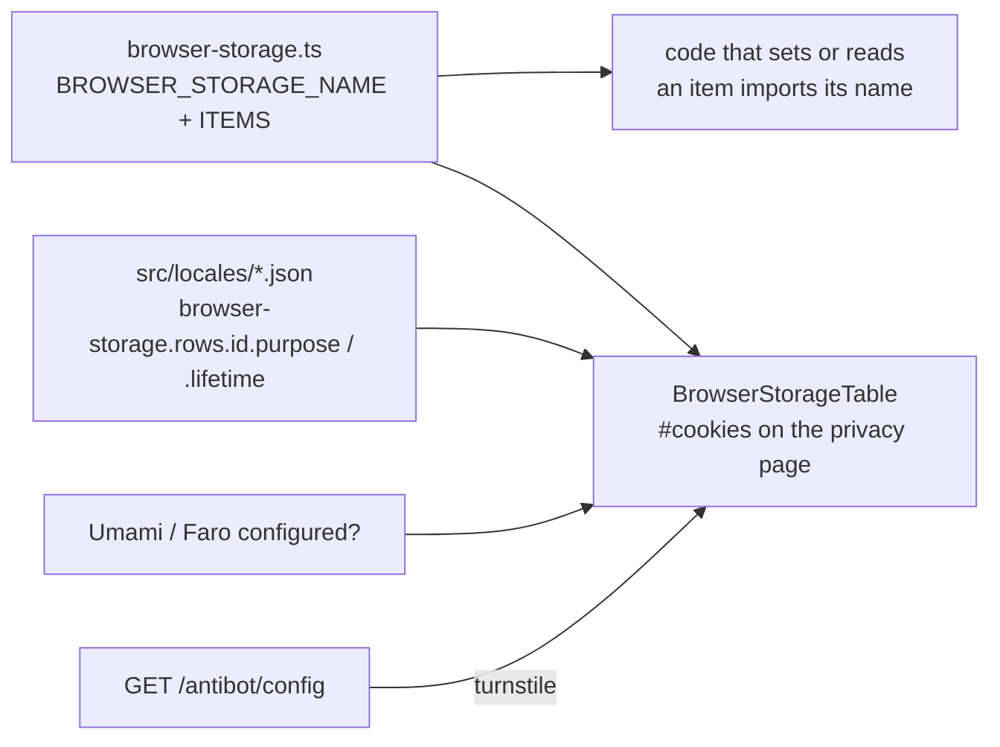

# Cookies and storage

Everything the app leaves in a visitor's browser is listed once, in
`src/infrastructure/browser-storage.ts`: twelve cookies and eight storage keys. The privacy page
(`#cookies`) renders that list as a table, and the code that sets each item takes its name from the
same list, so the page cannot drift from what the browser holds.

## How it fits together

## One row

| Field       | Meaning                                                                                      |
| ----------- | -------------------------------------------------------------------------------------------- |
| `id`        | Stable id: the key into `BROWSER_STORAGE_NAME` and into the translation rows                 |
| `kind`      | `cookie`, `localStorage` or `sessionStorage`                                                 |
| `setter`    | `backend` (sent as `Set-Cookie`), `frontend` (this app's code) or `library` (code it loads)  |
| `party`     | `first` for everything here; a vendor widget on the page is named under the table instead    |
| `necessity` | `necessary` (exempt, ePrivacy Art. 5(3)) or `consent` (exists only after the visitor agreed) |
| `when`      | `analytics` or `faro`: the row is shown only when the shop configured that                   |

The purpose and lifetime cells are **translation keys**, `browser-storage.rows.<id>.purpose` and
`.lifetime`, in English and Italian. Admins override them at runtime like any other text. A row
without both keys in both languages fails `tests/unit/infrastructure/browser-storage.spec.ts`.

## What is in it

| Where             | Items                                                                                                                                          |
| ----------------- | ---------------------------------------------------------------------------------------------------------------------------------------------- |
| Cookies, backend  | `__Host-session`, `isAuth`, `device`, and six `oauth_*` (state, verifier, continue, locale, link, MFA challenge)                               |
| Cookies, frontend | `rememberMe`, `analyticsConsent` (six months), `themePreference`                                                                               |
| `localStorage`    | `toursSeen` (six months after the last change), `guest-cart` (thirty days after the last change), `guest-cart-merge-attempt`, `umami.disabled` |
| `sessionStorage`  | `checkout-draft:<userId>`, `checkout-attempt`, `app:stale-deploy-reloaded`                                                                     |
| After consent     | `com.grafana.faro.lastNavigationId` in `sessionStorage` (gone when the tab closes), set by Faro's performance-measurement code                 |

## Rules that follow from the list

- **`isAuth` is the backend's.** It sets the cookie beside the session cookie with the same
  lifetime; the frontend only reads it (to decide whether a restore is worth trying) and clears it
  on sign-out.
- **The guest cart expires.** It is stored as `{ savedAt, lines }` and dropped when read after thirty
  days without a change.
- **The tour record is a storage key**, not a cookie: nothing on the server needs it, and it should
  not travel with every request.
- **"Remember me (uses a cookie)"**: the checkbox is the visitor's own request for the persistent
  session, which is why the cookie it sets is exempt from consent (WP29 Opinion 04/2012).
- **A new cookie or key means a new row.** Add it to `BROWSER_STORAGE_NAME` and the list, and add its
  two translated cells; there is no scan that finds a forgotten one, so the review does.
- **Cloudflare** is named under the table when the human check is Turnstile, because it is the one
  third party a visitor meets that the list cannot hold: its script runs on the shop's page.

See the paired backend's data-protection page for the legal reading of each row.
