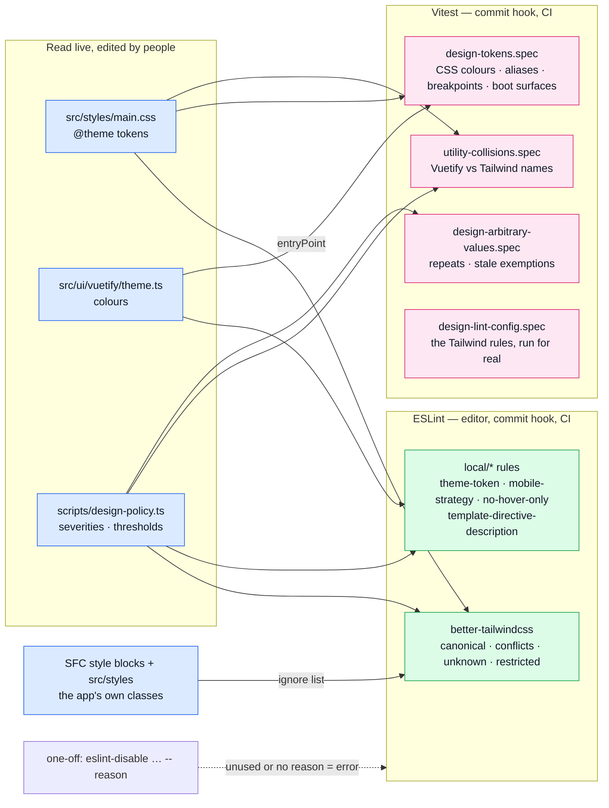

# Design Lint

The static half of the design checks: ESLint and Vitest read the **source** and fail an edit that
leaves the design system. It never sees a rendered page, so it cannot tell you a screen looks
wrong. Why the rules exist, and who owns which token: [Design System](../theory/design-system.md).

## What it reads

Four things are read live, never listed by hand:

1. **Tailwind tokens.** The plugin loads `src/styles/main.css`, so a variable added to `@theme` is a
   valid class at once, and the canonicaliser rewrites an existing arbitrary value that equals it.
2. **Vuetify colours.** `src/ui/vuetify/theme.ts` is plain data, imported by the policy, the rule
   and the specs.
3. **The app's own classes.** `scripts/eslint/stylesheet-classes.ts` reads `src/styles/*.css` and
   every SFC `<style>` block. A global class is valid in any file; a scoped class only in its own
   SFC, because its CSS reaches nowhere else.
4. **Vuetify's generated names.** `primary-darken-1`, `on-surface-variant` and the rest are derived
   from the theme; a spec compares the derivation with what Vuetify computes.

## The rules

| Rule                                           | What it flags                                                                                                                                    | Autofix |
| ---------------------------------------------- | ------------------------------------------------------------------------------------------------------------------------------------------------ | ------- |
| `better-tailwindcss/enforce-canonical-classes` | A class with a shorter or canonical spelling: `h-12 w-12` → `size-12`, `max-w-[1280px]` → `max-w-7xl`                                            | yes     |
| `better-tailwindcss/no-conflicting-classes`    | Two classes that set the same property                                                                                                           | no      |
| `better-tailwindcss/no-duplicate-classes`      | The same class twice                                                                                                                             | yes     |
| `better-tailwindcss/no-deprecated-classes`     | A Tailwind v3 spelling: a bare `rounded` → `rounded-md`                                                                                          | yes     |
| `better-tailwindcss/no-unknown-classes`        | A class no stylesheet defines: a wiped palette, shadow or radius name, a Vuetify utility, a typo                                                 | no      |
| `better-tailwindcss/no-restricted-classes`     | An arbitrary value (`w-[13px]`), `vh`, theme-blind `white`/`black`, a bare z-index of 100+, a hover-only cue, an ambiguous Vuetify/Tailwind name | no      |
| `local/mobile-strategy`                        | A `v-dialog` without `fullscreen`, a Vuetify data table outside `DataTable.vue`, an unnamed `v-table` scroll region                              | no      |
| `local/no-hover-only`                          | A hover handler with no click, `open-on-hover` with no `open-on-click`, a gesture-only handler, a `title` on clipped text                        | no      |
| `vue/no-static-inline-styles`                  | A static `style="…"`; a bound `:style` is allowed                                                                                                | no      |
| `local/theme-token`                            | A colour literal, an unknown `--v-theme-*`, or a Vuetify colour prop that is not a theme colour                                                  | no      |
| `local/template-directive-description`         | A template `<!-- eslint-disable -->` with no ` -- reason`                                                                                        | no      |
| `vue/comment-directive` (unused reporting)     | A template disable that silences nothing                                                                                                         | no      |
| `linterOptions.reportUnusedDisableDirectives`  | A script disable that silences nothing                                                                                                           | no      |

Stylistic Tailwind rules (class order, line wrapping, variable syntax) are deliberately off: they
are formatting, not design.

Strings inside a hoisted class map are reached too: a top-level `const FOO_CLASSES = {…} as const`
is read by name. A class map built inside `computed(() => ({…})[key])` is invisible to the plugin,
so keep them at the top level.

## The knobs

All in `scripts/design-policy.ts`.

| Field                  | What it sets                                                                            |
| ---------------------- | --------------------------------------------------------------------------------------- |
| `severity`             | Per check: `'error'` or `'off'`. A warning would only be an error in CI anyway          |
| `rootFontSize`         | Rem to pixels for the canonicaliser (16)                                                |
| `restrictedClasses`    | The refused class patterns, each with its message and way out                           |
| `ambiguousUtilities`   | The names both libraries generate with different meanings; `restrict: true` refuses one |
| `vuetifyOwnedClasses`  | Vuetify classes a template may use by name (`elevation-N`)                              |
| `arbitraryRepeatLimit` | How many places one arbitrary class may appear in (1)                                   |
| `mobileStrategy`       | The dialog binding, the table owner file and the scroll directive                       |
| `tailwindEntryPoint`   | The stylesheet whose `@theme` the plugin reads                                          |
| `colorProps`           | The Vuetify props that take a theme colour                                              |
| `colorKeywords`        | Strings that name no fixed colour (`transparent`, `currentcolor`, `inherit`)            |
| `themeColorNames()`    | The colour names a template may use, derived from the theme                             |

## Commands

| Command            | What it does                                                                                                                                                              |
| ------------------ | ------------------------------------------------------------------------------------------------------------------------------------------------------------------------- |
| `npm run lint`     | Everything above, over the whole repo                                                                                                                                     |
| `npm run lint:fix` | The same, applying the autofixes                                                                                                                                          |
| the commit hook    | Lints the staged files. A staged design source (`main.css`, the policy, the rules, `theme.ts`) lints all of `src/`, so a removed token cannot pass locally and fail in CI |

## The specs

| Spec                                                  | Guards                                                                                                                                          |
| ----------------------------------------------------- | ----------------------------------------------------------------------------------------------------------------------------------------------- |
| `tests/cross-cutting/design-tokens.spec.ts`           | CSS colours, `var(--v-theme-*)` references, Tailwind aliases, media-query breakpoints, the derived names against Vuetify, and the boot surfaces |
| `tests/cross-cutting/utility-collisions.spec.ts`      | The real set of Vuetify/Tailwind name collisions equals `ambiguousUtilities`; no radius name collides; Tailwind scans `src/` only               |
| `tests/cross-cutting/design-arbitrary-values.spec.ts` | No arbitrary class repeats; an exemption that matches no class is stale                                                                         |
| `tests/unit/scripts/design-lint-config.spec.ts`       | The plugin finds `main.css`, reaches a class map and a `*-class` prop; each refusal fires; an unused template disable fails                     |
| `tests/unit/scripts/eslint/*.spec.ts`                 | Each local rule and the stylesheet reader, with `RuleTester`                                                                                    |
| `tests/unit/ui/use-theme-color-meta.spec.ts`          | Switching the theme rewrites the browser's `theme-color` tags                                                                                   |

## Troubleshooting

- **"My new class is unknown / non-canonical."** The plugin reads `src/styles/main.css`. A token
  belongs in its `@theme`; if the lint cannot find the file, `design-lint-config.spec.ts` goes red first.
- **"`lint:fix` rewrote my value."** A token or a scale step equals it. That is the canonicaliser
  doing its job; keep the shorter class.
- **"A class is unknown but I wrote it in a `<style>`."** A scoped class is valid in its own file
  only. Use it there, or make the block unscoped if it is global.
- **"I need a value the scale does not have."** If two places need it, add a token (see
  [Adding a custom Tailwind token](../theory/design-system.md#adding-a-custom-tailwind-token)). For a true
  one-off: `<!-- eslint-disable-next-line better-tailwindcss/no-restricted-classes -- <why> -->`.
- **"I need a colour that is not in the theme."** Add it to `src/ui/vuetify/theme.ts` in both themes
  (a spec fails if the two disagree), then use its name.
- **"Which colour names exist?"** `themeColorNames()` in the policy; `ThemeColor` in `src/ui/types.ts`
  is the same set as a type.

## File map

| File                                               | What it is                                               |
| -------------------------------------------------- | -------------------------------------------------------- |
| `scripts/design-policy.ts`                         | The knobs and `themeColorNames()`                        |
| `scripts/eslint/index.ts`                          | The local rule plugin                                    |
| `scripts/eslint/design-config.ts`                  | The Tailwind rule blocks for `eslint.config.ts`          |
| `scripts/eslint/theme-token.ts`                    | `local/theme-token`                                      |
| `scripts/eslint/mobile-strategy.ts`                | `local/mobile-strategy`                                  |
| `scripts/eslint/no-hover-only.ts`                  | `local/no-hover-only`                                    |
| `scripts/eslint/stylesheet-classes.ts`             | Reads the app's own CSS classes for `no-unknown-classes` |
| `scripts/eslint/template-directive-description.ts` | `local/template-directive-description`                   |
| `src/ui/vuetify/theme.ts`                          | The colours, as data                                     |
| `src/ui/composables/use-theme-color-meta.ts`       | Keeps the address-bar colour in step with the theme      |
