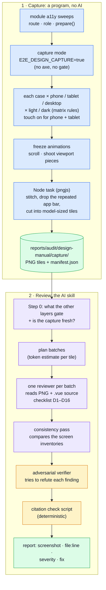

# Design Review

An AI review that judges whether the design is _right_: is the primary action obvious, is it in
reach of a thumb, do the same things look the same everywhere, does the dark theme hold up. It is
the judgement layer above the automated checks ([Design Lint](./design-lint.md), [Layout
Sweep](./layout-sweep.md), [Touch Testing](./touch-testing.md), [Visual
Regression](./visual-regression.md), [Lighthouse](./lighthouse.md)), and it never re-reports what
they already catch. Why a design verdict needs its own method: [Judging a Design](../theory/design-judgement.md).

Nothing here gates CI. It is run on demand, and it reports.

## How it works, in plain words

An AI cannot open a browser and look at the running app. It can read a PNG, and it can read a
`.vue` file. So the review is two steps, with a program in the middle.

1. **Capture**: a program with no AI in it. The accessibility sweeps already visit every route,
   signed in as the right role, with steps that open the drawer, the dialogs and the menus. With
   one environment variable set, that sweep stops running axe and takes photographs instead: each
   screen at phone, tablet and desktop size, in light and dark, with touch emulation on for phone
   and tablet. Long pages are scrolled and shot piece by piece; a Node step stitches the pieces
   into one tall image, keeps one copy of the fixed app bar, and cuts the result into tiles a model
   reads without shrinking them. Every tile is listed in the manifest (`reports/audit/design-manual/capture/manifest.json`).
2. **Review**: the skill `scripts/audit/design-manual/SKILL.md`. It splits manifest into
   batches small enough for one context. A reviewer reads each PNG, finds the view in the
   [sitemap](../theory/sitemap.md), reads the component next to it, and judges the screen against a
   fixed checklist. Every finding needs a screenshot, a `file:line`, a severity and a fix. A second,
   independent pass tries to refute each one, and a script checks every citation.

## The capture matrix

Capture runs through the module sweeps, not a central spec, so the sweeps stay the one list of
routes (and a deleted module takes its captures with it). Sizes come from `scripts/e2e/viewports.ts`
and always go through `applyViewport`, so phone and tablet shots run with touch emulation on and
show Vuetify's touch-only CSS.

| Sweep case shape                                 | Shots                                                     | Why                                                                                  |
| ------------------------------------------------ | --------------------------------------------------------- | ------------------------------------------------------------------------------------ |
| Plain route                                      | phone·light, phone·dark, tablet·light, desktop·light      | Phone is where design breaks. Dark parity is judged where it is densest              |
| Only a size and/or theme, no `prepare`           | none                                                      | A layout variant of a plain case; shooting it twice wastes context                   |
| `prepare` with a pinned size                     | that size, light (dark too if the case is pinned dark)    | The state only exists at that size                                                   |
| `prepare`, no size (menus, dialogs, empty forms) | phone·light, desktop·light                                | A dialog is fullscreen on a phone and floats on a desktop, so the two look different |
| `E2E_DESIGN_CAPTURE_LOCALES=en,it`               | adds phone·light under `/it` to plain routes              | Italian strings run longer: this is where truncation that loses meaning shows up     |
| Action-table `read` row                          | loading then error, each at phone·light and desktop·light | The request is held open for the loading shot, then answered with the failure        |
| Action-table `empty` row                         | loading then empty, each at phone·light and desktop·light | Same hold, ended with the schema-checked empty page                                  |
| Action-table `form`, `dialog` or `row` row       | error at phone·light and desktop·light                    | The shot is taken once the stubbed failure shows its alert                           |

A shot's id is `<module>--<case>--<viewport>--<theme>[--<locale>]`. An action-table row's case part
is `row-<index>-<first 48 characters of its name>-<state>`, so two rows that open alike stay apart. The theme is asserted before
the shot (`.v-theme--light` or `.v-theme--dark`), because the default is the visitor's stored
choice, else the OS's: a shot must never record whatever the host prefers.

## How a page is photographed

`cy.captureDesign()` (`tests/support/e2e/design-capture.ts`), per shot:

1. Freeze transitions, the caret and the activity indicator.
2. Find what scrolls: the document, or a fullscreen overlay's own scroller (a fullscreen dialog on
   a phone scrolls inside itself). Any other open overlay blocks the document, so the page is one
   piece.
3. Measure the **bands**: visible fixed elements at least half the viewport wide that touch the top
   or bottom edge. Measured, never a hard-coded 56 px. Every other fixed element (a toast, a
   button that floats) is kept in the first piece, hidden in the rest, and listed in the shot's
   `fixed` field. A sticky element that sticks to the document repeats across pieces, so the shot
   records `stickyRepeats`.
4. Scroll in steps, wait for images on screen and for the network (unless the shot is a held-open
   loading state), and shoot the viewport. Each piece must be exactly the viewport's size: a
   clamped or retina shot would be reviewed as a cropped page, so it fails loudly instead.
5. Read what a picture cannot show: each form control's label, `type`, `inputmode`, `autocomplete`
   and `enterkeyhint`; the `h1`–`h3` outline; `scrollWidth` against `clientWidth`.
6. Node stitches the pieces (the first keeps its top band, the last its bottom band), cuts tiles
   and appends the row to the capture manifest.

### The tile-size rule

A model scales an image down when its long edge passes 1568 px or it passes about 1.15 MP
(models before Opus 4.7; current ones take 2576 px / 3.75 MP). The constants keep the **lower**
limit on purpose (checked 2026-10-18): a tile under it is read at full size by every model, tokens
follow area (width × height / 750) so bigger tiles save only Read calls, and a downscaled 14 px
label becomes about 10 px, which is where a model starts to misread.

Tile height is `min(1560, floor(1_150_000 / width))`: phone 390 → 1560 px, tablet 1024 → 1123 px,
desktop 1280 → 898 px. Neighbouring tiles share 40 rows, so an element on a cut is whole in at
least one. Both limits are constants in `scripts/audit/design-manual/scripts/stitch.ts`.

## The checklist

D1–D16, in `scripts/audit/design-manual/SKILL.md` (the text lives there once). A reviewer may add
an item if it names its anchor.

| Id  | Item                                  | Id  | Item                         |
| --- | ------------------------------------- | --- | ---------------------------- |
| D1  | Visual hierarchy, primary action      | D9  | Empty, loading, error states |
| D2  | Alignment, grid                       | D10 | Dark-theme parity            |
| D3  | Spacing rhythm                        | D11 | Density: desktop vs phone    |
| D4  | Thumb zone on phone                   | D12 | Typography scale use         |
| D5  | Content priority on phone             | D13 | Icon and label clarity       |
| D6  | Sticky CTA on long forms and checkout | D14 | Image crop and aspect        |
| D7  | Truncation that loses meaning         | D15 | Form ergonomics on phone     |
| D8  | Same component, same look             | D16 | Feedback after actions       |

Every ISSUE names an **anchor** (a precedent elsewhere in the app, a named rule, or a task that
fails), a severity (S1 blocks, S2 slows, S3 polish), and one of four verdicts: ISSUE, OK,
NOT-APPLICABLE, NEEDS-DEVICE-CHECK. The verifier adds CONFIRMED, REFUTED or DOWNGRADED. The reasoning
behind the rubric is in [Judging a Design](../theory/design-judgement.md#the-severity-rubric).

### What it reads from the other layers

Step 0 of the skill reads these pages and builds an exclusion list, so nothing they gate is
reported again: [Accessibility Testing](./accessibility-testing.md), [Design Lint](./design-lint.md),
[Layout Sweep](./layout-sweep.md), [Touch Testing](./touch-testing.md),
[Visual Regression](./visual-regression.md) and [Lighthouse](./lighthouse.md). Their machine
reports are **leads**, never findings: a lead becomes a finding only with its own tile, source line
and anchor.

## Limits: what a static screenshot cannot judge

The report repeats this list at the top, so a clean report is not read as "the design is fine".

- **Motion**: transitions are frozen on purpose; timing and vestibular safety are not judged.
- **Real devices**: this is desktop Chromium at a phone's width, with touch emulation. It does not
  show iOS Safari's safe-area insets, its dynamic toolbar, the soft keyboard covering a field,
  scroll physics, WebKit's "first tap is hover" rule, or a retina display. Those rows are
  NEEDS-DEVICE-CHECK.
- **Fonts**: Roboto is bundled, so the face is right; antialiasing on iOS and Android is not.
- **Interaction states**: hover, focus and pressed appear only where a `prepare` step put them.
- **Inner scroll areas**: only the document and a fullscreen overlay are stitched. A fixed-height
  table body, or a sticky column inside its own scroll area, shows only what fits.
- **Data variety**: the screens show the demo seed.
- **Loading, error and empty states**: judged only where an action-table row holds a request open.
  Until those rows exist, the only error states captured are the sweeps' submitted-empty forms, and
  the report counts what it did not capture.
- **The model's eye**: differences under 4 px and exact colours are not reliable from a PNG; they go
  to the code, or nowhere.

## Running it

| Command                                   | What it does                                                                                                                   |
| ----------------------------------------- | ------------------------------------------------------------------------------------------------------------------------------ |
| `/audit-design-manual <scope>`            | The whole review: capture if stale, plan, review, verify, check. Scope: a module, `shell`, a path, `--diff`                    |
| `npm run audit:design:capture -- <scope>` | The capture alone. A live e2e (build, demo backend on :3100, preview on :8085); empty scope is the whole app, about 45 minutes |
| `npm run audit:design:plan -- <scope>`    | Splits the last capture into batches                                                                                           |
| `npm run audit:design:check -- <scope>`   | Checks every tile and `file:line` a report cites                                                                               |

A capture is a live e2e: it takes the e2e lock (`flock /tmp/claude-e2e.lock`) and never runs beside
the mutation run or a gate. Each run replaces the last whole: its manifest (`reports/audit/design-manual/capture/manifest.json`) records the scope,
the git commit, and any uncommitted paths, and the skill treats a manifest as stale when files in
its scope changed since.

- **Per module change**: `/audit-design-manual --diff` after UI work (about 5 minutes of capture).
- **Before a release**: the whole app.
- **After a theme or framework change** (a Vuetify or Tailwind upgrade, or an edit to
  `src/ui/vuetify/index.ts` or `src/styles/main.css`): the whole app, D10 and D12 first.
- Not on a schedule, and not in CI.

## File map

| Path                                                    | Role                                                   |
| ------------------------------------------------------- | ------------------------------------------------------ |
| `scripts/audit/design-manual/SKILL.md`                  | The prompt                                             |
| `.claude/skills/audit-design-manual/SKILL.md`           | The pointer that registers it with Claude Code         |
| `scripts/audit/design-manual/scripts/stitch.ts`         | Scroll offsets, band classifier, stitcher, tile cutter |
| `scripts/audit/design-manual/scripts/capture-matrix.ts` | Which shots a sweep case becomes                       |
| `scripts/audit/design-manual/scripts/capture-scope.ts`  | A typed scope to sweep specs                           |
| `scripts/audit/design-manual/scripts/capture-task.ts`   | The Node tasks behind `cy.captureDesign()`             |
| `scripts/audit/design-manual/scripts/capture.ts`        | The capture CLI                                        |
| `scripts/audit/design-manual/scripts/manifest.ts`       | The manifest's types and merge                         |
| `scripts/audit/design-manual/scripts/plan-batches.ts`   | The batch planner (`plan.ts` is its CLI)               |
| `scripts/audit/design-manual/scripts/check-report.ts`   | The citation check (`check.ts` is its CLI)             |
| `tests/support/e2e/design-capture.ts`                   | `cy.captureDesign()`                                   |
| `tests/support/e2e/a11y-sweep.ts`                       | Capture mode of `sweepA11y`                            |
| `cypress.config.ts`                                     | `expose.designCapture` and the two capture tasks       |

## Does it work?

Not measured yet. The first full run on the whole app is the calibration: shots, tiles, wall time,
the batch budgets, the counts (proposed → refuted → confirmed) and whether a planted defect (a
`text` submit beside a filled cancel on a create form) is caught. This section holds those numbers
once they exist.

## Related pages

- [Judging a Design](../theory/design-judgement.md) — why a design verdict needs anchors, a refuting pass and a citation check
- [AI Auditing](./ai-auditing.md) — the other audit prompts and the one rule they share
- [Accessibility Testing](./accessibility-testing.md) — the sweeps this capture rides on
- [Layout Sweep](./layout-sweep.md), [Touch Testing](./touch-testing.md), [Design Lint](./design-lint.md), [Visual Regression](./visual-regression.md), [Lighthouse](./lighthouse.md) — the automated layers this one sits above
- [Testing & Docs](./testing-and-docs.md) — the map
