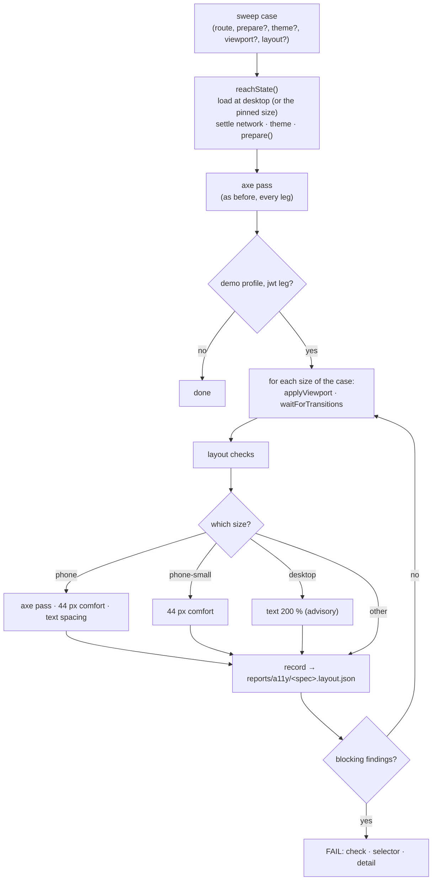

# Layout Sweep

Does every page fit, and stay usable, at every width? The layout sweep lays each page the
accessibility sweep visits out at five device sizes and names the element that does not fit.

It is not a new suite. The checks run inside [the accessibility sweep](./accessibility-testing.md),
so `tests/cross-cutting/a11y-coverage.spec.ts` already guarantees every route gets them.

## What it catches, and what it cannot

| Question                                                         | Where it is answered                        |
| ---------------------------------------------------------------- | ------------------------------------------- |
| Does anything escape the screen, get cut, or sit under another?  | **here**                                    |
| Is a control big enough for a finger (24 px gate, 44 px comfort) | **here** (axe's `target-size`)              |
| Does a hover-only reveal or a gesture block a finger?            | [Touch Testing](./touch-testing.md)         |
| Does it still _look_ the way it did?                             | [Visual Regression](./visual-regression.md) |
| Does the whole screen feel right?                                | a person (the design manual)                |

## The matrix

Sizes live in one module, `scripts/e2e/viewports.ts`, and nowhere else.
`tests/cross-cutting/viewport-matrix.spec.ts` refuses a size typed in a spec.

| Name              | Size     | App band      | Touch | Why                                                            |
| ----------------- | -------- | ------------- | ----- | -------------------------------------------------------------- |
| `phone-small`     | 320×568  | xs (< 600)    | yes   | WCAG 1.4.10 reflow width; the smallest phone still in use      |
| `phone`           | 390×844  | xs            | yes   | the common phone; the width the data table stacks rows below   |
| `phone-landscape` | 844×390  | sm (600–959)  | yes   | a short height (sticky bar, dialogs); stands in for 200 % zoom |
| `tablet`          | 1024×768 | md (960–1279) | yes   | the nav is collapsed but the grid is wide                      |
| `desktop`         | 1280×800 | lg (≥ 1280)   | no    | the configured default; every desktop baseline is this size    |

Why one size per band is enough, and what a band means: [Design System](../theory/design-system.md#breakpoints-viewport-bands-and-layout-invariants).

## The flow



**One load, then resize in place.** A resize lays the app out the same as a fresh load, because
nothing in `src/` reads the width at mount: Vuetify listens to `resize`, and the rest is CSS. A
resize also carries the state `prepare` built (an open dialog, a drawer) to the phone. A reload
would lose it, and some `prepare` steps are writes that cannot be repeated.

**Where it runs.** The matrix runs in the demo profile's `jwt` leg only. Markup does not depend on
the session mode or the backend profile. The desktop axe pass keeps running everywhere, unchanged.

## The checks

Each check reads boxes, not the scrollbar. Vuetify sets `html { overflow-x: hidden }`, so a
too-wide element is cut off and unreachable, not scrolled to: a check that waits for the page to
scroll sideways finds nothing.

| Check         | Fails when                                                                                      | Severity            |
| ------------- | ----------------------------------------------------------------------------------------------- | ------------------- |
| `overflow`    | an element's right edge is past the viewport; named where content leaves its container          | blocking            |
| `overlay-fit` | an open dialog, menu or drawer does not fit inside the screen                                   | blocking            |
| `clipped`     | a box cuts text or a control (media is advisory; ellipsis is by design in normal mode)          | blocking · advisory |
| `covered`     | a control's centre is under another element, or only a box the user cannot scroll would show it | blocking            |
| `input-font`  | a field is under 16 px at a phone width (iOS zooms the page on focus)                           | blocking            |
| `scroll-x`    | a container still scrolls sideways at a phone width (reflow was lost there)                     | advisory            |

Details that matter when a finding looks wrong:

- **Escape points.** `overflow` reports an element whose parent is not also past the edge: where
  the content leaves its container, not every descendant.
- **Modal scope.** While a dialog, menu or temporary drawer is open, `covered` checks only the
  controls inside it. The rest of the page is behind a scrim by design.
- **Scrolling to look.** A control outside the screen is scrolled into view first, as focus would
  (`scroll-padding` is honoured). If that moves a box whose overflow is hidden, the control was
  unreachable. Every scroll offset is put back afterwards.
- **A tall control.** The point tested is the centre of the part that is on screen.

### The tap-target tiers

- **24 px** is already a gate: axe's `target-size` runs in every `cy.checkPageA11y()` (WCAG 2.5.8).
- **44 px** is the comfort tier at `phone` and `phone-small`, blocking. It is the same axe
  algorithm with `minSize` and `minOffset` set to 44, so it keeps axe's handling of inline links
  and its spacing allowance: a small target passes when 44 px of free space surrounds it. This is
  **not** WCAG 2.5.5 (AAA), which has no spacing exception. 44 px is Apple's HIG, Vuetify's `large`
  button, and what `useTouchFriendlySize` hands a row action below `sm`.

### Text modes

- **Text spacing** (WCAG 1.4.12), at `phone`, **blocking**: line height 1.5, letter spacing 0.12 em,
  word spacing 0.16 em, paragraph spacing 2 em, then `overflow` and `clipped` again.
- **Text at 200 %** (WCAG 1.4.4), at `desktop`, **advisory**: `html { font-size: 200% }`. It
  approximates the browser's font-size setting (rem and em scale, px does not). 1.4.4 itself is met
  by page zoom, which `phone-landscape` exercises.

## What looks wrong and is not

The collector skips these on purpose, so a finding on them is a bug in the check:

| Source                                                        | Handling                                                                                                            |
| ------------------------------------------------------------- | ------------------------------------------------------------------------------------------------------------------- |
| `html { overflow-x: hidden }`                                 | `html` and `body` are never "clipped"; `overflow` owns them                                                         |
| The off-screen skip link (fixed, revealed on focus)           | a fixed element wholly off screen is skipped                                                                        |
| Closed drawers, inactive overlays                             | only `.v-navigation-drawer--active` and `.v-overlay--active` count                                                  |
| Tooltips                                                      | `pointer-events: none`; never in the way                                                                            |
| `aria-hidden` and `inert` subtrees, `sr-only` text            | skipped                                                                                                             |
| Truncation with an ellipsis                                   | not "clipped" in normal mode; advisory under the text modes                                                         |
| A text input inside a `.v-field`                              | the comfort pass skips the native `<input>` (24 px tall, 6 px wide beside chips); the field around it is the target |
| A control and the widget around it (`v-select`, `v-checkbox`) | a hit inside the same widget root counts as the control                                                             |
| Containers that scroll sideways on purpose                    | their content is reachable: `overflow` skips it; `scroll-x` advises                                                 |

## Opting out

A case may narrow the matrix or accept one element for one check. Never a whole check.

```ts
{
    name: 'home, account menu open',
    route: '/en',
    prepare: () => { /* open the menu */ },
    layout: {
        // The matrix sizes this case runs at.
        only: { viewports: ['desktop'], reason: 'an open menu is placed once, against its activator' },
        // One element, one check, optionally limited to some sizes.
        allow: [{ check: 'clipped', selector: '[data-test=big-table]', reason: '…', viewports: ['phone'] }]
    }
}
```

- A reason must be an argument: at least 20 characters, not a `TODO`. It is checked when the spec is
  collected, so a bad one fails before any browser starts.
- A selector matches the finding's path: equal, or a prefix followed by a space, a dot or a bracket.
- An accepted finding is still written to the report, with `allowed: <reason>`.
- A menu that is open while the page resizes is **not** repositioned: use `only` for it, and add a
  case that opens the same menu at the phone size (`viewport: 'phone'`).

## Reading a failure and the report

```
[layout home @ phone-small] 2 blocking finding(s):
  overflow — header div.v-toolbar__content … — right edge 364 > viewport 305; escapes header …
  covered — [data-test=language-switcher] — unreachable: only a container the user cannot scroll …
```

The viewport is the page width without the scrollbar (`clientWidth`), which is why 320 reads as
305 in headless Chrome. Every finding, advisory and accepted ones included, is written before the
run fails, to `reports/a11y/<spec>.layout.json`, beside the axe report CI already uploads.

## Runtime

Measured locally, serial, on one demo backend (2026-10-18, jwt leg):

| Run                                            | Time         |
| ---------------------------------------------- | ------------ |
| The shell sweep: 16 cases × 5 sizes            | about 50 s   |
| The 16 module sweeps: about 95 cases × 5 sizes | about 15 min |
| The planted-fixture spec                       | about 5 s    |

Why it stays cheap: the matrix runs in the jwt leg of the demo profile only, axe runs at two sizes
instead of five, a resize replaces a reload, a control is scrolled only when it is off screen, and
every size's checks are one synchronous call in the page. If the CI e2e job ever crosses about 70 of
its 75 minutes, move `tablet`, `phone-landscape` and the text modes to the nightly and keep
`desktop`, `phone` and `phone-small` in the gate.

## Commands

```bash
# One or more specs, serial, on its own backend (port 3100), jwt mode
E2E_SPEC='tests/e2e/specs/a11y.cy.ts,src/modules/*/tests/e2e/a11y.cy.ts' npm run test:e2e:spec

# The checks proving themselves on planted fixtures
E2E_SPEC=tests/e2e/specs/layout-checks.cy.ts npm run test:e2e:spec

# The rule that no size is typed outside the matrix
npx vitest run tests/cross-cutting/viewport-matrix.spec.ts
```

## File map

| File                                          | What it holds                                                                      |
| --------------------------------------------- | ---------------------------------------------------------------------------------- |
| `scripts/e2e/viewports.ts`                    | The matrix. Pure data                                                              |
| `scripts/e2e/layout-findings.ts`              | What blocks, how a case accepts a finding, the failure message. No DOM             |
| `tests/support/e2e/layout-checks.ts`          | `collectLayoutFindings`, `cy.checkLayout`, `cy.checkTargetComfort`, the text modes |
| `tests/support/e2e/sweep-state.ts`            | `reachState`, `switchToDarkTheme` (width-aware): the steps every sweep starts with |
| `tests/support/e2e/apply-viewport.ts`         | The one seam that sets a size (and touch emulation)                                |
| `tests/support/e2e/layout-task.ts`            | Writes `reports/a11y/<spec>.layout.json`                                           |
| `tests/e2e/specs/layout-checks.cy.ts`         | Planted offenders and look-alikes: each check, red and green                       |
| `tests/cross-cutting/viewport-matrix.spec.ts` | No size outside the matrix; a size in every band; the meta viewport allows zoom    |

## Related pages

- [Accessibility Testing](./accessibility-testing.md) — the sweep these checks ride on, and the 24 px gate
- [Touch Testing](./touch-testing.md) — what a finger can reach
- [Visual Regression](./visual-regression.md) — the browser window the viewports are sized for
- [Design System](../theory/design-system.md) — the band model and the invariants
- [Testing & Docs](./testing-and-docs.md) — the map of layers
