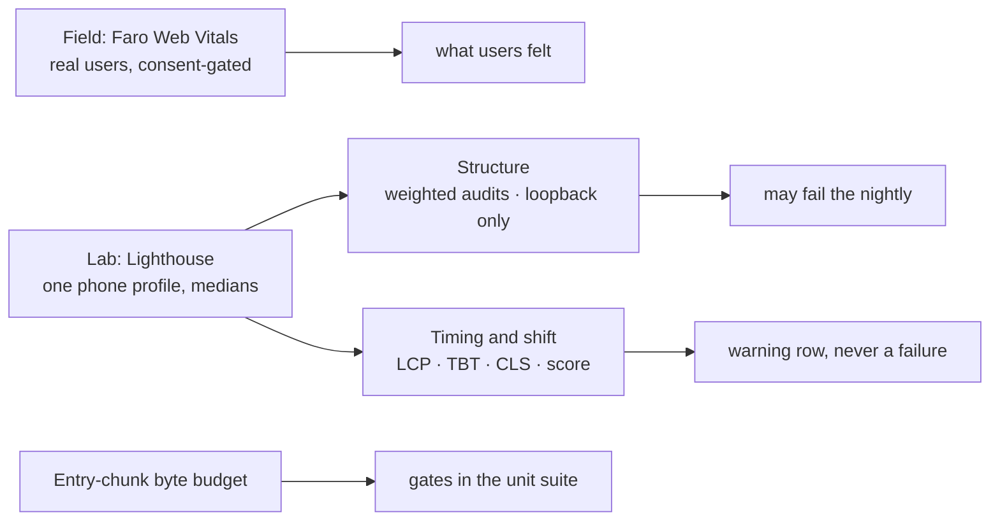
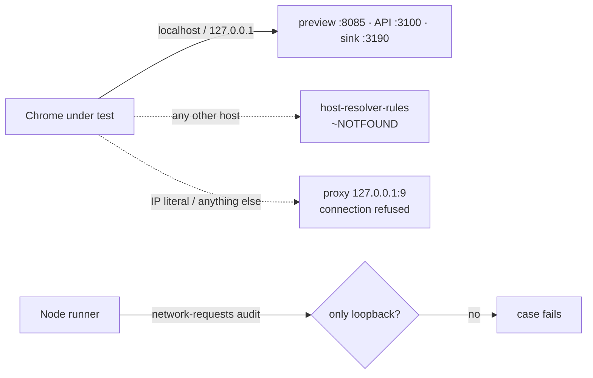
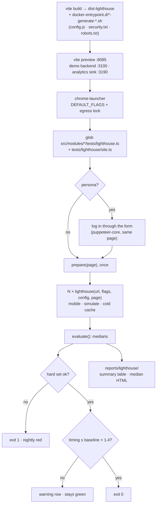

# Lighthouse

A local [Lighthouse](https://github.com/GoogleChrome/lighthouse) run over six representative routes, two of them signed in, under a phone profile. It is the **lab** half of performance. The **field** half is already there: Faro reports real users' Web Vitals to your own collector (consent-gated). Lab and field answer different questions, and neither replaces the other.

No external service is involved. Every path that could phone home is listed in [No byte leaves the machine](#no-byte-leaves-the-machine), with how it is switched off.

## What this layer is for

| Question                                                   | Answered by                                                 |
| ---------------------------------------------------------- | ----------------------------------------------------------- |
| Did the entry bundle grow?                                 | the byte budget in the unit suite (a gate)                  |
| Is a phone's first load stable and structurally sound?     | this layer (the hard set below)                             |
| How fast was it for real users on real devices?            | Faro Web Vitals (field)                                     |
| How fast is it on one emulated phone, compared with before | this layer's timing rows (a report, never a gate)           |
| Is the page accessible?                                    | the axe sweep ([Accessibility](./accessibility-testing.md)) |

Lighthouse's own accessibility category is **off**: it is a subset of the same `axe-core` the sweep already runs, and the sweep covers more.

## Theory: lab versus field

- **Lab** is one emulated device (a Moto G Power: 412 × 823 at 1.75 DPR) on a throttled network, measured with the same procedure every time. It is repeatable, and it is what you can run before shipping.
- **Field** is every real visitor: their device, their network, their cache. It is the truth, and it arrives after shipping.
- The lab can be wrong in both directions: a fast CI machine hides what a slow phone feels, and a noisy shared runner shows slowness that is the runner's.
- **Simulated** throttling (Lighthouse's default) loads the page fast and then _computes_ what a slow phone would have seen. It has the lowest variance of the three methods, and it is calibrated to that one device. **Observed** throttling slows the real load and can miss a layout shift that only appears on a slow network.
- Hence **medians**, not single runs: 3 runs locally, 5 in the nightly. The HTML report people read is the run nearest the median LCP.

## What gates and what reports

Timing is a property of the machine. A hard threshold on it is a flake that gets the job disabled, and a threshold measured on the demo's fixtures is inherited by forks as authoritative. So timing **reports and never gates**. What gates is structure that does not depend on data volume or CPU speed.

| Kind       | What                                                                                                                                                                                                                                                                                                                                       |
| ---------- | ------------------------------------------------------------------------------------------------------------------------------------------------------------------------------------------------------------------------------------------------------------------------------------------------------------------------------------------ |
| **Hard**   | each case loads (HTTP status passes, the page is not the login screen, no runtime error) · nothing leaves the machine · every **weighted** best-practices audit passes · on SEO cases every weighted SEO audit · `viewport-insight`, `font-display-insight`, `unsized-images` · no stale exception                                         |
| **Report** | median CLS above 0.1 · LCP, FCP, TBT, Speed Index and the performance score against the baseline × 1.4 · `image-delivery-insight`, `unused-javascript`, `legacy-javascript-insight`, `render-blocking-insight`, `bf-cache`, `total-byte-weight` · a machine whose CPU benchmark moved by more than a quarter · a case with no baseline yet |

- "Weighted" is read from the report's own category list (`auditRefs` with a weight above zero), so the list cannot rot when Lighthouse adds or drops an audit.
- An audit counts as failed when it fails in **more than half** of a case's runs.
- The 1.4 × headroom is the backend's load-test rule: a threshold is seeded from a measured run, with headroom, because a threshold invented before anything was measured is a wish.
- **Exceptions.** A case (or the whole site) may excuse one audit, with a reason: `exceptions: { 'image-size-responsive': 'why' }`. A **stale exception**, one whose audit passed in every run, fails the run: an exemption is an argument, and it expires when its cause does.
- **Risk to watch:** CLS is the one hard number that can move with timing (data landing before or after first paint). The median of five damps it. If CLS is what flaps in the first fortnight of nightlies, it is the first candidate to demote to a report.

## The phone profile

- Form factor `mobile`, the Moto G Power screen (412 × 823, 1.75 DPR), `mobileSlow4G` throttling, method `simulate`.
- The width and height come from `scripts/e2e/viewports.ts` (`REPORT_VIEWPORTS['lighthouse-mobile']`, a size the layout sweep does not iterate). A unit test pins that entry to Lighthouse's own preset, so a Lighthouse upgrade that moves its preset fails the test instead of silently auditing a device the simulation is not calibrated for.
- Categories: performance, best practices, SEO. `cache-insight` is skipped: it would grade the preview server's caching, and nginx owns the cache headers (`docker/nginx.conf`).
- Real-user **INP** has no lab equivalent here; Total Blocking Time is the stand-in.

## No byte leaves the machine

| Path                                                | How it is off                                                                                                                                                                                                                  |
| --------------------------------------------------- | ------------------------------------------------------------------------------------------------------------------------------------------------------------------------------------------------------------------------------ |
| Lighthouse's Sentry error reporting                 | The Node API is used, never the CLI (the CLI is what asks and caches a consent). The runner also passes `enableErrorReporting: false`                                                                                          |
| `@lhci/cli` uploads and its wizard                  | `@lhci/cli` is not installed (it is frozen on Lighthouse 12 and its default upload target is a service)                                                                                                                        |
| Chrome's background networking                      | `chrome-launcher`'s default flags (no component updates, sync, Safe Browsing, domain reliability, metrics)                                                                                                                     |
| The app's own outbound calls (Faro, Umami, the API) | The audit build bakes loopback URLs. Faro and Umami post to a local sink (`scripts/lighthouse/analytics-sink.ts`), so the consent banner shows as on a first visit                                                             |
| Anything else Chrome tries                          | **Egress lock**: `--host-resolver-rules` makes every hostname but loopback fail to resolve, and `--proxy-server=127.0.0.1:9` sends every other address to a closed port                                                        |
| An outside request the lock caught                  | After each run the `network-requests` audit is read: **any** request to a host other than loopback fails the case, blocked or not, because the app _tried_ to call out. A URL baked in from a developer's `.env` shows up here |
| Install-time downloads                              | Only `puppeteer-core` is used, never `puppeteer` (which downloads a browser in `postinstall`); `.npmrc` sets `strict-allow-scripts`                                                                                            |
| Links in the HTML report                            | "Open in Viewer" and "view treemap" go to a Google-hosted page **only when clicked**. Do not click them on a private report: it holds your staging URL and a signed-in session's page                                          |

## Signed-in routes

Two cases are signed in (`cart/checkout` as `user`, `orders/sales` as `manager`). Each case gets its own browser context, signs in through the real login form, runs its `prepare` (add a product, say), and is then measured N times. Lighthouse keeps cookies and storage between runs but clears the HTTP cache, so each run is a **cold-cache load of a signed-in visitor**. No cookie injection.

## Cases live with modules

A case is `{ name, route, persona?, prepare?, seo?, exceptions? }` (`tests/support/lighthouse/case.ts`).

- Each module's cases are in `src/modules/<module>/tests/lighthouse.ts` (export `lighthouseCases`); the ones that belong to none are in `tests/lighthouse/site.ts`. The runner finds them by glob, so `npm run demo:remove` takes a removed module's cases with it.
- `route` may contain `{subject:product.rich}`, filled from the backend's `/__test/scenario`. An unknown subject is an error that lists the ones the backend does publish.
- `seo` is **opt-in**. Mark only the public, crawlable pages. A signed-in page and the cart are never crawled, so they are never SEO-audited by accident.
- `prepare` drives the page like a person, once per case, before the runs.

| Case                 | Route                                 | Who       | SEO | Stands for                             |
| -------------------- | ------------------------------------- | --------- | --- | -------------------------------------- |
| `shell/home`         | `/en`                                 | guest     | yes | the landing page, hero, consent banner |
| `products/catalogue` | `/en/products`                        | guest     | yes | the image-heaviest list                |
| `products/detail`    | `/en/products/{subject:product.rich}` | guest     | yes | a product hero image as the likely LCP |
| `cart/guest`         | `/en/cart` after one add              | guest     | no  | the guest cart from browser storage    |
| `cart/checkout`      | `/en/cart` after one add              | `user`    | no  | the signed-in checkout                 |
| `orders/sales`       | `/en/sales/orders`                    | `manager` | no  | a staff data table                     |

Known exceptions: `robots-txt` (site-wide, until the sitemap lane writes a `robots.txt`), and `image-size-responsive` on the two product cases (the API stores one image size; the thumbnails backlog removes it).

## Baseline and ratchet

- `lighthouse-baseline.json` (repo root, beside `mutation-baseline.json`) holds the medians per case and the machine they were taken on. It is created by the first update, not committed empty.
- It is **the CI image's**. The nightly uploads the proposed baseline as the `lighthouse-baseline` artifact (the nightly has no write access); `npm run test:lighthouse:pull` brings it home, and `npm run test:lighthouse:baseline` ratchets it. A local run prints the deltas, but its timings are not compared (the benchmark warning says why).
- The ratchet only rises: a metric is recorded when it improves, a new case is recorded at what it first measures, and a case no file declares any more is dropped. Raising a number is a person's commit with a reason, the same rule as the mutation baseline.
- This is the answer to "a fork inherits our thresholds": timing never gates, so a fork inherits a report, not a verdict.
- The first baseline comes from a dispatch of the nightly with `mode: measure` after the code is pushed (it needs a GitHub run).

## Running it

| Command                            | What                                                                  |
| ---------------------------------- | --------------------------------------------------------------------- |
| `npm run test:lighthouse`          | build, boot the demo backend and the preview server, audit every case |
| `npm run test:lighthouse:baseline` | ratchet the committed baseline with the last run's proposal           |
| `npm run test:lighthouse:pull`     | download the nightly's proposed baseline (needs `gh auth login`)      |

Knobs are environment variables (the npm script hands its arguments to `start-server-and-test`, not to the runner):

- `LIGHTHOUSE_RUNS`: runs per case, default 3 (the nightly uses 5).
- `LIGHTHOUSE_MODE`: `compare` (default) or `measure`, which turns every failure into a warning.
- `CHROME_PATH`: the Chrome to launch; otherwise `chrome-launcher` searches.

Exit codes: 0 fine, 1 a hard finding, 2 no backend / no reports / the sink port taken.

It needs ports 3100, 8085 and 3190 free, and it must not run beside Cypress or Stryker, or another gate: Lighthouse's own variability notes say concurrent runs spoil each other. On this machine take the lock: `flock /tmp/claude-e2e.lock npm run test:lighthouse`. It is not part of `complete` or the pre-commit gate: it needs Chrome and an idle machine.

The nightly (`.github/workflows/lighthouse.yml`, 04:15 UTC) runs in the same pinned image as the visual-regression nightly. A unit test refuses a digest bump in one workflow that leaves the other behind.

## Reading the report

`reports/lighthouse/` holds `reports/lighthouse/summary.md` (a table per case, timing against budget), `reports/lighthouse/summary.json`, one JSON file per run and one HTML report per case. Open the HTML from disk. Do not use "Open in Viewer".

## Words

| Word      | Meaning                                                                    |
| --------- | -------------------------------------------------------------------------- |
| Lab       | measured on one emulated device, the same way every time                   |
| Field     | measured on real visitors (Faro)                                           |
| Simulate  | Lighthouse loads fast, then computes what the slow profile would have seen |
| Median    | the middle of N runs; what every assertion reads                           |
| Hard      | fails the run                                                              |
| Report    | a warning row; never fails                                                 |
| Exception | one audit a case accepts, with a reason; a stale one fails                 |

## Related pages

- [Testing & Docs](./testing-and-docs.md#delivery-performance-lab-field-and-what-may-gate)
- [Visual Regression](./visual-regression.md): the other browser nightly, same pinned image
- [Accessibility Testing](./accessibility-testing.md)
