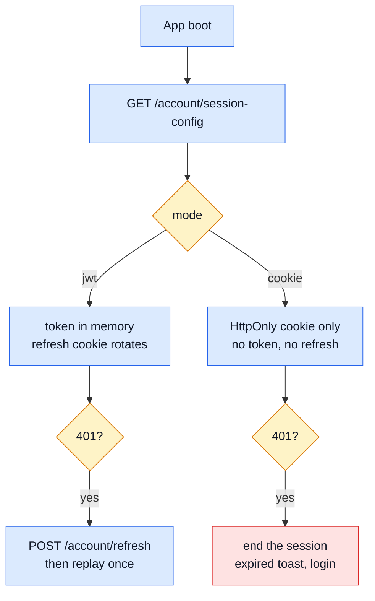
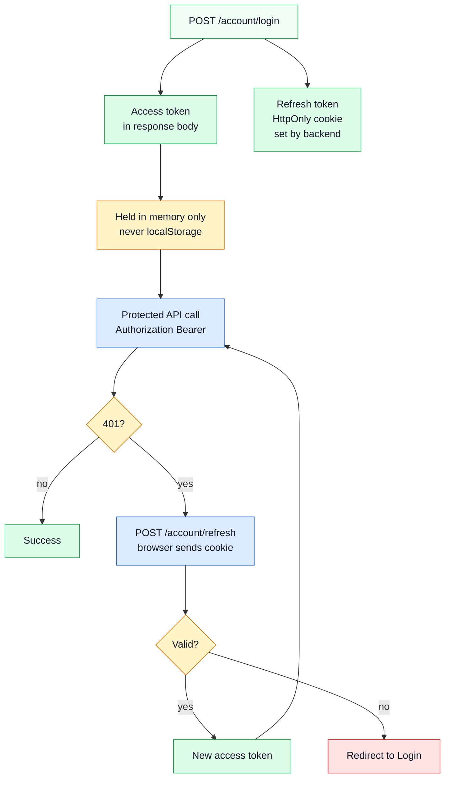
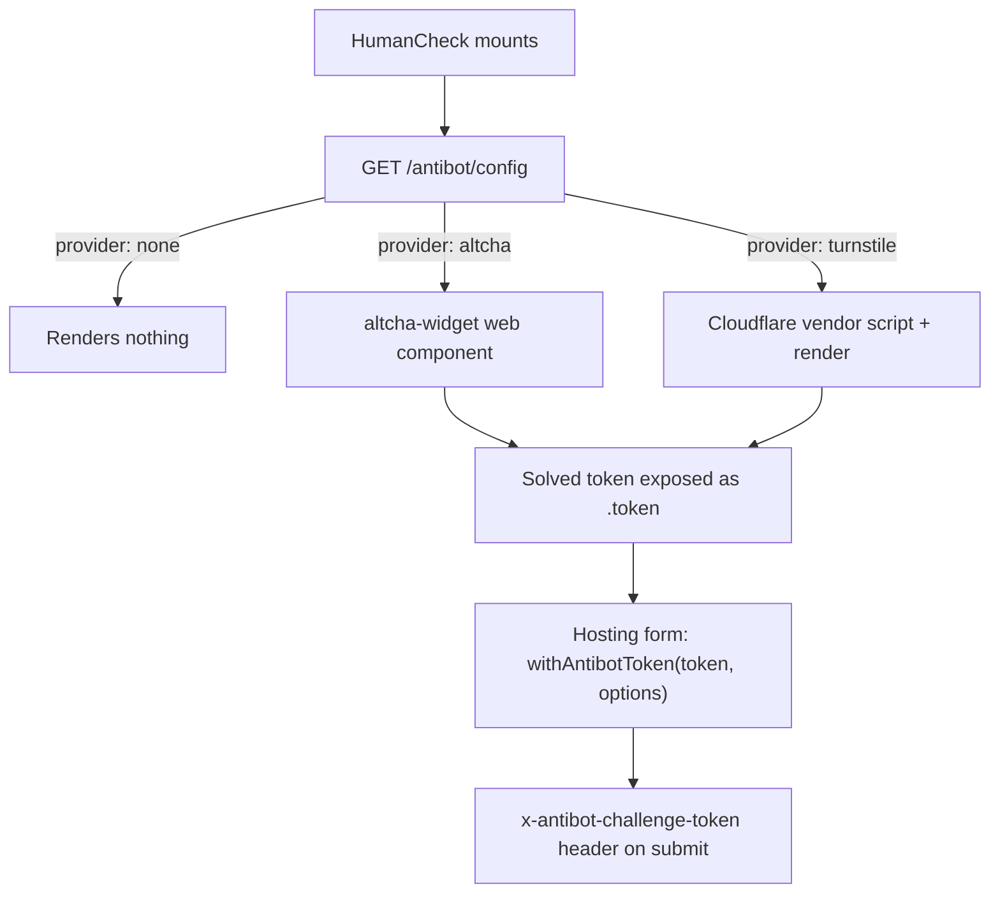

# Security

This page describes security from the **frontend perspective**: how the SPA stores and uses auth tokens, and how route guards enforce access control.

For the backend auth architecture (JWT signing, bcrypt, refresh token DB storage), see the [backend docs](https://github.com/Guebbit/boilerplate-node-backend).

## Two session modes

The backend keeps people signed in one of two ways, chosen per deployment by `NODE_SESSION_MODE`. The SPA has no switch of its own: `useSessionStore().loadSessionMode()` reads `GET /account/session-config` once per tab and every code path adapts.

| Mode            | What the SPA holds                                     | On a `401`                                       | After a reload                                                       |
| --------------- | ------------------------------------------------------ | ------------------------------------------------ | -------------------------------------------------------------------- |
| `jwt` (default) | an access token in memory, a rotating refresh cookie   | `POST /account/refresh`, then replay the request | `isAuth` hint cookie, then a refresh, then `GET /account`            |
| `cookie`        | nothing readable: one `__Host-session` HttpOnly cookie | the session is over; no refresh (it is a 404)    | `isAuth` hint cookie, then `GET /account` (a `401` ends the session) |

Both modes write the same `isAuth` and `rememberMe` hint cookies, and both use `__Host-session` as the credential cookie. `session.hasSession` answers "is a session held" in either mode; `session.isAuth` adds "and the viewer is known". Login-shaped responses (login, 2FA, step-up, password change) all go through `session.adoptSession()`, so no caller asks which mode is on. The sessions list shows when each sign-in began and, in `cookie` mode, a device label such as "Firefox on Linux".

The rest of this page describes the `jwt` flow in detail; `cookie` mode drops the token and the refresh step. The backend's sessions theory page explains when to pick which.

## Auth token model in `jwt` mode (what the FE sees)

The backend uses a **split-token model**. The FE receives:

- **Access token** — short-lived JWT returned in the login response body. Sent on every protected API call as `Authorization: Bearer <token>`.
- **Refresh token** — longer-lived JWT stored in an `HttpOnly` cookie set by the backend. The browser sends it automatically on `POST /account/refresh`; the FE never reads it directly.

This keeps the refresh token out of JavaScript access (no `localStorage`, no `document.cookie`).

## Login → auth → refresh flow (`jwt` mode)

## Where token logic lives

| Concern                            | File                                                                                                                                       |
| ---------------------------------- | ------------------------------------------------------------------------------------------------------------------------------------------ |
| Token storage + session state      | `src/infrastructure/session.ts` — the mode, the token or cookie session, a `{ id, email, role, … }` projection, and the caller's own rules |
| The visitor's own account record   | `src/modules/account/stores/profile.ts`                                                                                                    |
| Attaching Bearer token to requests | `src/infrastructure/http/index.ts` (request interceptor)                                                                                   |
| Handling `401` responses           | `src/infrastructure/http/refresh.ts` (refresh and replay in `jwt` mode, end the session in `cookie` mode)                                  |
| Restoring auth on page reload      | `src/app/guards/authentications.ts` → `tryRestoreAuth`                                                                                     |
| Route guards                       | `src/app/guards/authentications.ts` → `canAccess`, `enforceRouteAccess`                                                                    |

## Route guards

A route declares its requirement once, on its own record; `enforceRouteAccess` runs globally in
`router.beforeEach` and applies `canAccess` to it. There is no `isAuth`/`isGuest` guard — one
predicate covers every case, and `AppNavigation` calls the same one to decide whether to show a
link, so a visible link can never bounce you.

The requirement has two halves, and they are ANDed:

| Field                         | Effect                                                                                                                                                                                                                   |
| ----------------------------- | ------------------------------------------------------------------------------------------------------------------------------------------------------------------------------------------------------------------------ |
| `meta.access` absent          | No standing required.                                                                                                                                                                                                    |
| `meta.access: 'auth'`         | Must be logged in. Redirects to `/login?continue=<current-path>` on failure.                                                                                                                                             |
| `meta.access: 'guest'`        | Must NOT be logged in. Redirects to Home if already authenticated.                                                                                                                                                       |
| `meta.access: 'open'`         | Anyone: a guest passes, and a signed-in visitor still has to hold `meta.can`. The cart's own (a guest has one, staff do not).                                                                                            |
| `meta.can: [action, subject]` | Must hold that rule. Redirects to Home on failure — logging in again cannot grant a permission, so no `continue` target is offered.                                                                                      |
| `meta.others: true`           | With `meta.can`: the rule must be held on OTHER people's rows (`session.canOnOthers`). A customer holds `orders.self.read`, which answers `can` yes; only `orders.any.read` answers this. The staff orders page uses it. |

**There is no `admin` level, and that is the point.** A screen names the permission it needs —
`['update', 'Product']`, `['read', 'User']` — and the answer comes from the rules the API
published for this caller at `GET /account/abilities`, which are the same rules the server
enforces. A ladder of role names cannot express the model behind it: `warehouse` may move stock and
not answer a message, `support` may answer a message and not move stock — neither is "more
privileged" than the other — and the boolean that used to stand in for all of it could not say
_administrator of what_.

A rule always implies a session — rules are published for a caller the server identified — so a
stranger is refused before the abilities are consulted at all.

Every refusal notifies the visitor — silently bouncing someone reads as a broken link.

`tryRestoreAuth` runs first in the same `beforeEach` and silently restores the token (via the
refresh endpoint, gated on the `isAuth` cookie), then the viewer, then the rules that go with
them. This ensures public pages (e.g. `ProductsList`) render staff controls correctly after a hard
reload.

### The two scopes

`GET /account/abilities` answers **two** rule lists, and the store keeps them as two abilities:

| Ability           | What it covers                                                      | Who has any                                         |
| ----------------- | ------------------------------------------------------------------- | --------------------------------------------------- |
| `tenantAbility`   | this shop — products, orders, users, locales, webhooks, credentials | everyone, down to the `guest` role a stranger holds |
| `platformAbility` | the installation — health, metrics, the operational audit           | a platform operator, and nobody else                |

They are never merged. A tenant rule can never satisfy a platform key and the reverse is equally
impossible, so `session.can(action, subject)` asks each in turn: a subject is declared in exactly
one scope, so at most one of them can answer yes. That is what lets the observability dashboard be
gated on `['read', 'ObservabilitySnapshot']` like any other screen, instead of on a shop key that
merely correlated with it.

::: warning The client's copy has no authority
It decides what to RENDER, never what is allowed. Every request is re-evaluated server-side. An
empty ability — before the fetch lands, or after it fails — is the least-privileged answer, so a
slow network greys things out rather than opening them.
:::

## Interceptor error handling

| Status | What happens                                                                                 |
| ------ | -------------------------------------------------------------------------------------------- |
| `401`  | Redirect to Login with `?continue=` preserved; form-level actions show auth-focused messages |
| `403`  | Show a clear "forbidden" message (never treated as a server error)                           |
| `5xx`  | Navigate to `/error/500`; `captureException()` sends the error to Grafana Faro               |

## Security properties provided

- **Bearer transport**: access token is not auto-attached by the browser; every protected request must explicitly include it.
- **HttpOnly refresh cookie**: the refresh token is inaccessible to JavaScript, reducing XSS exposure.
- **`sameSite=lax`** (set by backend): reduces cross-site cookie sending in common CSRF scenarios.
- **No PII in Umami**: `identifyUser()` passes the email to Faro (this deployment's own error/session tool, for triage) but strips it before calling Umami's `identify()` — Umami markets itself as privacy-respecting, cookieless analytics, and gets the user id only.

## The human-challenge widget (rung 3)

The backend's antibot rung is off by default (`NODE_ANTIBOT_PROVIDER=none`) but an operator can
turn it on. Once on, `POST /account/signup`, `POST /account/reset` and `POST /feedback/contact`
always require an `x-antibot-challenge-token` header; `POST /account/login` and
`POST /payments/:id/confirm` only require it after a prior failure — see
`boilerplate-node-backend/docs/modules/antibot.md`.

`src/ui/organisms/HumanCheck.vue` is the one provider-neutral component every gated form mounts:

| Concern                                       | File                                                                                                      |
| --------------------------------------------- | --------------------------------------------------------------------------------------------------------- |
| The widget itself                             | `src/ui/organisms/HumanCheck.vue`                                                                         |
| Header attach + 401 detection                 | `src/infrastructure/http/antibot.ts`                                                                      |
| Always-guarded forms (signup, reset, contact) | Mount `<HumanCheck>` unconditionally                                                                      |
| Conditionally-guarded forms (login, payment)  | Mount `<HumanCheck>` only after `ANTIBOT_VERIFICATION_FAILED`, then let the visitor retry the same submit |

**Why `altcha` is the one npm dependency.** It is the official web component for the backend's
self-hosted `altcha` provider — same project family as the backend's `altcha-lib` — MIT-licensed,
actively maintained, and typed. Its `Challenge`/`ChallengeParameters` types match the backend's
`AntibotChallenge` contract schema field-for-field, so `HumanCheck.vue` fetches a challenge through
the generated client and hands it straight to the widget's `.configure()`, no translation layer.
**Turnstile gets no wrapper**: it is one vendor `<script>` tag and one `window.turnstile.render()`
call, not worth a dependency — see `docs/tools/package-dependencies.md`.

## External references

- [OWASP SPA Security Cheat Sheet](https://cheatsheetseries.owasp.org/cheatsheets/HTML5_Security_Cheat_Sheet.html)
- [OWASP JWT Cheat Sheet](https://cheatsheetseries.owasp.org/cheatsheets/JSON_Web_Token_for_Java_Cheat_Sheet.html)

## Related pages

- [Sitemap & Access Control](../theory/sitemap.md)
- [Request Flow](../theory/request-flow.md)
- [State & Routing](./state-and-routing.md)
