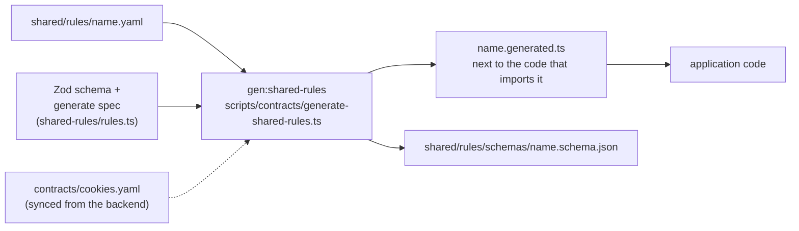

# Shared rules

A rule that is only **data** (a list, a map, a few names) lives in a YAML file under
`shared/rules/`, checked by a Zod schema, and `npm run regenerate` turns it into a committed
`as const` TypeScript file the code imports. The point is a second reader: another frontend, or a
doc, can take the YAML without taking the code.

The backend runs the same generator over its own `shared/rules/` (see the shared-rules page in its theory docs).
This page is the frontend's half.

## How a file becomes code

- `npm run check` runs the generator with `--check`: a stale generated file or schema fails it.
- The generator writes only what the registry lists. A YAML nobody lists is dead data.
- Two shapes, the backend's: `verbatim` (dump the parsed data) and `keyed-list`
  (`{ value, description }` rows become `{ KEY: 'value' }`). Nothing here uses `keyed-list` yet.

## Today

| YAML                                     | Generated file                                                       | Read by                                |
| ---------------------------------------- | -------------------------------------------------------------------- | -------------------------------------- |
| `shared/rules/browser-storage.yaml`      | `src/infrastructure/browser-storage.generated.ts`                    | `browser-storage.ts` (names and items) |
| `shared/rules/static-pages.yaml`         | `src/app/utils/static-pages.generated.ts`                            | `static-pages.ts`                      |
| `shared/rules/tours.yaml`                | `src/app/tours/tours.generated.ts`                                   | `app/tours/catalogue.ts`               |
| `shared/rules/notification-screens.yaml` | `src/modules/notifications/domain/notification-screens.generated.ts` | `notifications/domain/describe.ts`     |

Not data on purpose: the route table (73 routes; the router would have to be rebuilt from data plus
a component map) and the theme palette. Both wait for a second frontend that needs them.

## Browser storage: two sources, one order

The inventory merges two files. The backend's cookies arrive as `contracts/cookies.yaml`
(`sync:frontend` copies it; never edit it here). This repo's own items and the display order are in
`shared/rules/browser-storage.yaml`.

`order` lists **every** id. The build fails when the backend adds a cookie the order has no place
for, when an id is listed twice or has no row, when an own row reuses a backend id, or when two rows
share a stored name. Purpose and lifetime texts are not in either file: they are translation keys
under `browser-storage.rows.<id>`.

The synced file is read through a loose schema (`syncedCookiesSchema`): the backend owns the rest of
each row. It accepts only `necessity: necessary` and `setter: backend`, because the frontend's table
has no word for anything else; a backend row that says otherwise fails the build instead of showing
a wrong cell.

## Adding a rule

1. Write `shared/rules/<name>.yaml`, a comment on every list saying why it is shaped that way.
2. Add its schema and one row (`source`, `inputs`, `generate`) to `SHARED_RULES` in
   `scripts/contracts/shared-rules/rules.ts`.
3. `npm run regenerate`, then import the generated constant where the literal used to be.
4. Add the schema's refusals to `tests/unit/scripts/contracts/shared-rules.spec.ts`.
