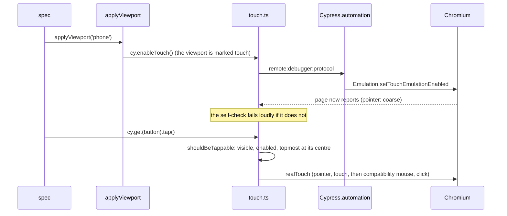
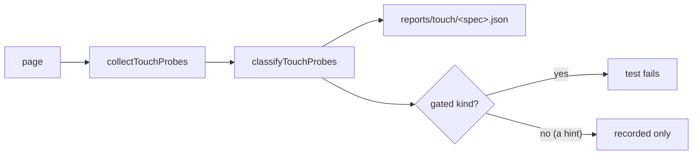

# Touch testing

A phone is not a narrow desktop. A finger cannot hover, taps fire compatibility mouse events, and a
swipe can do things a click never did. This page is how the e2e suites become a touch device, and
what they check once they are one.

Theory (why input is not width, why a tooltip is a mouse thing): [Pointer vs touch](../theory/design-system.md#pointer-vs-touch).

## What emulation changes

Chrome DevTools Protocol touch emulation (`Emulation.setTouchEmulationEnabled`) flips, live and with
no reload:

| The page reads             | Mouse | Touch emulation |
| -------------------------- | ----- | --------------- |
| `(hover: hover)`           | true  | false           |
| `(any-hover: hover)`       | true  | false           |
| `(pointer: coarse)`        | false | true            |
| `'ontouchstart' in window` | false | true            |
| `navigator.maxTouchPoints` | 0     | 5               |

What follows from that CSS:

- Vuetify shows the clear "×" of a `clearable` field all the time under `(hover: none)`.
- Tailwind wraps `hover:` in `@media (hover: hover)`, so a `group-hover:` reveal never happens.
- Vuetify has **no touch branch** in its components. A tap fires the compatibility `mouseenter`, so a
  `v-tooltip` opens on a tap and stays open until a tap lands elsewhere.

Measured on Electron 37 and Chromium 154. Calls that look useful and are silent no-ops here, so are not
used: `setEmulatedMedia` for hover/pointer, `setEmitTouchEventsForMouse`, `setDeviceMetricsOverride`.

## How it works

- **One switch.** `Viewport.touch` in `scripts/e2e/viewports.ts` says which sizes are touch devices.
  `applyViewport` (`tests/support/e2e/apply-viewport.ts`) turns emulation on or off to match. A spec that
  calls `applyViewport('phone')` is a touch device with no code of its own.
- **The self-check.** Some emulation calls answer OK and change nothing. `cy.enableTouch()` asserts that
  `(pointer: coarse)` is now true, and names the Cypress and browser version if not.
- **A live flip is safe.** Vuetify computes `SUPPORTS_TOUCH` once at import, but no component reads it.
  A spec that asserts `ontouchstart` must still switch **before** `cy.visit`.
- **The per-spec leak.** Emulation survives into the next test of the same spec. A root `afterEach` in
  `touch.ts` resets it (`{ enabled: false }` alone: adding `maxTouchPoints: 0` throws).
- **Chromium only.** `enableTouch` throws elsewhere: a phone case that passes without touch proves nothing.

## The commands

| Command               | What it does                                                                                                   |
| --------------------- | -------------------------------------------------------------------------------------------------------------- |
| `cy.enableTouch()`    | Emulation on, with the self-check.                                                                             |
| `cy.resetTouch()`     | Emulation off, if this spec turned it on.                                                                      |
| `.shouldBeTappable()` | Visible, enabled, and the topmost element at its centre. Fails naming what covers it.                          |
| `.tap()`              | `shouldBeTappable()`, a wait for the box to hold still for two frames, then `realTouch` (cypress-real-events). |
| `cy.tapAway()`        | Taps the page heading: closes a sticky tooltip the way a person does. Moving the mouse does not.               |

`.click()` is not a tap. It is a synthetic mouse event: no `touchstart`, and Vuetify's touch paths never run.
`realTouch` checks nothing itself and does not wait for an element to stop moving, which is why `.tap()` runs the actionability checks and waits for the box to settle first: a bar that re-flows when the bell arrives would send the finger to its neighbour.

## The scan

`cy.checkTouchReachable(context)` reads the page into plain records (`collectTouchProbes` in `touch.ts`)
and judges them with a pure classifier (`scripts/e2e/touch-findings.ts`, unit tested with no DOM).

| Rule                     | Fires when                                                                                | Gated |
| ------------------------ | ----------------------------------------------------------------------------------------- | ----- |
| `hidden-control`         | An interactive control is at effective opacity below 0.1, or `visibility: hidden`.        | yes   |
| `title-only-data`        | A `title` holds text the element does not show: CSS clipped it, or JS cut it to `abc...`. | yes   |
| `tooltip-on-non-control` | A Vuetify tooltip hangs on a non-interactive element.                                     | yes   |
| `title-only-hint`        | A `title` adds a hint nothing cut off. Recorded for triage.                               | no    |

The allowlist is closed: the visible input of a Vuetify selection control, `input[type=file]` inside a
file input (the glyph or button beside them is the control), and the `input` or `textarea` inside a
`.v-field` (at rest its label sits on top of it, at opacity 0, and the field takes the tap and focuses it). Findings with the same kind and detail are
grouped, with a count and up to three selectors.

Where it runs: the shell contract in `tests/e2e/specs/touch.cy.ts`. It carries a committed red/green case
that doctors the page and expects exactly the two findings, then none.

It also runs in every module's viewport sweep (`tests/support/e2e/a11y-sweep.ts`), as a column of the layout
matrix: once, at `phone-small`, the narrowest width, where truncation is worst. The four rules do not
depend on width, so a scan at every touch size would cost four times for no extra catch. A case pinned to a
touch size (the drawer and dialog cases at `phone`) is scanned there instead, once, since it never visits
the matrix. Like the matrix it runs on the demo profile's `jwt` leg, and the report key is
`<case> @ <viewport>`.

A worked example: the audit trail cut a request id to `abc12345...` and kept the rest in a `title`, which
is exactly `title-only-data` (the text is the title cut short in JavaScript). The cell now has a copy button
whose name carries the whole id and no `title`, so the observability audit route scans green. The scan's
first sweep also showed its own false positive: an empty text field has its input at opacity 0 under the
label, so the input is on the allowlist above.

## Determinism rules

- Switch emulation before the visit when import-time state matters.
- Never wait on time. Overlays: Vuetify's `.v-overlay--active` class.
- Close a sticky tooltip with `cy.tapAway()`, not a mouse move.
- Tooltip content ignores pointer events, so compare **rectangles**, not a hit test.
- Put touch `describe`s **last** in a spec that mixes pointers: see the next section.

## Live Chromium

Headless Chromium has no mouse: it reports `hover: none` and no pointer, so the same spec renders
different CSS than in Electron. `scripts/e2e/browser-launch.ts` launches it with Blink settings that
report a hovering, fine pointer. After a touch reset Chromium falls back to "no pointer", not to the
flag. That is exactly the old live state, so it is never worse. The live check runs in
[Live E2E](./live-e2e.md), never inside a lane.

## What it cannot do

Things to judge by hand (the design manual's checklist): iOS WebKit's "first tap is hover", the on-screen
keyboard covering a field, gesture velocity, long-press callouts, safe areas, momentum scroll.

## Cost

| Piece                       | Cost                                                 |
| --------------------------- | ---------------------------------------------------- |
| `touch.cy.ts`               | one spec, a few seconds per case in the demo profile |
| The scan                    | one DOM pass per audited state; no network           |
| Every `applyViewport` phone | two extra CDP calls                                  |

## Files

| Path                               | Contents                                              |
| ---------------------------------- | ----------------------------------------------------- |
| `tests/support/e2e/touch.ts`       | The commands, the collector, `cy.checkTouchReachable` |
| `tests/support/e2e/touch-task.ts`  | The Node task that writes `reports/touch/<spec>.json` |
| `tests/support/e2e/spec-report.ts` | The read-merge-write both report tasks share          |
| `scripts/e2e/touch-findings.ts`    | The pure classifier                                   |
| `scripts/e2e/browser-launch.ts`    | The desktop pointer for headless Chromium             |
| `tests/e2e/specs/touch.cy.ts`      | The shell's touch contract                            |
