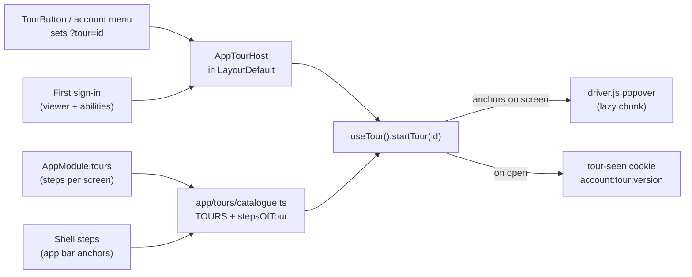

# Guided tours

A short, skippable walk through the app that opens by itself the first time an account is seen on
a browser, and can be opened again any time. Built on [driver.js](https://driverjs.com/).

## What it does

| Tour          | Opens                                          | Shows                                                                   |
| ------------- | ---------------------------------------------- | ----------------------------------------------------------------------- |
| `welcome`     | by itself after the first sign-in, then replay | the app bar and the entries this account can see, then the account menu |
| `checkout`    | "Show me around" on the cart, or `?tour=`      | lines, delivery and payment, note, total, place order                   |
| `order-staff` | "Show me around" on an order, staff only       | payment, shipment, timeline                                             |
| `stock-board` | "Show me around" on the stock page             | receipt and adjustment forms, the board, the ledger                     |

Page tours never open on their own. Nothing blocks: Esc, the close button and a click outside all
end a tour, and the focus goes back to where it was.

## How it fits together

- **A module adds steps** with `tours` on its `AppModule` (beside `navigation`): `{ tour, id,
target, title, body, order }`. `target` is the value of a `data-tour="…"` attribute on the page.
  On a Vuetify component the attribute lands on the wrapper, which is the element worth
  highlighting. `title` and `body` are i18n keys in the module's own `locales/*.json`.
- **A step whose anchor is not on screen is skipped.** That is the whole per-role story: a nav
  entry an account cannot see is never rendered, so its step falls away. The FE never names roles.
- **A new tour** needs one line in `TOURS` (`app/tours/catalogue.ts`), its steps, and a
  `<TourButton tour="id" />` on the page. An unknown `?tour=` value is ignored.
- **`useTour` is the only file that imports driver.js.** The library and its stylesheet load on
  first use, so they are not in the boot bundle.

## Seen, and bumping a version

"Already seen" is a first-party cookie (`toursSeen`), the same kind as the theme choice
(`infrastructure/theme-preference.ts`) and exempt from consent as a remembered interface choice.
It holds a list of `accountId:tourId:version` keys, newest last, capped at 40.

- It is **per browser**: a new browser or device shows the tour again. Storing it on the account
  was the alternative; it would need a field on `PATCH /account`, and is not built.
- It is recorded **when the tour opens**, not when it closes, so a reload mid-tour does not bring
  it straight back.
- **Bump `version` in `TOURS`** to show a changed tour once more to everyone.

## The switch

`TOURS_ENABLED` (`VITE_TOURS_ENABLED` at build time, overridable at container start like the other
[runtime values](./environment.md)) is on unless it reads `false`. Off, no tour opens, the account
menu entry and the "Show me around" buttons are gone. The Cypress `window:before:load` hook injects
it **off** so a first-login tour never covers the screen under test; `tours.cy.ts` turns it on
per visit.

## Tests

| File                                          | Covers                                                                                               |
| --------------------------------------------- | ---------------------------------------------------------------------------------------------------- |
| `tests/unit/app/tours.spec.ts`                | step order, absent anchors dropped, copy exists in both languages, axe on the popover, Esc and focus |
| `tests/unit/app/tour-host.spec.ts`            | when the welcome tour opens, `?tour=` handling                                                       |
| `tests/unit/infrastructure/tour-seen.spec.ts` | the seen key includes account and version; damaged cookie                                            |
| `tests/e2e/specs/tours.cy.ts`                 | first sight, skip, stays closed, replay from the menu, `?tour=`                                      |

## Why driver.js

MIT, small, no framework, keyboard support, maintained. Shepherd.js (v14 and later) and Intro.js
are AGPL-3.0, which a commercial shop would need a paid licence for; `vue-tour` was last released in 2022. `v-onboarding` (MIT, Vue-native) was the close second.
