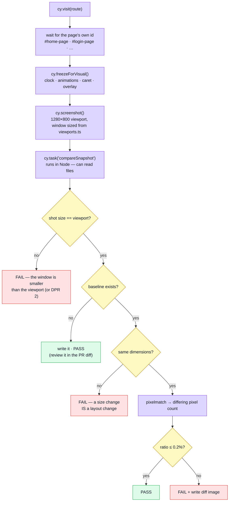
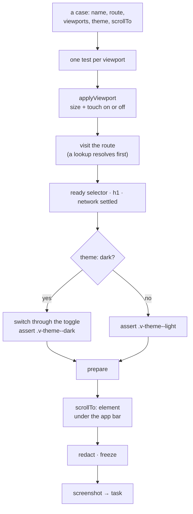
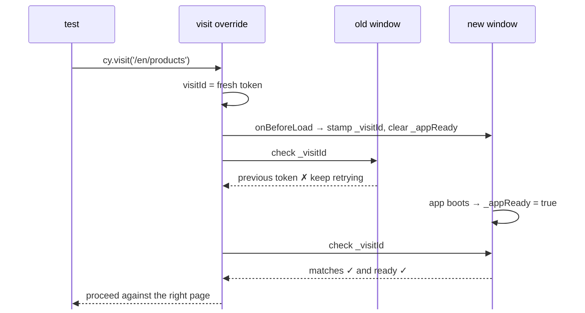
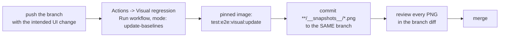

# Visual Regression Testing

Photographing a handful of screens and comparing them, pixel by pixel, against committed baseline images.

## What this layer is for

Every other test in this repository reads the DOM. They ask what exists, what it contains, what it announces. None of them asks what the page **looks like**, and there is a whole class of defect that lives exactly there:

| Defect                                 | What the DOM says                   | What the user sees                 |
| -------------------------------------- | ----------------------------------- | ---------------------------------- |
| A CSS change shifts a layout           | every element present, correct text | content overlapping the footer     |
| A web font fails to load               | text nodes intact                   | fallback font, everything reflowed |
| A dark-mode token goes wrong           | correct colour variable referenced  | grey text on a grey card           |
| A stylesheet is dropped from the build | identical markup                    | unstyled document                  |

In every row the DOM assertions pass. Only the appearance is wrong, and only a picture catches it.



## One main screen per module, plus a phone set by layout family

Visual testing is the classic flake generator, and its failure mode is **social** rather than technical:

1. a screenshot differs for a reason that is not a bug
2. someone re-approves the baseline without looking at it
3. that becomes the habit
4. the suite now produces the paperwork of review without the review

Screens that are genuinely looked at beat a crowd that is rubber-stamped. The rule is **one main screen per module, plus the shell's own** — a module gains a second baseline (a state that is a layout of its own: a modal, a challenge step) by a decision, not a habit, which keeps the count tied to the architecture rather than to somebody's enthusiasm.

The same argument settles what has **no** photograph: reflow at 320 px (WCAG 1.4.10) and landscape overflow are invariants, and an assertion that nothing scrolls sideways beats a picture of it — those are the [layout sweep's](./layout-sweep.md) job. A phone photograph exists only where a layout family changes shape on a phone, and the table below is the list: the pull-request review keeps it, not a coverage spec.

| Screen                                                                        | Owner           | Viewports                          | Layout family it stands for                        |
| ----------------------------------------------------------------------------- | --------------- | ---------------------------------- | -------------------------------------------------- |
| `home`                                                                        | shell           | desktop, phone, tablet; phone dark | marketing content, cards, hero; the hamburger bar  |
| `home-signed-in`                                                              | shell           | desktop, phone                     | the pinned cart and the account menu share 390 px  |
| `drawer`, `drawer, every section`                                             | shell           | phone                              | the drawer exists only below `lg`; the longest one |
| `about`, `faq`                                                                | shell           | desktop                            | long-form prose, accordions                        |
| `not-found`                                                                   | shell           | desktop                            | error state, empty state                           |
| `login`                                                                       | `account`       | desktop, phone                     | centred narrow form at full width                  |
| `login, 2FA challenge`                                                        | `account`       | desktop                            | second step                                        |
| `profile, 2FA panel off`, `profile, 2FA backup codes`                         | `account`       | desktop                            | settings card, modal over a page                   |
| `profile, add-address dialog`                                                 | `account`       | phone                              | the fullscreen-dialog family                       |
| `products-list`                                                               | `products`      | desktop, phone, tablet; phone dark | filter form, product grid                          |
| `product`                                                                     | `products`      | desktop, phone                     | the storefront's main page                         |
| `cart`                                                                        | `cart`          | desktop                            | empty state                                        |
| `cart, one line`                                                              | `cart`          | phone, phone dark                  | lines and totals stack                             |
| `cart, checkout`                                                              | `cart`          | phone                              | below the fold: pickers, payment method, button    |
| `cart, clear confirm`                                                         | `cart`          | phone                              | the app-wide confirm, fullscreen                   |
| `orders-list`                                                                 | `orders`        | desktop, phone, tablet             | data table, stacked on a phone                     |
| `order, awaiting transfer`                                                    | `orders`        | phone                              | the page after checkout: payment panel             |
| `wishlist`                                                                    | `wishlist`      | desktop                            | card list, authenticated                           |
| `users-list`                                                                  | `users`         | desktop                            | admin data table                                   |
| `inventory-ledger`                                                            | `inventory`     | desktop, phone                     | admin forms + table, on the warehouse floor        |
| `contact`                                                                     | `feedback`      | desktop                            | public form                                        |
| `locales-list`, `locales-dictionary`, `locale-entries`, `entity-translations` | `locales`       | desktop                            | admin tables, wide matrix, tabbed form             |
| `admin-dashboard`                                                             | `observability` | desktop                            | KPI tiles, dense numbers                           |
| `realtime-playground`                                                         | `observability` | desktop                            | live-updating panels                               |

That is 43 images: 23 desktop, 14 phone, 3 tablet and 3 dark phone.

## Phone, tablet and dark baselines

A case expands to one test per viewport and theme, and each is its own file, `<name>.<viewport>[.dark].png`, desktop included, so one screen's variants sit together in a pull request's file list.



- **Touch is on for phone and tablet.** Vuetify ships CSS that exists only under `hover: none` (the `clearable` icon, for one), so a phone shot taken with a mouse is not what a phone shows. Desktop cases run with touch off.
- **Segments, not `fullPage`.** Content below the fold is a named `scrollTo` element scrolled just under the app bar, which is what a phone shows after scrolling. A stitched full page repeats the fixed bar in every segment, and a tall viewport changes the layout it is meant to photograph.
- **The light theme is asserted.** The default theme is `system`, so on a dark OS a light case would otherwise record dark pixels without any error.
- **The dark set** is three phone shots (`home`, `products-list`, `cart, one line`).
- **Same thresholds at every size.** `MAX_DIFFERING_RATIO` is a share of the image, and a phone holds about as much text per pixel as a desktop, so the share is the right unit.
- **Device pixel ratio 1**, enforced by the size guard rather than a browser flag.

## Where the baselines live

Beside the spec that takes them:

```
src/modules/products/tests/e2e/
  products.visual.cy.ts
  __snapshots__/products-list.desktop.png
  __snapshots__/products-list.phone.png
```

`cy.compareSnapshot()` resolves the directory from `Cypress.spec.relative`, so nothing is configured per module — a new module's first baseline lands in the right place by existing. **The point is deletion**: `rm -rf src/modules/products` takes its photographs with it, where a central folder would be left holding a picture of a screen the app no longer serves and nothing would ever notice.

Diffs go the other way, to `reports/visual-diff/` — one gitignored folder, because a diff is throwaway output of a failed run and CI uploads it from one place.

## Not in the gate — deliberately

The visual specs sit inside `src/modules/*/tests/e2e/`, which is also the functional e2e glob, so `scripts/e2e/run-shards.ts` excludes them **by the `.visual.cy.ts` suffix**. Without that the merge gate would have silently acquired a dozen pixel-comparing specs, and the first font update would have looked like an application regression.

`npm run test:e2e:visual` is where they run.

Adding a fifth is cheap. Adding a fiftieth is how the suite dies.

## The two tolerance numbers

Both live in `tests/support/e2e/visual-task.ts`, deliberately spelled out rather than hidden in a plugin's options.

**`PIXEL_THRESHOLD` (0.15)** — per-pixel colour tolerance. How different two pixels must be before `pixelmatch` counts them as different _at all_. This absorbs antialiasing and sub-pixel font rendering, which differ between machines with nothing having changed.

**`MAX_DIFFERING_RATIO` (0.002)** — how much of the image may differ before the test fails. This is the one that separates classes of change:

```
a font rendered a hair differently   →  tens of pixels     →  0.00x%   pass
one word of copy changed             →  hundreds           →  0.0x%    pass
a button restyled                    →  thousands          →  0.x%     fail
a layout shifted by 120px            →  45,000             →  4.9%     fail
```

Both are deliberately loose. A visual test that fails on noise is worse than no visual test, because it trains people to ignore it.

## Determinism: the five things that must be pinned

A screenshot is only useful if an unchanged app produces identical pixels twice. Five things break that, and the last one is the one nobody expects:

1. **Viewport and window** — the viewport is pinned to 1280×800 in `cypress.config.ts` (the `desktop` entry of `scripts/e2e/viewports.ts`), in a browser window sized from the same matrix. Image size is part of the diff. See [The browser window](#the-browser-window).
2. **Clock** — frozen by `cy.freezeForVisual()`. Anything rendering a date or a relative time changes by the minute.
3. **Animations** — killed by the same command, via an injected stylesheet that zeroes every `transition` and `animation`. A screenshot caught mid-transition differs from itself between runs.
4. **Data** — the demo profile, whose backend puts the same dataset back on every restore. `cy.restore()` in the `beforeEach` guarantees identical data and a signed-out session; the navigation gains a whole column (Cart, Orders, the account email, Logout) when signed in, so auth state changes the layout, not just the content.
5. **The page actually being the page.** See below — this one was a real bug.

### The browser window

A headless browser opens a 1280×720 window, and `cy.screenshot({ capture: 'viewport' })` clips to it. So every baseline was 1280×720 while the configured viewport said 1280×800, and a phone viewport (taller than 720) would have been clipped the same way.

- **One launch handler.** `cypress.config.ts` registers a single `before:browser:launch`, because Cypress keeps only the last one registered. It calls `withWindowSize` from `scripts/e2e/browser-launch.ts` with `windowFor(VIEWPORTS)`: the widest width and the tallest height of the matrix, taken independently (today 1280×844).
- **Headless only.** `cypress open` keeps the developer's window; Firefox has no visual run.
- **The guard.** `compareSnapshot` hands the task the page's own `innerWidth × innerHeight`. `shotSizeProblem` (`scripts/e2e/shot-size.ts`) runs before any baseline logic, update mode included: a clamped shot, or a double-density one, fails with its own message and can never be recorded as a baseline. It is a different failure from "size changed vs the baseline".
- **The real path.** The PNG's path comes from `cy.screenshot`'s `onAfterScreenshot`, not from a rebuilt string, so a single-spec run (`test:e2e:spec`) finds its file too.

Touch emulation (`tests/support/e2e/touch.ts`, switched by `applyViewport`) is a separate seam that the next lanes document.

### Scrollbars

The two visual scripts set `ELECTRON_EXTRA_LAUNCH_ARGS=--hide-scrollbars`, so a page that scrolls lays out at the viewport's full width. Without it a phone shot would lay out at 375 px under a 15 px bar: a layout no phone shows. The flag is scoped to the visual process, so the layout sweeps keep real scrollbars. A sentinel test at the end of `tests/e2e/visual/visual.cy.ts` checks `clientWidth` equals the viewport width on a scrolling page.

### The bug this suite found in the test harness

`cy.visit()` is overridden in `tests/support/e2e/commands.ts` to wait for the app to finish bootstrapping. The original wait was:

```ts
cy.window().should('have.property', '_appReady', true);
```

`_appReady` is set on `window` by the app once it has booted — and the **outgoing** `window` object survives right up to the moment the new document commits. So on the second `cy.visit()` inside a test, that assertion could look at the page being navigated _away from_, see a flag it set long ago, and resolve immediately. Every command afterwards ran against the previous screen.

In an ordinary spec this is almost invisible, because `cy.get()` retries: the page swaps underneath it and the assertion passes a beat later. It is entirely visible to anything that reads the page **once** — a screenshot, `cy.document()`, `location.href`.

It surfaced as a baseline for `/en/this-route-does-not-exist` that was a photograph of the home page, and as an accessibility suite that had been auditing the previous route for most of its cases.

The fix is a per-visit token, because the flag has to be something the old window can never satisfy:



The lesson generalises: **a readiness flag that persists across navigations is not a readiness flag.** It has to be scoped to the navigation it describes.

## The three outcomes of a comparison

### No baseline yet → write it and **pass**

A first run cannot fail, because there is nothing to compare against; failing would only mean "this is new". The baseline is committed, so the diff that matters is the one a reviewer sees in the pull request when the image changes — that is where a human actually looks at the picture.

### Different dimensions → **fail immediately**

Comparing images of different sizes pixel by pixel is meaningless, and a size change is itself a layout regression. The message says both sizes rather than a percentage.

### Same size → compare

Over budget writes a diff image to `reports/visual-diff/` — red pixels mark what moved — and the failure message names the file and the update command.

## Updating a baseline

When a change to the design is intended:

```bash
npm run test:e2e:visual:update
```

One viewport at a time goes through the tag filter, not a new script. Tags are namespaced `@visual-*` (`@visual-desktop`, `@visual-phone`, `@visual-tablet`, `@visual-dark`), so no other spec can match them statically; the grep plugin then always takes its run-everything-and-filter path.

```bash
E2E_GREP_TAGS=@visual-phone npm run test:e2e:visual:update
```

The workflow's `tags` input does the same: `update-baselines` with `@visual-phone` re-records only the phone images, and empty means everything.

Then **look at the resulting image diff in the pull request**. That review is the entire point of the layer; skipping it turns the baselines into rubber stamps and the suite into decoration.

## Proving the suite actually works

A visual suite that is silently photographing blank pages passes forever and catches nothing. This one has been falsified — the check that it can fail:

```bash
# inject a layout shift
#   LayoutDefault.vue's own <v-main style="padding-top:120px" …>
npm run test:e2e:visual
#   home: 45043 of 921600 pixels differ (4.887%, budget 0.200%)  ← 1 failing
#   the other screens still pass    ← proves run-to-run stability at the same time
```

That is the check to repeat after touching anything in `freezeForVisual`, the viewport, or the visit override. It caught the blank-baseline problem: an early version recorded images with 19 distinct colours, and `home.png` was byte-identical to `not-found.png`.

A quick sanity signal, when a baseline looks suspicious — a real screenshot of this app has a few thousand distinct colours:

```bash
node -e "const {PNG}=require('pngjs'),fs=require('fs');
for (const f of fs.readdirSync('src/modules/<name>/tests/e2e/__snapshots__').filter(x=>x.endsWith('.png'))) {
  const i=PNG.sync.read(fs.readFileSync('src/modules/<name>/tests/e2e/__snapshots__/'+f)), c=new Set();
  for (let n=0;n<i.data.length;n+=4) c.add(i.data.readUInt32BE(n));
  console.log(f, c.size);
}"
```

## Running it in CI

Screenshots are machine-sensitive. Font rasterisation, subpixel hinting and the exact browser build
all differ between a developer's machine and a CI runner, by more than the 0.2% budget on
text-heavy pages. So the suite runs in **one pinned image**, and the baselines are recorded there
too — never on a host:

| What                   | Where                                                                                |
| ---------------------- | ------------------------------------------------------------------------------------ |
| The image              | `cypress/included:<version>@sha256:<digest>` — pinned in `visual.yml`                |
| The nightly comparison | `.github/workflows/visual.yml`, 02:30 UTC and on demand                              |
| The re-record          | the `update-visual-baselines` job of the same workflow, run by hand, never on `main` |
| The diff images        | uploaded as the `visual-diff` artefact on every run                                  |
| The baselines          | recorded in that same image, committed beside each spec                              |

One image digest serves every job that photographs or measures a page: `visual.yml`'s two jobs share it, so a bump changes both and re-records the baselines in the same commit.

It stays a nightly rather than a merge gate: a red run means "go and look at the picture", and the
artefact is that picture.

### Re-recording the baselines

Only after looking at the diff, and only inside the pinned image. The way to do it is the manual
`update-visual-baselines` job of `visual.yml`:



- It runs in the same image and digest as the nightly, so both sides of a comparison match.
- It commits to the branch it was started from and refuses to run on `main`: the new PNGs reach
  `main` only through a reviewed merge.
- `contents: write` is granted to that one job; the comparison job keeps `contents: read`.
- Nothing changed means nothing committed.

To record locally instead (say, to look before pushing), take the one e2e lock (`flock /tmp/claude-e2e.lock`; the engine here is rootless podman) and copy both checkouts into a container of
the same image; never mount them read-write, because the image's Node would rebuild the host's
`node_modules`. Leave the container on its own network (no `--network host`): the preview (8085)
and the demo backend (3100) both live inside it, and a host-network container would collide with
any other Cypress run using those ports.

From a worktree the backend sits at no fixed relative path, so `BACKEND_PATH` names the committed backend checkout explicitly. The engine is rootless podman (`podman` for `docker`), and `rm -f` can take over a minute to tear down: prove the ports are free before the next run.

```bash
IMAGE=cypress/included:15.18.1@sha256:d133bd7549adb28f82ea4a8c90e8cb73fc28657b8eb32656c771b1d0c5afe047   # the digest pinned in visual.yml
docker run -d --name visual \
  -v "$PWD:/src/frontend:ro" -v "$BACKEND_PATH:/src/backend:ro" \
  --entrypoint sleep "$IMAGE" infinity
docker exec visual bash -c '
  mkdir -p /work/frontend /work/backend
  tar -C /src/frontend --exclude=./node_modules --exclude=./.env --exclude=./.git -cf - . | tar -C /work/frontend -xf -
  tar -C /src/backend  --exclude=./node_modules --exclude=./.env --exclude=./.git -cf - . | tar -C /work/backend -xf -
  cd /work/backend && npm ci && cd /work/frontend && CYPRESS_INSTALL_BINARY=0 npm ci'
docker exec -w /work/frontend -e BACKEND_PATH=/work/backend \
  -e 'BACKEND_DEMO_COMMAND=npm --prefix {backend} run demo' visual npm run test:e2e:visual:update
docker exec -w /work/frontend visual bash -c \
  'find . -path ./node_modules -prune -o -name "*.png" -path "*__snapshots__*" -print | tar -cf - -T -' \
  | tar -xf - -C .
docker rm -f visual
```

`.env` is left behind on purpose: CI has none, and a host `.env` can name paths that do not exist
inside the image. Then review the changed PNGs in the diff, as always. Run the comparison once
more afterwards: a second run on the fresh baselines must be green, or something on a screen
varies per run (see below).

### The preview binds `127.0.0.1`

`test:e2e:visual` starts `vite preview --host 127.0.0.1`. Without it the preview binds
`localhost`, which inside the container resolves to `::1` only, so a client that asks for
`127.0.0.1` never gets an answer. Bound to `127.0.0.1`, `localhost` still works from Node and
Chrome, which try both address families; the app's own origin (`http://localhost:8085`) stays
what the backend's CORS list expects.

### What varies between two runs of an unchanged app

A screen that shows a value minted per run — an id created at boot, a date relative to today, a
freshly random backup code, a live counter or a clock — cannot be compared as it stands. `sweepVisual`'s `redact` option
replaces those elements' text with one fixed placeholder before the photograph. Replaced, not
hidden: a hidden table cell still sizes its column by the text inside it.

## Why hand-rolled rather than a plugin

Visual regression plugins wrap roughly this much code around `pixelmatch`. The part that decides whether the suite is useful or infuriating — the tolerance, and what happens when a baseline is missing — is exactly the part a plugin hides behind options. For a boilerplate, every project copied from it inherits that choice, so it is written out where it can be read and changed.

## File map

| Path                                               | Contents                                                                                                                                       |
| -------------------------------------------------- | ---------------------------------------------------------------------------------------------------------------------------------------------- |
| `tests/e2e/visual/visual.cy.ts`                    | The shell's screens, the readiness selectors, the determinism `beforeEach`                                                                     |
| `tests/support/e2e/visual-sweep.ts`                | `sweepVisual`: a case expands over viewports and theme, then drives the shot                                                                   |
| `tests/support/e2e/apply-viewport.ts`              | `applyViewport(name)`: size and touch for a `VIEWPORTS` entry                                                                                  |
| `tests/support/e2e/sweep-state.ts`                 | The route type, `resolveRoute` and `switchToDarkTheme`, shared with the other sweeps                                                           |
| `tests/support/e2e/visual-task.ts`                 | The comparison itself — thresholds, the three outcomes, diff output. Runs in **Node**, because the browser cannot read the committed baselines |
| `tests/support/e2e/commands.ts`                    | `cy.freezeForVisual()`, `cy.compareSnapshot()`, and the `visit` override with its per-visit token                                              |
| `cypress.config.ts`                                | Registers the `compareSnapshot` task, pins the desktop viewport and registers the one `before:browser:launch` handler                          |
| `scripts/e2e/viewports.ts`                         | The device sizes (`VIEWPORTS`), cy-free, so Node tools can import them                                                                         |
| `scripts/e2e/browser-launch.ts`                    | Pure: `windowFor` and `withWindowSize`, the headless window size                                                                               |
| `scripts/e2e/shot-size.ts`                         | Pure: `shotSizeProblem`, the guard against a clamped screenshot                                                                                |
| `src/modules/<name>/tests/e2e/__snapshots__/*.png` | The committed baselines, `<name>.<viewport>[.dark].png` — reviewed as images, in the PR diff                                                   |
| `reports/visual-diff/`                             | Diff images written on failure. Not committed                                                                                                  |

Note the directory split: the visual spec lives under `tests/e2e/visual/` rather than `tests/e2e/specs/`, because the ordinary `npm run test:e2e` run must not record or compare screenshots. Each npm script scopes itself with `--spec`.

## Commands

| Command                          | Effect                                                           |
| -------------------------------- | ---------------------------------------------------------------- |
| `npm run test:e2e:visual`        | Compare against the committed baselines                          |
| `npm run test:e2e:visual:update` | Re-record every baseline, then review the images                 |
| `npm run test:e2e`               | The functional e2e suite — deliberately excludes the visual spec |

## Where it sits, and where it does not

It is deterministic inside its pinned image, and it runs nightly rather than on each pull request — see [Running it in CI](#running-it-in-ci). It is not a hunter: it will never tell you something you did not already have a baseline for.

It also does not replace accessibility testing. A screenshot cannot tell you that grey-on-grey text fails a contrast ratio; it will happily record it as the baseline and defend it forever. Contrast is [axe's](./accessibility-testing.md) job, and the two layers found different halves of the same theme problems.

## Related pages

- [Accessibility Testing](./accessibility-testing.md) — the other layer that looks at the rendered result, and the one that judges it
- [Component Testing](./component-testing.md) — appearance of a single component, before it reaches a page
- [The demo profile](./demo-profile.md) — the fixed dataset these screenshots depend on
- [Testing (overview)](./testing-and-docs.md) — the map of every layer
