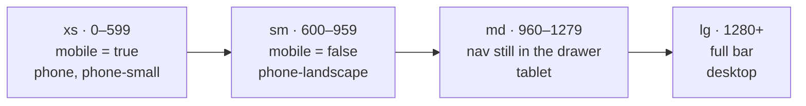
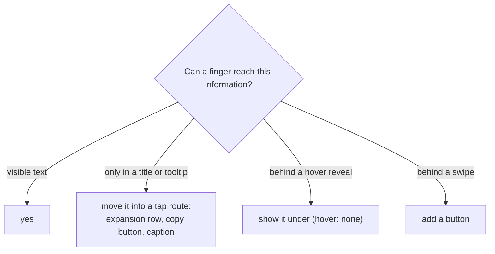

# Design system: touch and layout

Part of [Design System](./design-system.md): hover, phones, breakpoints and pointer vs touch.

## Hover is not a cue on touch

Tailwind v4 wraps `hover:` in `@media (hover: hover)`, so on a phone a hover-only underline, reveal
or colour shift never happens. A link that is underlined only on hover is a plain word on touch.

- Give the **resting** state the cue (`underline`); keep `hover:` for a refinement on top of it.
- `hover:underline`, `hover:opacity-*` and the reveal utilities (`hover:block`, `hover:visible`…)
  are refused as classes; `local/no-hover-only` refuses the handler forms (hover with no click,
  `open-on-hover` without `open-on-click`, gesture-only handlers, a native `title` on clipped text).

## Phone strategy

A dialog binds `:fullscreen="fullscreen"` from `useFullscreenDialog()`, so it fills a phone
instead of floating in it. A Vuetify data table is rendered through the `DataTable` wrapper, which
owns `mobile-breakpoint`, and a `v-table` carries a **named** `v-focusable-scroll`, so its sideways
scroll region is reachable by keyboard. `local/mobile-strategy` enforces all three.

A form or step dialog sits in `DialogShell` (`src/ui/organisms/DialogShell.vue`), which binds
`:fullscreen`, names the dialog by its heading and hands focus back to the opener. `DialogHost.vue`
stays its own `v-dialog` on purpose.

## Breakpoints, viewport bands and layout invariants

Where the layout changes, and the rules a page has to keep at every width. The sweep that checks
them is [Layout Sweep](../build/layout-sweep.md).

### The bands

Vuetify and Tailwind share one set of thresholds (`src/ui/vuetify/breakpoints.ts`), so `useDisplay()`
and `sm:`/`md:`/`lg:` agree. `useDisplay().mobile` is true **below `sm`** (600 px): Vuetify's own
default is `lg`, which would give a 1024 px tablet fullscreen dialogs and finger-sized row buttons.

One matrix size per band is enough, because the layout only changes at a threshold. Two more sizes
are stress cases: 320 px wide (WCAG 1.4.10 reflow) and 390 px tall (a sticky bar and a dialog
fighting for the height).

### A resize equals a load

The sweep loads a page once and resizes it in place. That is sound while nothing reads the width at
mount: the app reads it through Vuetify (which listens to `resize`) and CSS only. A component that
sized itself once, from `innerWidth` or a `ResizeObserver` at setup, would break the premise, and
this is where it would show.

### The invariants, and the standards behind them

| Invariant                                                   | Standard                                                                                          |
| ----------------------------------------------------------- | ------------------------------------------------------------------------------------------------- |
| Content reflows at 320 px with no loss                      | WCAG 1.4.10 Reflow                                                                                |
| Text spacing can be raised without losing content           | WCAG 1.4.12                                                                                       |
| Text can be resized to 200 % (met by zoom)                  | WCAG 1.4.4                                                                                        |
| A focused control is not entirely hidden                    | WCAG 2.4.11 Focus Not Obscured                                                                    |
| A target is 24 px, or has 24 px of room around it           | WCAG 2.5.8 Target Size (Minimum)                                                                  |
| A finger target is 44 px (or has the room) at a phone width | the comfort tier: Apple HIG, Vuetify `large`; **not** 2.5.5 (AAA), which has no spacing exception |
| A field is 16 px or more on a phone                         | iOS Safari zooms the page on focus below 16 px                                                    |

### Geometry, not scroll

Vuetify clips `html` sideways, so an overflowing element is hidden, not scrolled to. The checks read
boxes: an **escape point** is an element past the edge whose parent is not, which is where the
content leaves its container and where the fix goes.

### Fix it in the app

A finding is fixed through Vuetify's props and config (`mobileBreakpoint`, `size`, `scrollable`,
`fullscreen`), or with Tailwind classes on our own markup. Never by overriding Vuetify's internals.
An allowance names one element, for one check, and carries a reason.

## Pointer vs touch

A phone is not a narrow desktop. What a user can do depends on the **input**, not the window width.

- **Input modality is not width.** `hover`, `any-hover`, `pointer` and `any-pointer` (Media Queries
  Level 4) describe the device. A touch laptop is wide and coarse; a tablet with a mouse is both.
  `mobile` (width) and `coarse` (pointer) are separate inputs, and `useTouchFriendlySize` combines
  them: a row action is the 44 px `large` when either is true, so a touch tablet above 600 px gets
  finger-sized buttons and a narrow desktop window does too.
- **Compatibility mouse events and sticky hover.** A tap emits `mouseover`, `mouseenter` and `click`
  (Touch Events, Pointer Events), so a hover state set by a tap sticks until a tap lands elsewhere.
- **A tooltip is a pointer affordance.** Material 3 and WCAG 1.4.13 (content on hover or focus is
  dismissible, hoverable, persistent) describe it. On touch the label lives in the accessible name and
  the icon. Our nav tooltips open on hover only where the device can hover (`useFocusTooltip`), and on
  keyboard focus everywhere.
- **`title=` never carries information alone.** The HTML standard warns that `title` is not exposed to
  touch or keyboard users. Truncated data needs a tap route: an expansion row, a copy button, a caption.
  The audit trail's request and trace ids show their first characters and carry a copy button
  (`useCopyToClipboard`) whose name holds the whole id.
- **Gestures are an enhancement, never the only route**, and never inside an input. WCAG 2.5.1 (pointer
  gestures) and 2.5.7 (dragging). The trap to avoid: a swipe that starts in a text field switching a
  panel. `v-window` swipes between its items, so the translation panels (product create and edit,
  the entity translations screen) are a `v-tabs-window`, Vuetify's own component for a `v-tabs`
  panel set, which does not.
- **Target size** is the layout lane's: WCAG 2.5.8 gates at 24 px, and the 44 px comfort tier applies at
  phone widths.

How the e2e suites emulate a finger and scan for the above: [Touch testing](../build/touch-testing.md).

## Read next

- [Design System](./design-system.md)
