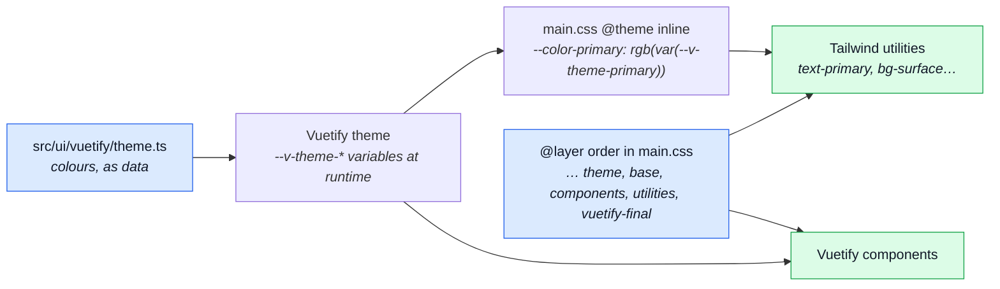
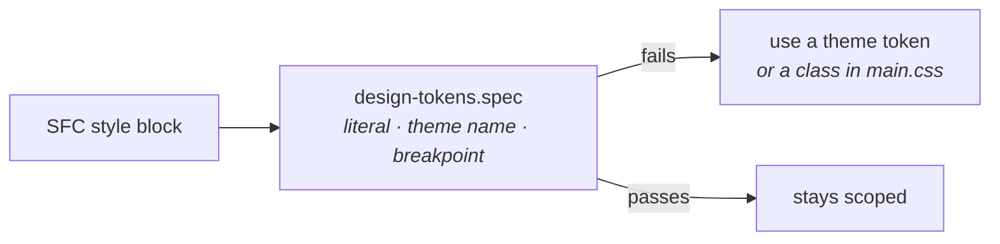
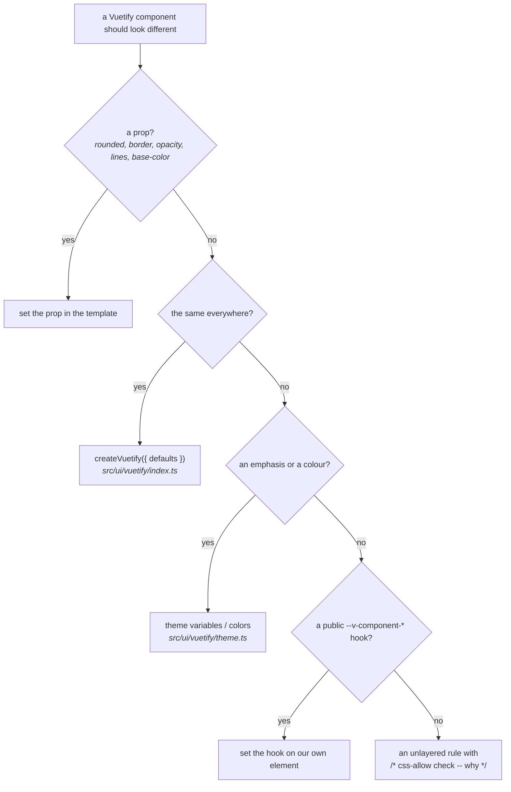

# Design System

How the styling is split between two libraries, and the rules that keep the split from drifting.
The tool that enforces it is [Design Lint](../build/design-lint.md); this page is the _why_.

## Two libraries, one design

Vuetify draws the components. Tailwind lays them out. Both can emit a class with the same name, so
the order they load in decides which one wins.



- **Colours are Vuetify's.** The palette lives in `src/ui/vuetify/theme.ts`. Tailwind's own palette
  and font families are wiped in `main.css`, and each colour it offers is an alias of a Vuetify
  runtime variable. `text-primary` and `<v-btn color="primary">` cannot drift apart, and both follow
  a light/dark switch.
- **The cascade is fixed once.** The `@layer` statement at the top of `main.css` puts Tailwind's
  `utilities` after Vuetify's component styles. When both libraries generate the same class name
  (`rounded-xl` was the live example), the later layer wins, so the two must agree on what a name
  means: see [Names that mean two things](#names-that-mean-two-things).
- **Tailwind reads `src/` only.** See [What Tailwind reads](#what-tailwind-reads).

## Who owns which token

One owner per kind of token, so nobody has to ask which library to use.

| Token                                  | Owner    | Where it lives                                    |
| -------------------------------------- | -------- | ------------------------------------------------- |
| Colour                                 | Vuetify  | `src/ui/vuetify/theme.ts`                         |
| Font family                            | Vuetify  | The Vuetify theme                                 |
| Radius names (`sm` `md` `lg` `xl`)     | Vuetify  | `--radius-*` in `@theme`, set to Vuetify's values |
| Elevation (shadows)                    | Vuetify  | `elevation-N`; Tailwind's shadow scales are wiped |
| Component defaults (rounded, variant…) | Vuetify  | `defaults` in `src/ui/vuetify/index.ts`           |
| Spacing, type size, weight, leading    | Tailwind | The default scale                                 |
| z-index names, layout tokens           | Tailwind | `@theme` in `src/styles/main.css`                 |
| Breakpoints                            | Both     | `@theme` `--breakpoint-*` and the display config  |

Ownership is enforced by **wiping the Tailwind namespace** (`--color-*`, `--font-*`, `--radius-*`,
`--shadow-*`, `--inset-shadow-*`, `--drop-shadow-*`, `--text-shadow-*`), the way colours and fonts
already were. A class from a wiped namespace is unknown to Tailwind, so `no-unknown-classes` says so
with no extra rule.

A custom value added to `@theme` is a token at once: it becomes a valid class, and the lint
accepts it. There is no second list to keep.

## The radius scale

Cards are 24 px, Vuetify's own `xl`, and Tailwind's radius names carry Vuetify's values, so a name
both libraries generate is one thing.

| Name  | Size  | Used by                            |
| ----- | ----- | ---------------------------------- |
| `sm`  | 2 px  | Vuetify                            |
| `md`  | 4 px  | Vuetify; the default for images    |
| `lg`  | 8 px  | `VBtn`, `VAlert` defaults          |
| `xl`  | 24 px | `VCard` default                    |
| `2xl` | 16 px | Tailwind only (nothing in between) |

`rounded-full` and `rounded-none` are static utilities and unchanged. A bare `rounded` (Tailwind v3)
is refused: write `rounded-md`.

## Adding a custom Tailwind token

1. Add the variable to `@theme` in `src/styles/main.css`, in the namespace the utility reads:
   `--container-*` (widths), `--z-index-*`, `--tracking-*`, `--grid-template-columns-*`. A colour that
   follows the theme goes in `@theme inline` as an alias of a `--v-theme-*` variable.
2. Run `npm run lint:fix`. The canonicaliser rewrites every arbitrary value equal to the new token
   into the token.
3. The class is valid, and nothing else needs registering.

Worked example: `--container-toast: min(420px, calc(100vw - 2rem))` made `w-[min(420px,calc(100vw-2rem))]`
into `w-toast` in two files.

## What Tailwind reads

`main.css` imports the utilities with `source(none)` and names one folder: `@source '../'`, which is
`src/`. Without it Tailwind scans every tracked file, so a doc, a wiki page or a plan that merely
writes a class name could change the app's CSS (the root of the card-radius bug below). The index
page uses no Tailwind class, and `node_modules` was never scanned.

## Names that mean two things

Vuetify and Tailwind generate 411 class names between them that overlap. After the radius scale
was aligned, a small set still means something different in each. `tests/cross-cutting/utility-collisions.spec.ts`
measures the set from the real stylesheets, and `ambiguousUtilities` in `scripts/design-policy.ts`
holds it to a list.

| Name                        | Vuetify               | Tailwind                           | Write instead              |
| --------------------------- | --------------------- | ---------------------------------- | -------------------------- |
| `w-25` … `w-100`, `h-25` …  | a percentage          | a fixed length (`w-100` is 400 px) | `w-1/4`, `w-1/2`, `w-full` |
| `h-screen`                  | `100dvh`              | `100vh`                            | `h-dvh`                    |
| `order-first`, `order-last` | `-1`, `13`            | `-9999`, `9999`                    | an explicit `order-N`      |
| `align-baseline`            | `align-items`         | `vertical-align`                   | `items-baseline`           |
| `text-wrap`                 | `white-space: normal` | `text-wrap: wrap`                  | `whitespace-normal`        |

A new collision, or a listed one that stops colliding, fails the spec by name.

## The reasoned escape hatch

A one-off that no token covers takes an inline disable, and the disable has to say why:

```vue
<!-- eslint-disable-next-line better-tailwindcss/no-restricted-classes -- the honeypot must sit off-screen yet stay filled by bots -->
<div class="absolute left-[-9999px]" aria-hidden="true">
```

In a script the same disable goes above the line as `// eslint-disable-next-line … -- why`. Hoist a
class string that spans several lines into a top-level `*_CLASSES` constant so the disable covers
one line exactly.

It cannot rot:

- An **unused** disable is an error (`reportUnusedDisableDirectives`), in scripts and in templates.
- A disable with **no reason** is an error: `@eslint-community/eslint-comments/require-description`
  for scripts, `local/template-directive-description` for `<!-- eslint-disable… -->`.

Known gap: a disable covers the whole line for that rule, not one class on it.

## Colours are names, not literals

A hex, an `rgb(…)` with no `var(`, or a CSS colour name in a string or a style is a finding
(`local/theme-token`). The only home for a literal is `src/ui/vuetify/theme.ts`. A Vuetify colour
prop (`color`, `bg-color`…) takes a theme name; so does a status map in a script, which is typed
`Record<Status, ThemeColor>` so `vue-tsc` refuses a typo or a palette name Vuetify does not have.

The boot surfaces use the same colours. The splash is painted before any JavaScript runs, so
`index.html` repeats the theme's `background` and `on-background` as literals, and a spec holds them
to the theme's values. The address bar follows the theme through `useThemeColorMeta`.

## Scoped styles

Tailwind classes are the default. A SFC `<style scoped>` block is for what a class cannot say: a
multi-layer gradient, a sticky table cell, or the last step of the
[order of resort](#overriding-vuetify-the-order-of-resort) below.

- Theme colours only (`var(--v-theme-X)`, `--detail-accent`), never a literal.
- A declaration used in two SFCs moves to a class in `src/styles/main.css`, parameterised by custom
  properties. `.surface-glow` is the example: the hero glow's structure lives once, each hero sets
  its own colour and numbers.
- A shared class that must beat a Vuetify component background sits in `@layer components`, which
  is declared after Vuetify's component layer.
- Secondary text is the theme's medium emphasis (`variables['medium-emphasis-opacity']`, 0.82):
  use `opacity-muted`, never a `.v-*` opacity rule.
- `tests/cross-cutting/design-tokens.spec.ts` guards it: no literal, no unknown theme name, no
  undeclared breakpoint.



## Overriding Vuetify: the order of resort

Vuetify answers most styling questions itself. CSS that reaches into its classes is a second answer,
and a minor release can rename the class under it. So a change to a Vuetify component goes down this
list and stops at the first step that works:



- `tests/cross-cutting/css-invasiveness.spec.ts` holds it: a `.v-*` selector, `:deep`,
  a `--v-*` override, a raw z-index. `npm run audit:css` lists every
  hit with its fix. Today's hits are frozen in a baseline that only shrinks
  ([Design Lint](../build/design-lint.md#the-invasive-css-scan)).
- **The allowance** is the last step, never the first. It goes right before the one rule or element
  it covers, names one check, and says why:

    ```css
    /* css-allow vuetify-internal -- no prop reaches the field outline */
    .board .v-field { … }
    ```

    In a template it is `<!-- css-allow <check> -- <why> -->`, in a script `// css-allow <check> -- <why>`
    on the line above. One that covers nothing, has no reason, or names two Vuetify parts in one rule
    is itself a finding, like an unused `eslint-disable`.

- **z-index** is a token. A raw value is local stacking only (-1 to 9); anything that layers over the
  app is a `--z-index-*` in `@theme`, read as `var(--z-index-…)`.
- What no check can judge (is an allowance still earned, is a declaration dead, is a stacking order
  coherent) is the `css-invasive` audit skill: `scripts/audit/css-invasive/SKILL.md`.

## Read next

- [Hover is not a cue on touch](./design-system-touch-and-layout.md)
