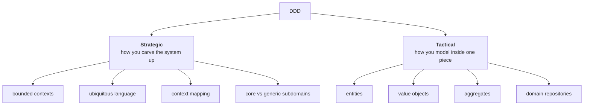

# Domain layer: what DDD is

Part of [Domain layer & DDD](./domain-layer.md): the two halves of DDD, and how it differs from feature folders.

## 2. What DDD is

**Domain-Driven Design** (Eric Evans, 2003) models a business in code. It has two halves.

Most people mean the tactical half when they say "DDD".

## 3. DDD vs feature/domain architecture

Feature architecture is a _packaging_ decision (where do files live?). DDD is a _modelling_ decision (what do the files contain?).

|             | Feature architecture         | DDD (tactical)                |
| ----------- | ---------------------------- | ----------------------------- |
| Answers     | _where does this file live?_ | _how is this rule expressed?_ |
| Unit        | a folder                     | an aggregate                  |
| Deliverable | a directory tree             | a model of the business       |

Immaculate feature folders with zero DDD is a good place to be; the usual failure is the reverse. A bounded context and a feature folder often end up the same directory, but a bounded context is defined by where one model and one language stop being valid, not by where files go.

## Read next

- [Domain layer & DDD](./domain-layer.md)
