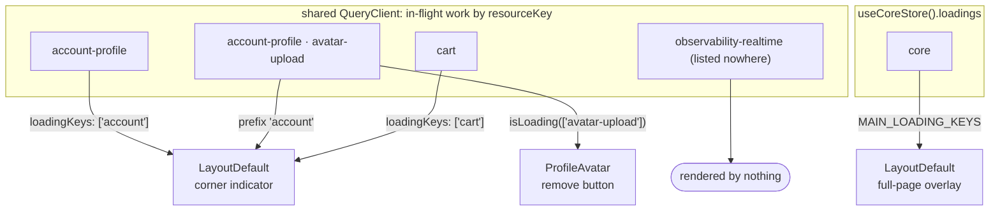

# Loading State

Two things answer "is this loading?", and they never mix:

- **The shared `QueryClient`** (TanStack, `src/infrastructure/query-client.ts`) counts every query
  and mutation in flight, each tagged with its store's `resourceKey`. Every domain store reads and
  writes through it.
- **`useCoreStore`** (vue-toolkit) keeps one hand-set `loadings` dictionary. Nothing in the domain
  stores writes to it; only the full-page overlay reads it, through the `core` key.

Nothing in the UI ORs everything together: every reader names the keys it cares about, which is
what separates a full-page overlay from a corner indicator from a single button's spinner.

## Key naming

A `resourceKey` is the store's Pinia id; a store that owns several resources suffixes it
(`webhooks-subscriptions`, `webhooks-deliveries`). An action inside the store adds a key segment of
its own:

| Key                                 | Set by                                                               |
| ----------------------------------- | -------------------------------------------------------------------- |
| `account-profile`                   | any `useAccountProfileStore` call without its own action key         |
| `account-profile` · `avatar-upload` | `updateProfile` when the payload carries an `imageUpload`            |
| `account-profile` · `avatar-remove` | `updateProfile` when the payload clears the image (`imageUrl: null`) |
| `account-two-factor` · `confirm`    | `confirmMethod`                                                      |
| `cart`, `orders`, `products`, …     | the domain store of the same Pinia id                                |

The resource half is declared once, where the toolkit composable is created:

```ts
useStructureRestApi<Account, string>({ resourceKey: 'account-profile', queryClient });
```

The action half is per call:

```ts
fetchAny(() => apiSetupTwoFactorMethod(method), { key: ['setup'] });
```

TanStack counts per key, so two overlapping calls on one key cannot clear each other.

## Who reads what



Three levels:

- **Full-page overlay** — `isLoading(MAIN_LOADING_KEYS)` on `useCoreStore`, today just `core`. No
  module sets it by default; the static splash in `index.html` covers boot.
- **Corner indicator** — `useIsLoading(SIDE_LOADING_KEYS, queryClient)`, where the list is every
  enabled module's manifest `loadingKeys` (`collectModuleLoadingKeys`). A key is a string prefix of
  `resourceKey`: `'account'` covers `account-profile`, `account-auth`, and so on, and `'webhooks'`
  covers both webhook resources.
- **One control** — the store's own `isLoading(['avatar-upload'])`, exposed as a named computed
  (`uploadingAvatar`, `sendingCode`, `mutatingWithCode`, …). Components bind to those rather than
  declaring local `ref(false)` flags, so two buttons on one store never spin together.

**A resource nobody lists renders nothing in the corner** — that is the point of the opt-in: a
background call can exist without announcing itself, which a blanket OR could never express. A
build whose modules declare no `loadingKeys` shows no indicator at all (`useIsLoading` reads an
empty list as "everything").

A composable that calls `@api` for one mounted caller (see [Layers](./layers.md#store-or-composable-the-test))
keeps its own flag with the toolkit's `useAsyncAction`; nothing else reads it.

## Adding a store

1. Pass `resourceKey: '<pinia id>'` (and `queryClient`) where the toolkit composable is created.
2. Add the module's id to its manifest `loadingKeys` if its work should show in the corner
   indicator. Declaring it there is enough: nobody edits the layout.
3. For an action that needs its own spinner, give the call a `key: ['<action>']` and expose a
   computed from the store — never a local flag in the component.
