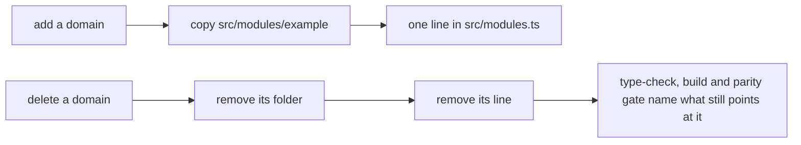

# Modules: adding and deleting a domain

Part of [Modules](./modules.md): what adding or deleting a whole domain touches.

## Adding and deleting a domain

One folder and one line, in both directions. The procedure — the manifest fields and the commands —
is [Adding & removing a module](../build/module-lifecycle.md). What belongs here is
what the exercise taught.

The template to copy is `src/modules/example` ([The module template](./modules.md#the-module-template)): a small note domain with a list, a detail, a create
form, an edit form (with a cover upload) and one public screen, a store over the generated client,
the Zod schemas, the response-schema rows, a provide/inject pair and both
languages. It has no page of its own and a barrel exporting all of it (unused on purpose); `demo:remove` deletes it with the shop, so copy it first. Copy
the folder, rename it, and delete the screens you do not need; delete the folder, and its line in
`src/modules.ts`, once you have your own domain.

Both halves are measured rather than asserted. A scaffold `events` module cost 5 files and 2 lines
in `src/modules.ts`, with **zero** edits to any existing file. Deleting `products`, `cart`, `orders`
**and `account`** together — four folders, five lines, and `account` is the hard one because the app
shell shows who is signed in — left the app shell intact (no menu entry, no sign-in button, no dead
link) but neither `src/` type-checking nor the production build clean: 12 type errors, 4 of them in
the shell (`AppVerificationBanner.vue` and `ReauthDialog.vue` importing `account`'s stores
directly), the rest in `inventory` (which reaches `products`) and `wishlist` (which reaches `cart`);
`vite build` then fails outright on `InventoryLedger.vue`'s static import of the now-missing
`@/modules/products` — real coupling the deletion makes visible, not a flaw in the procedure.

**None of this is fixable inside this repo alone.** The type errors and the failed build name
`inventory`'s and `wishlist`'s direct imports of `products`/`cart` — the coupling the procedure
exists to surface — and `response-schema-map.spec.ts` reports `expected [ 'GET /products', …(25) ]
to deeply equal []` — operations that `openapi.yaml` documents and no enabled module covers.

That is the parity gate working exactly as intended. Deleting a domain from the frontend does not
delete it from a contract shared byte-identically with the backend, so trimming it is a two-repo
change driven from the backend, not a frontend chore. **A green suite here would mean the gate had
stopped checking.**

Getting there took fixing four genuinely different things, and the first is the one worth
remembering:

1. **A route name is a string.** Three places in the app shell addressed a module's route by name,
   and neither the compiler, the type-checker nor lint could see any of them: `Home.vue`'s
   call-to-action pointed at `ProductsList`, and `loginContinueTo` plus the sign-in/sign-up buttons
   pointed at `Login` / `Signup`. Each rendered a control that navigated nowhere, and a 401 with no
   sign-in route aborted the navigation and stranded the visitor with nothing on screen. All now
   ask `router.hasRoute()` first. **This class of bug is invisible to every gate except actually
   deleting the module**, which is the whole argument for running this exercise rather than
   trusting the architecture.

2. **Specs that named a domain.** A platform spec asserting `navigation.label-products-list`, or a
   central parity file importing two modules' handlers, is the same coupling the manifest removed
   from `src/` — just moved into `tests/`. The rule that fixed it:

    > A spec outside a module may **iterate** the registry. It may never **name** a domain.

    So the mechanism tests use invented domains (`public-domain`, `staff-domain`, `/widgets`) and
    invented schemas; the per-domain facts moved into `src/modules/<name>/tests/`; and
    `tests/cross-cutting/registry.spec.ts` sweeps every enabled module for invariants — every
    navigation entry points at a route that module declares, every route is named, every module
    ships the same set of locales — without naming one.

3. **The contract, which is not ours alone.** See above.

4. **One store split into four, along two different seams.** A single `infrastructure` store holding
   the access token _and_ the `User` record puts a domain entity in a delivery tier and makes the app
   shell reach into a domain to render a name. The first seam is `infrastructure/session.ts` — token, plus
   a `{ id, email, role, imageUrl, thumbnailUrl, verified }` projection and the calls a session needs
   to restore or end itself — and the account module's own store. The second seam runs by the same
   logic one level down: `modules/account/stores/auth.ts` establishes or ends a session (login,
   signup, password reset, logout), `stores/profile.ts` owns the editable record itself
   (fetch/update, role view, email verification, account deletion), and `stores/sessions.ts` /
   `stores/addresses.ts` / `stores/oauth-providers.ts` / `stores/two-factor.ts` each hold state scoped to the
   one component that renders it. The shell knows only _someone is signed in, here is their name and
   picture, here is their role_ — the second seam divides responsibilities within the account
   domain, without moving anything across the session/account boundary. The shell's other calls
   that need a session but not the credential lifecycle — the step-up re-proof, the verification
   resend and the language preference — sit in their own files beside `session.ts`
   (`reauth.ts`, `email-verification.ts`, `locale-preference.ts`).

### The honest scorecard

The goal test passes for `src/` and for the suite. It fails only where the answer is not this
repo's to give: the shared contract still documents the deleted endpoints.

That is worth stating precisely, because "green" would have been the wrong outcome.

::: tip Run a deletability test after any significant change
Delete two or three domains on a throwaway copy and see what breaks. Nothing in the suite checks
this, and every finding above was invisible to lint, to `vue-tsc` and to a fully green run — the
dead links most of all. The procedure is
[Re-running the deletability check](../build/module-lifecycle-removing.md#re-running-the-deletability-check).
:::

## Read next

- [Modules](./modules.md)
