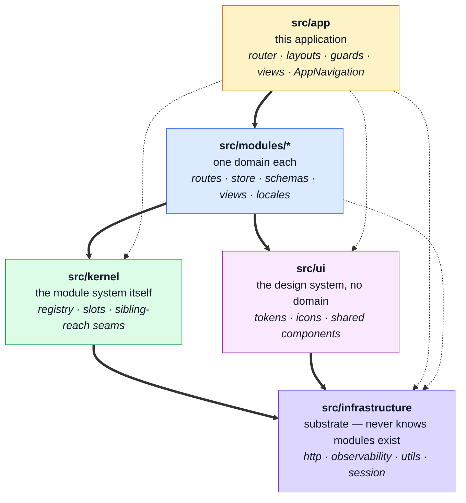
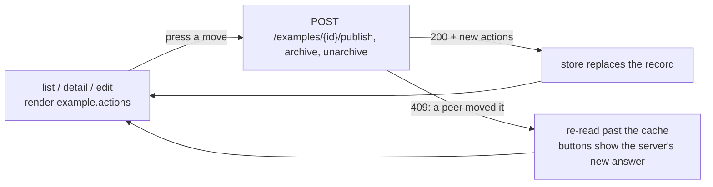

# Modules

This page is the **contract**: what a module is, what it may know, and what it costs to add or
delete one. [Layers](./layers.md) is the folder map; this is the reasoning behind it.

## The goal, stated as a test

> Deleting a domain is `rm -rf` of one folder plus removing one line from a registry, and
> `complete` stays green.

The driving scenario is a boilerplate that gets carved up: today an ecommerce demo; tomorrow an
event portal that keeps users, replaces products with events and drops the cart; later a marketing
site that keeps almost none of it. **"Which slices are in this build" has to be a configuration
question, not a surgery question.**

## The tiers



**Every arrow points down and none points back.** `eslint.config.ts`'s `eslint-plugin-boundaries`
config enforces each edge in both directions — deny by default, an explicit policy per allowed
edge, an unclassified file refused outright. `src/i18n` sits below the diagram's
`infrastructure`, its own tier again: nothing above it, not even infrastructure, may skip it — see
the "extractable i18n runtime" note under [Layers](./layers.md).

Each tier, its folder, what it knows and what it holds: the [Tiers table in Layers](./layers.md#tiers).

### Why `app` exists

The module-system tier, `kernel`, must not hold the router, the layouts, the route guards, the app
views or `AppNavigation`, because they would need an exemption to import `@/modules`, the registry.
That exemption is the whole problem: **the
registry names every enabled domain**, so anything reading it knows this application rather than
this kind of application.

`app` holds what needs to read the registry:

| Folder            | Holds                                                   |
| ----------------- | ------------------------------------------------------- |
| `app/router/`     | splices every enabled module's routes                   |
| `app/components/` | `AppNavigation.vue`, renders every module's nav entries |
| `app/guards/`     | route guards for this app's route tree                  |
| `app/layouts/`    | the app shell, which composes the navigation            |
| `app/views/`      | Home, Error, the prose pages — pages of this app        |

Because they live in `app`, none of them needs an exemption to import `@/modules`.

**This mirrors the backend**, which made the same split at the same time — the tiers there are
`app → modules → kernel → infrastructure`, and `ui` is the one tier a backend has no use for — this repo's fifth.

### The `infrastructure` / `kernel` line

Both repos use one question, and it is the only test that matters:

> **If this project had no modules at all — if it were one undivided app — would this file still
> make sense?**

- **Yes, it still works** → `infrastructure` (or `ui`, if it is a component).
- **No, it becomes meaningless** → `kernel`.

`infrastructure` is not "framework-free" — it is the opposite. It imports axios, vue-i18n and Pinia,
and that is correct: `infrastructure/http/index.ts` is axios-coupled substrate and belongs exactly
where it is. The one thing it may never contain is the knowledge that a module system exists.

Being domain-free is **not enough** to earn a place in `kernel` — most of `infrastructure` and all
of `ui` are domain-free too. A `kernel` file's _purpose_ has to dissolve if modules do. By that test
`kernel` holds the module system and the seams that let one module reach another without importing it:

| File                                       | Why it cannot be infrastructure                                                                           |
| ------------------------------------------ | --------------------------------------------------------------------------------------------------------- |
| `registry.ts`                              | it _is_ the module system: `AppModule`, the nav entries, the route splice                                 |
| `slots.ts`                                 | extension points: a module owns a slot, others contribute components, nobody imports a contributor        |
| `route-link.ts`                            | reaches a sibling's route by name, only when this build ships it                                          |
| `order-link.ts`, `history-link.ts`         | the same reach, for the order page and the audit-log history link                                         |
| `availability.ts`, `work-counts.ts`        | a value one module writes and others read, so readers never import the writer                             |
| `inbox-notices.ts`, `use-badge-refresh.ts` | the bell's notices and the staff badges, read by siblings that must not import the module that fills them |

Each is meaningless in an app with no modules.

Three near misses show where the line falls, because each survives perfectly well in an app with no
modules and none is imported by the registry: `src/ui/molecules/PageSizeSelect.vue` imports
nothing at all, `src/app/components/AppLanguageSwitcher.vue` reads this app's locale list and
drives its locale-prefixed routes, and `src/modules/example/store.ts` is one domain's own state
rather than shared state. None of the three belongs to the module system; each
belongs to the tier its dependencies name.

The tier stays small and unambiguous. Everything domain-free that is _not_ the module system has two better homes already: `ui` for anything with a template, `infrastructure` for the rest.

#### Why these names

`kernel` names what the folder is: a microkernel that loads and connects plugins it has never heard of. The alternatives each mean something else in the wild:

| Name       | Why not                                                                                                   |
| ---------- | --------------------------------------------------------------------------------------------------------- |
| `core`     | overloaded: Nest and Angular use it for the DI container, Spring and Backstage for the substrate          |
| `platform` | in VS Code it is a service and DI layer; in current usage it is the base layer, which is `infrastructure` |

An overloaded name makes a reader think they already know it, and that failure is silent.

### The one arrow that cannot point down

`infrastructure` owns the http client, and `src/i18n` the i18n runtime. The response-schema rows and the translation
dictionaries are domain knowledge. `infrastructure` may not import `@/modules`, so the composition root hands
the data **down** instead of letting the bottom tier reach up:

```ts
// src/main.ts, at module scope
registerResponseSchemas(collectModuleResponseSchemas(enabledModules));
registerLocaleContributors(collectModuleLocales(enabledModules));
```

Each module registers its own response-schema rows, and that registration is what switches contract
validation on for its endpoints: enable the module and its answers are checked, delete the folder and
they are not.

This is the single most surprising thing in the codebase, and the thing most likely to bite: a test
that exercises either subsystem without doing the same wiring silently measures an app with no
domain vocabulary and no contract validation. `tests/support/unit/wire-modules.ts` exists for that.

::: tip The live version of this map
The diagrams on this page explain the **rules**. The context map as it stands — every edge, labelled
with its relationship and its reason, kept in sync by hand against the real imports — is
[the map on the Modules overview](../modules/start.md#the-whole-map), and every node there links to
the domain's own page.
:::

## The manifest

A module is a value, not a convention. Everything the application does _for_ a domain is declared
in one typed object:

```ts
export interface AppModule {
    name: string;
    routes: RouteRecordRaw[];
    navigation?: AppNavigationEntry[];
    responseSchemas?: ResponseSchemaRoute[];
    locales?: Record<string, () => Promise<TranslationDictionaries>>;
    setup?: () => void;
}
```

A navigation entry is `{ name, label, order, icon, section?, badge?, pinned?, detail? }`: the route
it points at, the label key, its rank, its lucide glyph, and the part of the chrome it sits in —
`main` in the bar, `account` or `admin` in a menu. A `pinned` menu entry is lifted onto the bar as
its own button beside the account menu, wearing its `badge` count and the text its `detail`
accessor returns (the cart's total). `section` and `pinned` are placement only; who sees the entry
is still the route's `meta.access`. See [Sitemap](./sitemap.md#navigation-sections).

What subdomain a module sits in, and what kind of relationship each arrow to a sibling is, are the
module's **strategic** declarations too — but they are not fields here. They are prose: the subdomain in the
docblock at the top of each `module.ts`, and each arrow's kind on the module's docs page under "The
map". See [Strategic DDD](./strategic-ddd.md) for why that reads better than a typed `subdomain`
and `dependsOn`.

Each optional field replaces a shared file that would otherwise enumerate domains — the navigation list,
the response-schema table, the locale bundle. That is most of the point: `src/modules.ts` is the
only place that HAS to. The corner loading indicator follows the same rule: a module opts its
stores in with `loadingKeys` (their `resourceKey` prefixes), and `LayoutDefault.vue` collects them.
A module that omits the field is invisible to the indicator, which is the right default for one
whose requests are background noise. `slots` lets a module contribute components to a place another
module owns (`src/kernel/slots.ts`) — the product page's cart and wishlist buttons, and the app
bar's notifications bell — so the owner never imports its contributors. `setup` is boot work a
module owns (the `shop` module loads its settings there), run once after mount: the core never
loads, or reads, what a removable module owns. Who runs the site (`operator`, the Terms version)
is `GET /config`, so the footer, Terms, Legal and Privacy pages keep working with the shop removed.

Which siblings a module may reach at all is enforced separately, by a generated ESLint rule rather
than a manifest field: each module's `module.yaml` `dependsOn` names which siblings it
may import (`eslint.config.ts` reads it) and the backend modules whose API it calls
(`tests/cross-cutting/module-coupling.spec.ts` checks the second), and a reach outside that list fails `npm run lint` at the offending line. A module's own spec may also
reach a listed sibling's `tests/**` (the doubles its siblings seed with); it never reaches a sibling's specs or `tests/e2e/**`.

### Why three fields are lazy

- `locales` — one chunk per locale per domain; a visitor downloads one language for the domains
  this build enables.
- `responseSchemas` is eager: the http client needs the table before the first request.

## The module template

`src/modules/example` is this template in code: the module to copy when you start a new domain, and
to delete once you have your own. Every non-test file opens with the same header —
`In any module:` (the pattern the file is), `Here:` (what it does in `example`), an optional
`Delete it if:`, an optional `Instead see:` and a closing `See:` — and a spec holds them to it.
Its backend twin, `../boilerplate-node-backend/src/modules/example`, shows the same patterns.

| Pattern                                 | Show / point | Where                                                      |
| --------------------------------------- | ------------ | ---------------------------------------------------------- |
| Manifest, routes, loading keys, locales | show         | `module.ts`, `routes.ts`, `locales/`                       |
| Store over the generated client         | show         | `store.ts`                                                 |
| Server-decided controls (`actions`)     | show         | list rows, detail, `components/ExampleStatusActions.vue`   |
| An action door and its 409              | show         | `composables/use-example-transition.ts`                    |
| A stale edit (412, "reload latest")     | show         | `views/ExampleEdit.vue`                                    |
| An idempotent create                    | show         | `store.ts` (`useIdempotencyKey`)                           |
| A reading rule in `domain/`             | show         | `domain/publication.ts`                                    |
| Upload with progress                    | show         | `views/ExampleEdit.vue`                                    |
| Typed provide/inject                    | show         | `provided.ts`                                              |
| A barrel                                | point        | `example/index.ts`                                         |
| A slot contribution                     | point        | `wishlist/module.ts`                                       |
| Step-up, antibot, realtime              | point        | `infrastructure/http/step-up.ts`, `tasks`, `observability` |



### Standards the template follows

The backend owns each of these and writes it once; the frontend follows it and never restates the
rule. The backend's "Standards the template carries" table
lists where each one lives.

| Standard                                 | What the frontend does                                            |
| ---------------------------------------- | ----------------------------------------------------------------- |
| `actions` on every read and write        | renders a control only from the flag; no status table of its own  |
| A status change is a door per event      | one button per open flag, each calling its own generated function |
| A refused lifecycle move is 409 + a code | shows the message in place, re-reads the record past the cache    |

Copy the folder, rename it, delete the screens and the patterns you do not need (each header says
when), and delete `example` once you have your own domain. The transition table lives on the
backend; a client never holds one (`actions.publish`, `archive` and `unarchive` are the server's answer).

## Related pages

- [Adding and deleting a domain](./modules-adding-and-deleting.md)
- [Modules overview](../modules/start.md) — every domain, one page each

- [Adding & removing a module](../build/module-lifecycle.md) — the procedure, with the commands
- [Layers](./layers.md) — the folder map
- [Architecture](./architecture.md)
- [Unit testing](../build/unit-testing.md) — where a spec lives, and why
- [The demo profile](../build/demo-profile.md) — why the handlers live under `src/`
