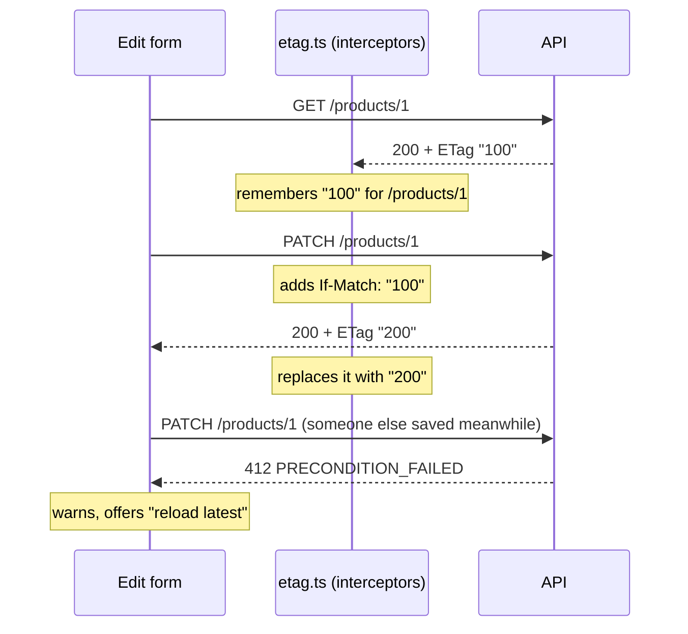
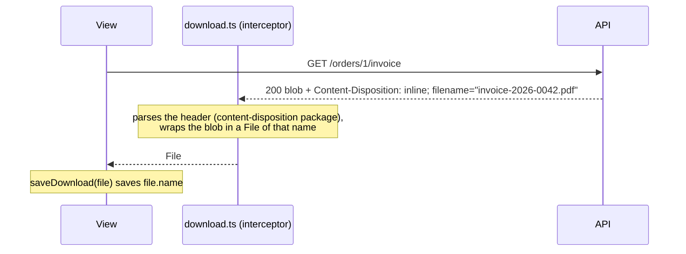
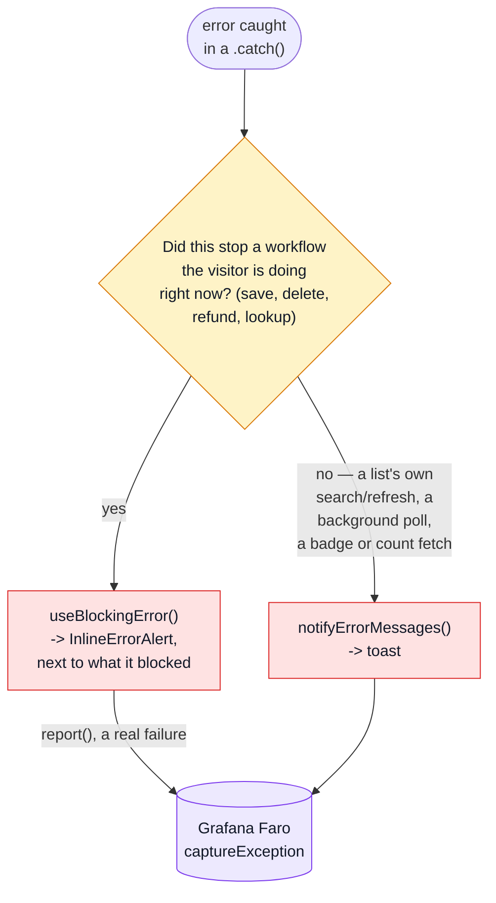
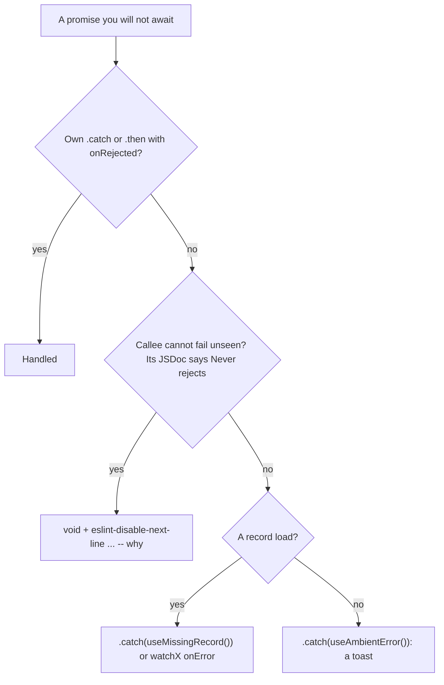

# Request flow: cross-cutting strategies

Part of [Request Flow](./request-flow.md): the strategies that apply to every call.

## Cross-cutting strategies

### Array query parameters

The shared axios instance repeats an array parameter (`?id=a&id=b`, `paramsSerializer.indexes: null`
in `client.ts`), which is what the contract declares (`style: form, explode: true`) and all the
backend reads. axios' own default is `?id[]=a&id[]=b`, refused as an unknown field `id[]` (a `422`).
`tests/unit/infrastructure/http/array-parameters.spec.ts` builds a real generated call and reads the URL.

### Auth-first routing

Route guards run on every navigation. A guard that refuses a guest redirects to Login with `?continue=` preserved so the user lands back after login. A `401` on an API call is not a redirect: the interceptor renews the token and replays the request once, and only a dead session (the refresh answered 401/403) signs the visitor out.

### Interceptors own error shape

All HTTP errors flow through the interceptors `src/infrastructure/http/install.ts` registers. Every failed request produces an `AxiosResponseErrorData`: the server's problem details (`application/problem+json`), or one the client builds with the same members when nothing answered with one — a transport failure included, as `status: 0`. The text a person reads is `errors[0].message`, then `detail`; `title` is the English status phrase and is never shown. Views and stores never parse raw axios errors; the call site decides whether the visitor sees a toast or an in-place alert, and reports a real failure to Faro (see below).

### Analytics is not this repo's call to make

There is no `track()` here. Pageviews are Umami's own script, automatic; everything with a request
behind it is reported by the backend handler that decided it happened, not by a client-side call
this repo would have to remember to make. This repo's own part is consent: `analytics-consent.ts`
persists the visitor's choice, and `http/interceptors.ts`'s `onRequest` forwards it as
`Analytics-Consent` on every request that qualifies.

### Conditional writes

The API versions the records its contract marks `x-versioned`, with an `ETag` on the read and an
optional `If-Match` on the write; a stale one is a `412`. The backend sets the rules (an `ETag` on the read, `If-Match` on the write, `412` when stale);
this repo's part is that no edit form has to remember any of it.

- **`src/infrastructure/http/etag.ts` is the whole transport half.** A success interceptor keeps the
  tag a GET or PATCH answered with, or a POST answered with an `ETag` and a `Content-Location` that names a record it holds (a PUT answers none, so its held tag is dropped); a request interceptor sends it as `If-Match` on the next
  PUT or PATCH of that path. A DELETE sends none: it is optional (RFC 9110 §13.1.1), staff delete on
  purpose, and the server would still answer 412 to one that was sent. A resource never read here is written unconditionally — the API's own default.
- **A write forgets the tag it did not answer.** `PUT /orders/1/shipping-address` changes the row and
  answers no tag, so everything held under that path is dropped rather than sent stale. A cancel is
  the exception: its answer carries the order's new tag and a `Content-Location: /orders/1`, which
  is kept. A sign-out drops all of them.
- **A write that moves a held record reads it again.** The transport drops the tag and says nothing
  about the new one, so the store reads the record back (a plain `GET` hands the new tag over);
  without it the next save would go out unchecked. The order after an address `PUT`, a payment or a
  note; the webhook after a secret `DELETE`. `/account` follows one rule: **re-read `GET /account`
  after every write that changes the user record**: an email change (request, cancel, resend,
  confirm), the password, the export request, the avatar, every two-factor write (setup, confirm,
  remove, disable, backup codes) and an OAuth unlink. Writes that do not change it (the idle touch,
  `POST /account/password/check`, the verification resend, sessions revoke, logout-all, the address
  book, which is not part of the `/account` answer) still drop the tag and are not re-read: the next
  profile save goes out unconditional, which is accepted because the profile page reads on mount.
- **A form handles the refusal with `useStaleRecord`** (`src/infrastructure/utils/use-stale-record.ts`):
  a `412` becomes a _warning_ through the form's own `useBlockingError` — nothing is wrong with the
  request, the record moved — plus a "reload latest" button that re-reads the record, re-hydrates the
  form and, by that read, refreshes the tag. The stale edit is never resent on its own.
- **Where it is wired:** every edit form of a versioned resource (`grep useStaleRecord src`), the
  profile picture panel included (it reloads `/account` and leaves the details form's typing alone). Anything
  built on the generated client gets the header for free; only a form that wants to _answer_ a 412
  needs the composable.

### Downloads are named by the server

The invoice, a credit note, the orders CSV and the account export are files the server names
(`Content-Disposition`, RFC 6266): `invoice-<number>.pdf`, `orders-<shop date>.csv`. The browser can
read that header only because the API lists it in its CORS `exposedHeaders`.

- **`src/infrastructure/http/download.ts`** is the whole of it: a success interceptor beside the
  `ETag` one, and `saveDownload`, which narrows with `instanceof File` and refuses a plain `Blob`
  rather than save it under a name the page invented.
- **The header is parsed by the `content-disposition` package**, not by hand: `filename*` (RFC 8187)
  and quoting are the parts people get wrong.

### Blocked vs ambient failures

A caught error reaches the visitor one of two ways, chosen by what failed, not by the status code:

Both pairings report a real failure to Faro alike — `useBlockingError().report()`
(`src/infrastructure/utils/use-blocking-error.ts`) mirrors `notifyErrorMessages`'s observability
half exactly. The question is never "is this worth reporting", it is "where does the visitor need
to see it":

- **Blocking, one control** — a form submit, a save, a payment, a refund, or a lookup with one
  dedicated button/field (`payments`' `OrderReferenceSearch.vue` is the worked example). The error
  renders through `InlineErrorAlert` (`src/ui/molecules/InlineErrorAlert.vue`) right next to that
  control, because a toast can fade before the visitor looks back at what they were doing.
  `useBlockingError` holds the message; call `report(error)` for a real failure (reaches Faro) or
  `warn(text)` for an expected absence like a lookup that matched nothing (does not — there is
  nothing there for an error monitor to see).
- **Blocking, one shared control** — a list's row actions (delete, hard-delete, resend) behind a
  confirm dialog (`products`' `ProductsList.vue` is the worked example). Each row's own button has
  nowhere to host an alert, and the dialog that confirmed the action has already closed by the
  time the request answers, so every write action on that page shares ONE `useBlockingError()`,
  rendered as one `InlineErrorAlert` above the table — the same slot `AdminAuditTab.vue` already
  used for its own load error, repurposed here for a write.
- **Blocking, hosted in a child** — the failure and the `useBlockingError()` instance still belong
  to the parent (it owns the store call), but the control the visitor is looking at is a dialog
  component the parent doesn't render the markup of. `locales`' three form dialogs
  (`EntryFormDialog.vue`, `EntriesImportDialog.vue`, `LanguageFormDialog.vue`) are the worked
  example: each exposes a named `error` slot right above its own button row, and the parent fills
  it with its own `InlineErrorAlert` — the same instantiation any other shape uses, just placed
  inside a `<template #error>` rather than directly in the parent's template. The dialog never
  imports `InlineErrorAlert` or learns that an error exists; it only leaves the slot, the same way
  `FormCard.vue` leaves slots for whatever the parent's fields are (default) and for its blocking error (`#after-submit`). This is what a
  dialog reused by more than one parent (`LanguageFormDialog.vue`, shared by `LocalesList.vue` and
  `LocalesDictionary.vue`) needs — each caller fills the slot with its own state, and the dialog
  stays ignorant of both.
- **Ambient** — a list's own search/refresh, a background poll, and a badge or count fetch. None
  of these stopped something the visitor just asked for in this view; the view keeps working
  either way, so `notifyErrorMessages`'s toast is where the failure belongs.

- **The record itself is not there** — a detail page (`ProductTarget.vue`, `OrderTarget.vue`, `ReturnTarget.vue`,
  `UserTarget.vue`) whose id the API answers 404 or 403. There is no view left to keep working, so
  `useMissingRecord()` (`src/infrastructure/utils/use-missing-record.ts`) replaces the route with
  the shell's Error page, carrying the status; any other failure still toasts. The API answers 404
  for an order another customer owns, so the visitor learns no more than "not found".

The status code decides nothing about the pairing above: a 404 lookup miss and a 500 on the same save both block the
same workflow, so both are inline (just `warn` vs `report`); a 500 on a background poll still only
toasts.

### A call nobody awaits

`void p` throws the value of `p` away and nothing else. If `p` rejects, no one is listening: the
browser fires `unhandledrejection`, the app has no listener, and the visitor sees nothing, with the
page left on placeholders or a stale list. Vue also forwards a promise _returned_ from a hook or
watcher to `app.config.errorHandler` (`src/app/vue-error-handler.ts`), and `void` throws that net
away too.

`@typescript-eslint/no-floating-promises` therefore runs with `ignoreVoid: false`: `void p` is
checked like `p`.

- **A record page** hands `useMissingRecord()` to `watchX(..., { onError })`, or to `.catch(...)`
  where there is no `watch*` (`ProductEdit.vue`'s uncached read).
- **Any other background read** ends in `.catch(onAmbientError)`, with
  `const onAmbientError = useAmbientError()` (`src/infrastructure/utils/use-ambient-error.ts`).
  A read shared by many components (`ensureWishlist`, `ensureStockAlerts`) toasts once inside the
  store and never rejects, so a grid of hearts does not toast once per heart.
- **A callee that cannot reject** (a router navigation, `nextTick`, a `load` that toasts its own
  failure) keeps its `void` and opts out on the line, with the reason:
  `// eslint-disable-next-line @typescript-eslint/no-floating-promises -- loadShop never rejects`.
  The callee's JSDoc says "Never rejects." so the reason can be checked.
- **A script's** top-level promise ends in `.catch(failScript)` (`scripts/fail-script.ts`).

## Read next

- [Request Flow](./request-flow.md)
