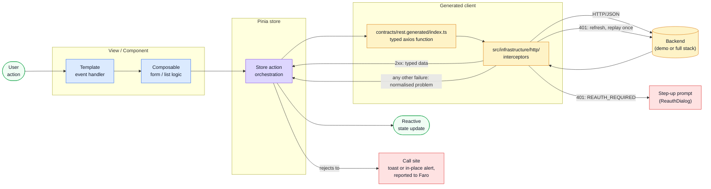
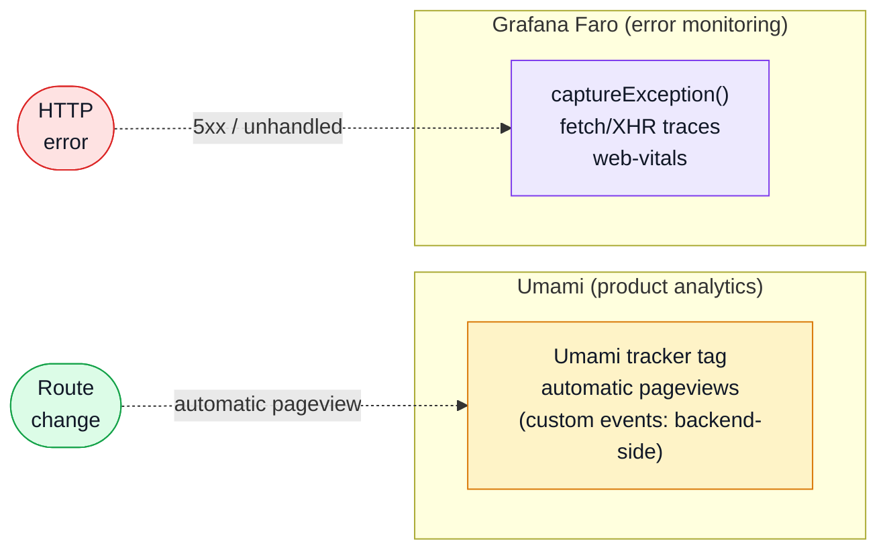

# Request Flow

How one user action becomes an HTTP call and a screen update, and what each layer does on the way.

## End-to-end path

## Observability signals

Every navigation and every HTTP error produces signals in parallel with the flow above.

## What each layer does

| Layer                                                  | Responsibility                                                                                                                                                          |
| ------------------------------------------------------ | ----------------------------------------------------------------------------------------------------------------------------------------------------------------------- |
| View / template                                        | Renders data, captures user events, delegates to composables                                                                                                            |
| Composable                                             | Encapsulates form state, validation, and list logic for one domain                                                                                                      |
| Pinia store                                            | Orchestrates API calls, holds reactive data, exposes actions                                                                                                            |
| Generated client (`contracts/rest.generated/index.ts`) | Typed axios function per operation — regenerated from `openapi.yaml`                                                                                                    |
| `src/infrastructure/http/install.ts`                   | Registers the request/response interceptors on the single axios instance (`client.ts`); `src/main.ts` calls it at boot; they shape errors into `AxiosResponseErrorData` |
| Router guards                                          | `tryRestoreAuth` then `enforceRouteAccess` (`beforeEach`), `localeChoice` (`beforeResolve`) — run before the view is entered; redirect on failure                       |

## Why the flow matters

When you change behavior, ask:

- Is this an **API contract** change? Go to [API](../build/api-contracts.md).
- Is this a **dependency or build** concern? Go to [Tool map](./tool-map.md).
- Is this a **layer ownership** issue? Go back to [Layers](./layers.md).
- Is this about **routing or access control**? Go to [Sitemap & Access Control](./sitemap.md).

## Read next

- [Cross-cutting strategies](./request-flow-strategies.md)
